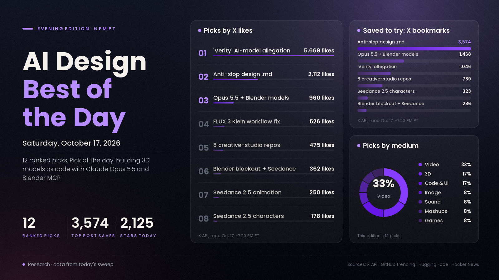

# AI Design Best of the Day · Saturday, Oct 17, 2026

## Treat every 3D model as code: today's design crowd is building in Blender by talking to an agent

The idea people kept saving today is a change in how 3D gets made. Instead of sculpting, creators have Claude Opus 5.5 write Python that builds each model part by part inside Blender, then rerun the script when something needs to change. A how-to thread on exactly that became one of the day's most-saved design posts, a case study of a Steam game built this way is circulating widely, and a steady stream of first-timers posted their own "vibe-modeled" assets within hours. It matters because it turns 3D from a craft skill into something you can direct, version and fix by editing a number, which is a different job for designers, not just a faster one.

*Engagement figures were read from the X API, GitHub trending, Hugging Face and Hacker News on the evening of Oct 17 (PT). Reddit blocks direct access from our tools, so Reddit sentiment is not counted.*

## ⭐ Pick of the day

### 🧊 3D

- [Make game models with Claude Opus 5.5 + Blender, "treat every model as code" (@rewind02)](https://x.com/rewind02/status/2111393368097849615), tutorial. A step-by-step thread: connect Opus 5.5 to Blender through MCP, then have it write Python that builds each model piece by piece so any change is just an edit and a rerun. Why people are losing it: 960 likes, 1,468 bookmarks and about 42K views in its first day, more saves than likes, which means people plan to actually try it. Copycats posted their own results all afternoon, including a [Gemini 4 Argon + Blender MCP figure with muscles added (96 likes)](https://x.com/HarshithLucky3/status/2111509124504817695) and [a miniature tabletop game's models for Unity (@Dilmerv)](https://x.com/Dilmerv/status/2111550087809978412). How to try it: install [MCP for Blender](https://www.mcp-for-blender.com/docs/reference/changelog), connect it to Claude, and ask for one simple prop, then ask for a change ("bigger claws") and watch it edit the script instead of starting over.

## The ranked picks

### 💻 Code and UI

- [An anti-"AI slop" design rules file (@shipper_now)](https://x.com/shipper_now/status/2110637576935891122), buzz. A huge Markdown rules file for coding agents that bans the tells of generated UI: box shadows, emojis, "LIVE" badges, blue and purple gradients. Why people are losing it: still the biggest design post of the week at 2,112 likes, 3,574 bookmarks and about 437.5K views, and copycats keep coming. How to use it: write a short taste file of your own (fonts, spacing, banned clichés) and keep it in every project an agent touches; Anthropic's [frontend-design skill](https://github.com/anthropics/skills/tree/main/skills/frontend-design) is a cleaner starting point than a giant file.
- [ArtCraft, "the IDE for artists" (GitHub)](https://github.com/storytold/artcraft), repo/tool. An open-source (Apache-2.0) crafting engine for artists, designers and filmmakers. Why people are losing it: 18,479 new stars this week on GitHub's weekly trending list, about 31.8K stars in total. How to try it: clone it and test one real task from your workflow next to the tool you pay for now.

### 🖼️ Image

- [FLUX 3 Image Klein: fixed ComfyUI workflows (Black Forest Labs)](https://x.com/bfl_ai/status/2111467996350652684), update. BFL patched the day-one workflows for its new 5.6B open-weights image model and updated its Hugging Face Space. Why people are losing it: 526 likes and about 30K views on the fix; the ComfyUI build is one of the top trending models on [Hugging Face](https://huggingface.co/black-forest-labs/flux-3-image-klein-comfy) with 224,108 downloads; and the [Hacker News thread (207 points)](https://news.ycombinator.com/item?id=50123580) is split, with testers still reporting anatomy problems. How to try it: update ComfyUI to v0.41.3, load the new workflow, and use at least 6 steps with long, detailed prompts, as the community recommends.

### 🎬 Video and animation

- [The Disturbance Call: a Blender blockout drives Seedance 2.5 (ComfyUI)](https://x.com/ComfyUI/status/2111110239714165176), tutorial. A rough 3D blockout fixes the camera, action and timing; Seedance 2.5 renders the final horror shot. Why people are losing it: 362 likes and 286 bookmarks (about 19.2K views), and it became the week's go-to "directing, not prompting" technique. How to try it: block out a three-shot scene with plain cubes, then follow the workflow and prompt linked in the post.
- ["Image models are done": making AI characters with a video model (@DavidRunsAds)](https://x.com/DavidRunsAds/status/2111405833355427843), tutorial. The argument: image models make everyone look like a perfect render, while Seedance 2.5 characters come out looking like real people. Why people are losing it: 178 likes and 323 bookmarks (about 7.7K views), again far more saves than likes. How to try it: generate a short clip of your character and pull stills from it instead of prompting an image model.
- [Seedance 2.5 AI animation (@SarcasticAnnabe)](https://x.com/SarcasticAnnabe/status/2111499845231919153), showcase. A stylised animation clip made with Seedance 2.5. Why people are losing it: 250 likes and 178 bookmarks on about 3.5K views, a very high save rate, and another account reposted the same caption hours later. How to use it: a good reference for how far stylised (non-photoreal) motion has come in one model.
- [Youri van Hofwegen: Master Kling 4.0 (YouTube)](https://www.youtube.com/watch?v=PaDFM23THsM), tutorial. A prompt structure for Kling 4.0's 30-second shots: timestamped beats with one action and one camera move each, a sound line, and a list of things to avoid. Why it matters: Kling 4.0 vs Seedance 2.5 is still the week's biggest video debate (no engagement number available from our tools for this video). How to try it: test ideas at 720p first and only render 1080p once the beats work.

### 🎵 Sound

- [VoiceStudio, a fully local ElevenLabs alternative (GitHub)](https://github.com/debpalash/VoiceStudio), repo/tool. Open-source voice cloning, voice design, video dubbing and dictation that runs on your own machine (AGPL-3.0). Why people are losing it: 2,125 stars today, the top gainer on GitHub's daily trending list, about 73.5K stars in total. How to try it: install it locally and dub one short clip of your own voice to judge quality before paying for cloud credits.

### 🧪 Mashups

- [8 open-source repos that turn your AI agent into a creative studio (@RoundtableSpace)](https://x.com/RoundtableSpace/status/2111234483139510507), buzz. A list led by HyperFrames (HTML to MP4) and diagram-design (editorial diagrams for agents). Why people are losing it: 475 likes, 789 bookmarks and about 68.9K views; the two lead repos gained [5,639](https://github.com/heygen-com/hyperframes) and [8,382](https://github.com/cathrynlavery/diagram-design) stars this week on GitHub trending. How to try it: install HyperFrames and diagram-design into Claude Code and ask for a 45-second explainer of one of your own projects.

### 🎮 Games

- [I Just Wanted to Fish: every model scripted by Claude through Blender MCP](https://www.mcp-for-blender.com/creations/case-studies/i-just-wanted-to-fish/), case study. A solo Unity developer ran one Claude Code session that drove both Blender and Unity; a crab went from a four-sentence brief to animated on the beach in 53 minutes. Why people are talking: a [summary post (@RoundtableSpace)](https://x.com/RoundtableSpace/status/2111596870866780627) passed about 39K views within hours. How to use it: read the honest limits section first (no realistic faces) and design your art style around what scripts do well.

### 🗣️ What people are talking about

- [Allegation that a studio's "Verity" character models were AI-generated (@JamsDX_)](https://x.com/JamsDX_/status/2111503161034973450), buzz. A post arguing, from behind-the-scenes footage, that the character models were made with a tool like Meshy or Rodin. This is an allegation, not a confirmed fact. Why it's here: it is the single most-engaged design post in today's sweep at 5,669 likes, 1,046 bookmarks and about 174K views, ranked lower only because it's a controversy, not something to try. What it means: audiences now inspect 3D work for AI tells, so labelling which parts are AI is becoming part of the job.

---
*Method:* starts from today's morning and noon digests, then a fresh evening check of X, GitHub trending, Hugging Face trending, Hacker News and YouTube. Ranked by engagement and velocity, how many creators are copying it, and how new it is. Reddit is blocked from our tools.

Want a deeper dive on any of these, or more of one medium tomorrow? Say the word and the next edition will steer there.
