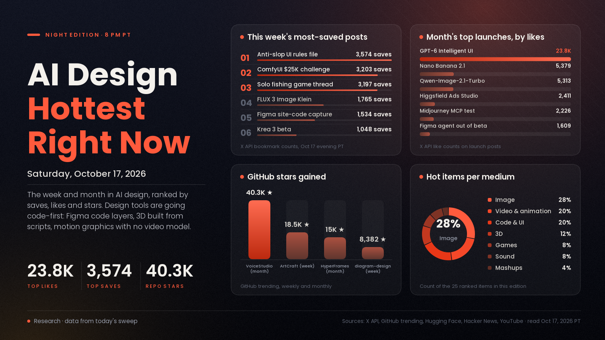

# AI Design Hottest Right Now · Saturday, Oct 17, 2026

## Design tools stop drawing and start writing code

The big story of the week and the month is the same one: the hottest AI design work is being made as code you can edit, not as pixels you regenerate. Figma's Config India launch put real website code on the canvas as Code Layers, the most-saved 3D posts have Claude write Python that builds every Blender model piece by piece, and a month of motion-design clips came from code-only animation with no video model at all. Meanwhile the image race got crowded and cheap fast: Qwen-Image-2.1-Turbo, Nano Banana 2.1, FLUX 3 Image Klein and Krea 3 all landed within ten days, and the open-weights ones are already running in ComfyUI. The practical takeaway is that taste files, scripts and design systems are becoming the thing a designer actually owns.

*Engagement figures were read from the X API, GitHub trending (weekly and monthly), Hugging Face trending, Hacker News and YouTube search on the evening of Oct 17 (PT). "This week" means Oct 10 to 17 and "this month" means Sept 17 to Oct 9. Reddit and Product Hunt block direct access from our tools, so they aren't counted.*

## 🔥 Blew up today

- [Make game models with Claude Opus 5.5 + Blender, "treat every model as code" (@rewind02)](https://x.com/rewind02/status/2111393368097849615), 3D tutorial. Opus connects to Blender through MCP and writes Python that builds each model part by part, so a change is an edit and a rerun instead of a resculpt. The signal: 982 likes, 1,505 bookmarks and about 43K views in its first day, with far more saves than likes. Try it: connect Claude to Blender MCP, ask for one simple prop, then ask for a change and watch it edit the script.
- [This Game Was Built Only With AI in 11 Weeks (Stefan 3D AI, YouTube)](https://www.youtube.com/watch?v=6a5VLKPlJRo), games case study. A creator's look at a game built entirely with AI in 11 weeks. The signal: 87,156 views within about 14 hours of posting, the fastest start of any AI-design video in our YouTube sweep. Use it: note which steps the AI handled well and which needed the most rework before you plan a small game of your own.
- [Allegation that a studio's "Verity" character models were AI-generated (@JamsDX_)](https://x.com/JamsDX_/status/2111503161034973450), 3D buzz. A post arguing from behind-the-scenes footage that the character models came from a tool like Meshy or Rodin; this is an allegation, not a confirmed fact. The signal: 5,808 likes, 1,068 bookmarks and about 180K views, the most-engaged design post of the day. What it means: audiences now inspect 3D work for AI tells, so saying plainly which parts used AI is becoming part of the job.

## 📈 Hottest this week

- [ComfyUI's $25,000 open-source build challenge (ComfyUI)](https://x.com/ComfyUI/status/2110870071933645103), mashups and tools news. After Higgsfield didn't open-source its platform as promised, Comfy and partners put up $25,000 in prizes for the best open-source builds on the Comfy Developer Platform, running two weeks from Oct 15. The signal: 4,491 likes, 3,203 bookmarks and about 507K views, the week's biggest creative-AI post. Try it: if you already have a ComfyUI workflow you reuse, packaging it as an open app is now worth real prize money.
- [FLUX 3 Image Klein, open weights (Black Forest Labs)](https://x.com/bfl_ai/status/2110751201105256925), image model. A 5.6B-parameter open-weights image model that runs on one consumer GPU, with native 4K, bounding boxes and pixel-precise editing. The signal: 3,278 likes and 1,765 bookmarks on the launch post, 224,108 downloads of the [ComfyUI build on Hugging Face](https://huggingface.co/black-forest-labs/flux-3-image-klein-comfy), and a split [Hacker News thread (207 points)](https://news.ycombinator.com/item?id=50123580). Try it: load it in ComfyUI and test a layout with bounding boxes, the feature most closed models still lack.
- [Figma's Chrome extension captures live website code as a Code Layer (Figma, Config India)](https://x.com/figma/status/2110603044346052714), code and UI tool. Point the extension at a site and its code lands on the Figma canvas as an editable layer; Code Layers and [Specs, collaborative Markdown inside Figma](https://x.com/figma/status/2110606384761069955), are both in open beta. The signal: 2,685 likes, 1,534 bookmarks and about 5.5M views. Try it: capture one of your own pages and redesign it on the canvas against the real code instead of a screenshot.
- [How to make a cozy fishing game solo with Claude Opus 5.5 + Blender + 3D AI + Unity 6 (@rewind02)](https://x.com/rewind02/status/2109585491280453986), games tutorial. A step-by-step pipeline built on giving every tool one job, starting with Tripo Smart Mesh generating every 3D model (palms, rocks, the pier, the boat) before Blender, Claude and Unity take over. The signal: 2,184 likes, 3,197 bookmarks and about 215K views, and today's follow-up thread (above) is blowing up too. Try it: copy the "one tool, one job" setup for a tiny scene before you attempt a whole game.
- [Krea 3 beta, an image model built for editing (Krea)](https://x.com/krea_ai/status/2110760037128012146), image model. End-to-end 2K edits in under 8 seconds, multi-turn edits and bounding-box control, also available in ComfyUI as Partner Nodes. The signal: 2,163 likes, 1,048 bookmarks and about 482K views, plus a [Hacker News thread at 349 points](https://news.ycombinator.com/item?id=50105648), the week's top image story there. Try it: run one character through several outfit or fabric edits and check how well it holds the face.
- [An anti-"AI slop" design rules file for coding agents (@shipper_now)](https://x.com/shipper_now/status/2110637576935891122), code and UI buzz. A huge Markdown rules file that bans the tells of generated UI: box shadows, emojis, "LIVE" badges, blue and purple gradients and overused AI words. The signal: 2,112 likes and 3,574 bookmarks, the week's most-saved design post. Use it: write a short taste file of your own and keep it in every project an agent touches; Anthropic's [frontend-design skill](https://github.com/anthropics/skills/tree/main/skills/frontend-design) is a cleaner starting point than a giant file.
- [ArtCraft, a crafting engine for artists, designers and filmmakers (GitHub)](https://github.com/storytold/artcraft), image and video tool. An open-source creative workspace pitched as an IDE for artists. The signal: 18,479 stars gained this week on GitHub's weekly trending list, the second-fastest-rising repo there, about 31.8K stars total. Try it: run one real task from your current workflow in it side by side with the tool you pay for.
- [Kling 4.0 is fully available, now with MCP and CLI access (Kling AI)](https://x.com/Kling_ai/status/2110747537187709424), video model. Kling's new model with 30-second shots, a refreshed web interface and agent access through MCP and a command line. The signal: 999 likes on the launch, and [Kingy AI's hands-on test](https://www.youtube.com/watch?v=ozoBaxEb7wk) reached 39,708 views in a day. Try it: plan a 30-second shot as timed beats with one action and one camera move each before you spend credits.
- [diagram-design: editorial diagrams for coding agents (GitHub)](https://github.com/cathrynlavery/diagram-design), code and UI skill. 44 diagram types as self-contained HTML and SVG, for Claude Code, Codex, Cursor and others. The signal: 8,382 stars gained this week, about 57K total. Try it: ask your agent for a diagram of one of your own processes and compare it with what you'd make by hand.
- [Gemini 4 Argon and Google Antigravity: from 2D concept to 3D cathedral (Google for Developers, YouTube)](https://www.youtube.com/watch?v=OYp5j2RihPE), 3D showcase. A demo that takes a flat 2D concept to a full 3D cathedral scene. The signal: 142,642 views in four days, the most-viewed AI 3D video in our sweep. Use it: a good reference for how far "concept art in, 3D scene out" has come.
- [How I Make Realistic AI Videos with Seedance 2.5, full guide (Dan Kieft, YouTube)](https://www.youtube.com/watch?v=2hJsvDSPWYM), video tutorial. A complete walkthrough for realistic Seedance 2.5 footage. The signal: 104,732 views in about a day, the top Seedance video of the week. Try it: follow it for one short shot, then compare the same prompt in Kling 4.0, which is the week's big video debate.

## 🏆 Hottest this month

- [GPT-6 and Intelligent UI rolling out in ChatGPT (OpenAI)](https://x.com/OpenAI/status/2107894997538525580), code and UI news. ChatGPT answers can now be built from text, visuals, charts and interactive elements that the model arranges for each question. The signal: 23,840 likes, 6,653 bookmarks and about 6.6M views, and the top design-related story in our month of [Hacker News (761 points)](https://news.ycombinator.com/item?id=49996425). Why it matters: AI is now laying out its own interfaces on the fly, so expect clients to ask for answers designed as small apps rather than pages.
- [Qwen-Image-2.1-Turbo, open-weights image generation and editing in 8 steps (Qwen)](https://x.com/Alibaba_Qwen/status/2108549075218120949), image model. A sped-up checkpoint of the 7B Qwen-Image-2.1 model that creates and edits images in eight denoising steps. The signal: 5,313 likes, 4,050 bookmarks and about 728K views, the most-saved image launch of the month; the base [Qwen Image 2.1 hit 740 points on Hacker News](https://news.ycombinator.com/item?id=49775499). Try it: grab the [weights on Hugging Face](https://huggingface.co/Qwen/Qwen-Image-2.1-Turbo) and use it for fast local drafts before a final render.
- [Nano Banana 2.1 (Google)](https://x.com/Google/status/2107501209154204148), image model. Google's upgraded image generation and editing model, with better visual design, mask-based editing and subject consistency, up to 4K, rolling out across Gemini, AI Studio, Flow and Stitch. The signal: 5,379 likes and about 1.18M views, and Higgsfield, Krea and ComfyUI added it within a day. Try it: test mask-based edits on a product shot where only one area should change.
- [VoiceStudio, a fully local ElevenLabs alternative (GitHub)](https://github.com/debpalash/VoiceStudio), sound tool. Open-source voice cloning, voice design, video dubbing, dictation and audiobook tools that run on your own machine. The signal: 40,333 stars gained this month, more than any other repo on GitHub's monthly trending list, about 73.5K total. Try it: dub one short clip in your own cloned voice to judge quality before paying for cloud credits.
- [Higgsfield Ads Studio (Higgsfield)](https://x.com/higgsfield_ai/status/2107154889478664342), image tool. A static-ad generator that researches a brand, watches trending formats and drafts ads from them. The signal: 2,411 likes, 2,702 bookmarks (more saves than likes) and about 541K views. Use it: worth a look for fast ad variations, but judge the output against your own brand rules before trusting it.
- [Midjourney opens a limited test of a Midjourney MCP (Midjourney)](https://x.com/midjourney/status/2108717365068509447), image tool news. Midjourney is recruiting creative and technical people to test an MCP connection, for artistic work rather than SaaS products. The signal: 2,226 likes and 717 bookmarks. Try it: apply through the post if you want Midjourney inside an agent workflow alongside your other tools.
- [Figma agent is out of beta (Figma)](https://x.com/figma/status/2107471912704327937), code and UI tool. Figma's built-in agent, now better at following instructions and handling longer tasks across files and FigJam boards. The signal: 1,609 likes, 974 bookmarks and about 1.4M views. Try it: ask it to pull content from several design files into one layout and see how much cleanup is left.
- [Motion design with no video model: Claude + Higgsfield Katana (Higgsfield)](https://x.com/higgsfield_ai/status/2108378429737628038), video and animation showcase. A run of clips where every frame is written as code in Claude, with no video generation. The signal: 1,374 likes and 905 bookmarks on the lead post, and a creator's [90-minute piece with the same setup](https://x.com/abg_cmo/status/2108406247058006030) drew 345 likes. Use it: code-based motion is easy to revise frame by frame, which makes it a good fit for product launch clips.
- [HyperFrames: write HTML, render video (GitHub)](https://github.com/heygen-com/hyperframes), video tool. An open-source tool that turns HTML into MP4, built for agents. The signal: 15,041 stars gained this month and 5,639 this week, about 66K total. Try it: have an agent build a 30-second explainer of one of your projects as an HTML page and render it.
- [ComfyUI for animation: keyframes to full character animation (ComfyUI)](https://x.com/ComfyUI/status/2107166635312414777), animation workflow. Load a few keyframes and one graph generates the in-betweens into a finished animation. The signal: 466 likes and 445 bookmarks, nearly one save per like, which says people plan to use it. Try it: draw five poses of a simple character and let the graph fill in the motion.
- [Drama-3 text-to-speech (Fish Audio, Hugging Face)](https://huggingface.co/fishaudio/drama-3), sound model. An open text-to-speech model released this month. The signal: 623 likes and 8,193 downloads on Hugging Face, and the top-trending sound model on the site this week. Try it: voice a short scene of dialogue and compare it with VoiceStudio above.

---
*Method:* a fresh search of X (lab and creator accounts and keyword searches over the past week and month), GitHub trending (daily, weekly and monthly), Hugging Face trending models and Spaces, Hacker News top stories for the week and month, and YouTube's most-viewed uploads this week. Ranked by engagement and velocity, staying power, how widely creators are copying it, and how new it is. Reddit and Product Hunt block our tools, so they aren't counted.

Want a deeper dive on any of these, or a different mix of mediums in the next edition? Say the word and it will steer there.
