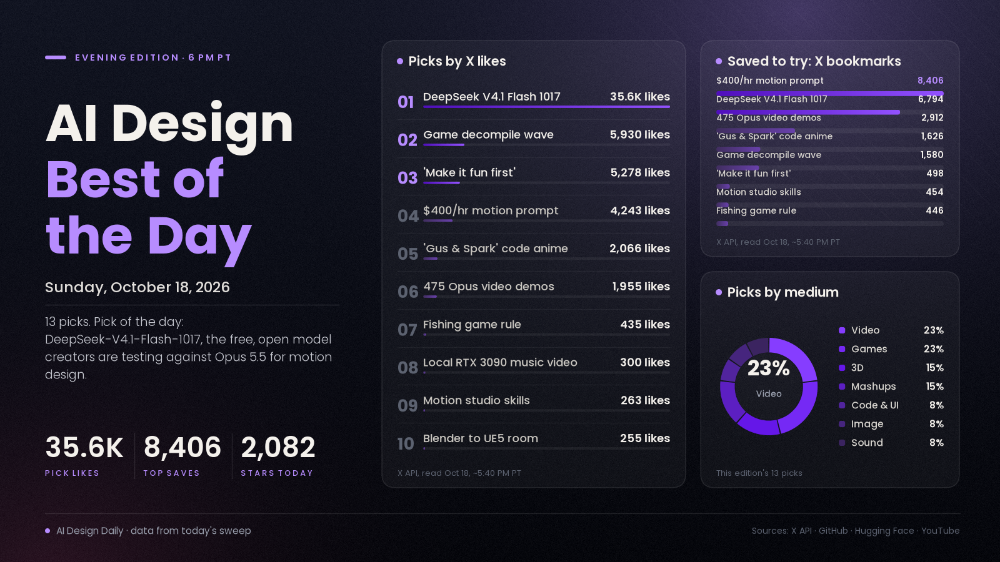

# AI Design Best of the Day · Sunday, Oct 18, 2026

## An open, free model just walked into the motion-design fight

The loudest design story of the weekend is DeepSeek-V4.1-Flash-1017, an MIT-licensed open-weights update that creators spent two days pitting against Claude Opus 5.5 on code-built motion graphics, 3D scenes and frontends. The announcement is the most-engaged AI post in today's sweep by a wide margin, the model sits at the top of Hugging Face's trending list, and one of the big AI video platforms called it "the new SOTA for motion design" after running its own tests. It matters because the hottest design technique of the month, motion and 3D written as code instead of rendered by a video model, has so far meant paying for a frontier model. If a free, open model holds up, that whole way of working gets much cheaper and can run on your own hardware. The verdict isn't settled, though: side-by-side tests are mixed, and a few came out with blown-out colours.

*Engagement figures were read from the X API, GitHub, Hugging Face and YouTube on the evening of Oct 18 (PT) and will keep changing. Reddit blocked our tools this evening, so Reddit sentiment is not counted.*

## ⭐ Pick of the day

### 💻 Code, UI and motion

- [DeepSeek-V4.1-Flash-1017, open weights (Hugging Face)](https://huggingface.co/deepseek-ai/DeepSeek-V4.1-Flash-1017), model. DeepSeek's Oct 17 update to V4.1 Flash: stronger benchmarks, faster task completion and shorter outputs, live on web, app and API with MIT weights. Why people are losing it: the [announcement](https://x.com/deepseek_ai/status/2111375640717033777) has 35,587 likes, 6,794 bookmarks and about 6.6M views; the model is #1 on Hugging Face's trending list (1,334 likes); [Higgsfield's "looks like the new SOTA for motion design" test](https://x.com/higgsfield_ai/status/2111499195257700857) reached 2,020 likes and 1,062 bookmarks; and a YouTube head-to-head, [Opus 5.5 vs DeepSeek V4.1 Flash: Which One Actually Wins?](https://www.youtube.com/watch?v=EixR4FdOG0Y), passed 11,500 views in about 14 hours. How to try it: take one motion-graphics or landing-page prompt you've already run on your usual model, run it free at chat.deepseek.com, and compare the two side by side before deciding which one to pay for.

## The ranked picks

### 🎬 Video and animation (written as code)

- [“This Opus 5.5 prompt is literally a $400/hr motion graphics designer” (@minchoi)](https://x.com/minchoi/status/2111306174259691669), tutorial. A motion-graphics prompt for Claude Opus 5.5 with a demo. Why people are losing it: the most-saved design post in today's sweep, with 8,406 bookmarks against 4,243 likes (about 240K views), so people are keeping it to use, not just reacting. How to try it: run the prompt on one of your own product shots or logos and change only the colours and copy.
- [awesome-opus5-5-videos: 475 viral Opus 5.5 videos with their prompts (GitHub)](https://github.com/yihui-dev/awesome-opus5-5-videos), repo/tool. A collection of motion graphics, explainers, 3D scenes and games made with HTML, Canvas, SVG and Three.js, each with its original prompt and source post. Why people are losing it: 6,247 stars, and [the post sharing it (@HurricaneCrypt0)](https://x.com/HurricaneCrypt0/status/2111531584037785970) has 1,955 likes and 2,912 bookmarks. How to try it: pick the demo closest to something you need, copy its prompt, and remake it with your own brand.
- [“Gus & Spark”, a 25-minute anime episode written entirely as code by Claude (@ziwenxu_)](https://x.com/ziwenxu_/status/2111212505947357651), showcase. No AI video model at all: the creator says Opus 5.5 worked for over 15 hours and wrote 34K lines of code, using 986M tokens (about $370 at API prices). Why people are losing it: 2,066 likes, 1,626 bookmarks and about 300K views, and [episode 2 followed on Oct 17](https://x.com/ziwenxu_/status/2111563277079912473). How to use it: a reference for how far code-built animation can be pushed, and a realistic idea of the cost.

### 🧊 3D

- [Build a game-ready room in Blender and move it into Unreal Engine 5 with Opus 5.5 (@rewind02)](https://x.com/rewind02/status/2111849852350894319), tutorial. An eight-step setup: Opus models simple objects directly in Blender through Blender MCP, sends complex props to Tripo from a reference image, cleans them up, lights the scene, then ports the whole room to Unreal. Why people are losing it: 255 likes and 347 bookmarks in its first hours (about 11.3K views), from the creator whose "treat every model as code" thread was yesterday's pick; [his motion-video-to-3D-animation follow-up](https://x.com/rewind02/status/2111759900317520294) is spreading too. How to try it: start with one reference image of a small room and let the agent decide which props to model and which to send to Tripo.
- [Opus 5.5 drew a 92 m² apartment from a single grid line, then built it in 3D (@Solvaix)](https://x.com/Solvaix/status/2111880621954081240), showcase. The CAD screen, every command and the 3D model are one HTML file the model wrote, following the order a real drafter would, grid first. Why people are talking: posted around 11 AM PT, it had 98 likes and 97 bookmarks within hours, almost one save per like. How to use it: a template for architecture or interior pitches where the plan and the walkthrough come from one file.

### 🧪 Mashups and agent studios

- [10 skills and repos that turn Opus 5.5 into a motion studio (@0xMovez)](https://x.com/0xMovez/status/2111841847408517282), buzz. Explainer figures, exploded product views, 3D, physics, motion and sound, all as installable skills. Why people are losing it: 263 likes and 454 bookmarks (about 15K views), nearly two saves per like. A [20-repo version (@N01ennn)](https://x.com/N01ennn/status/2111888466829303973) built on [LottieFiles' motion-design-skill](https://github.com/LottieFiles/motion-design-skill) (2,306 stars) is climbing the same way. How to try it: install just one skill, such as the product-reveal one, and give it one real product.
- [A melancholic music video made entirely on one RTX 3090 (@superalesha)](https://x.com/superalesha/status/2111726450848272429), showcase. Song, pictures, video and upscale, with no cloud model: MiniMax H3 and its latent upscaler for video, and Qwen Image 2.1, MOSS-Image and FLUX 3 for stills, in about 11 hours of generation. Why people are losing it: 300 likes and 205 bookmarks (about 15.2K views). How to use it: proof that a full local music-video pipeline fits on a consumer GPU if you're willing to wait.

### 🎮 Games

- [A local fishing game built with Opus 5.5 and Unity 6, and the one rule behind it (@sorenxet)](https://x.com/sorenxet/status/2111583999294398792), tutorial. Build one system, play it, then move on, with Tripo making the models and Opus writing scripts and running playtests. Why people are losing it: 435 likes and 446 bookmarks (about 33K views), more saves than likes. How to try it: follow the rule on a single mechanic before touching any art.

### 🖼️ Image

- [MOSS-Image in 8 steps: community distillation LoRA (Hugging Face)](https://huggingface.co/lodestones/MOSS-Image-SFT-8-steps-dmd), repo/tool. A work-in-progress LoRA that cuts MOSS-Image-SFT from 50 steps to 8 with no CFG. Why people are losing it: 30,751 downloads in two days, and it's on Hugging Face's trending list next to [MOSS-Image-SFT itself](https://huggingface.co/OpenMOSS-Team/MOSS-Image-SFT); creators are posting local results like [9 images at about 15 seconds each, including a magazine cover with a real masthead (@ivanfioravanti)](https://x.com/ivanfioravanti/status/2111786227640713651). How to try it: load the LoRA at strength 1 in ComfyUI on top of MOSS-Image-SFT and test it on a layout with text.

### 🎵 Sound

- [VoiceStudio, a fully local ElevenLabs alternative (GitHub)](https://github.com/debpalash/VoiceStudio), repo/tool. Open-source voice cloning, voice design, video dubbing and dictation that runs on your own machine. Why people are losing it: 2,082 stars today, the top creative tool on GitHub's daily trending list for a second day, now at 75,350 stars. How to try it: dub one short clip in your own voice and compare it with a cloud voice before paying for credits.

### 🗣️ What people are talking about

- [“Vibe coding” is starting to create a serious problem for the game industry (@Pirat_Nation)](https://x.com/Pirat_Nation/status/2111593348293128535), buzz. A summary of Kotaku's report that Opus 5.5 has made decompiling and recompiling games much easier, leading to unofficial ports, mods and clones, DMCA takedowns, and calls for platforms like Steam to carry more of the burden. Why it's here: the single most-engaged design post in today's sweep after the DeepSeek launch, at 5,930 likes and about 346K views. What it means: anything you ship can now be taken apart faster, so plan your protection and licensing early.
- [“Make sure your game is fun without a bunch of fancy art” (@pvncher)](https://x.com/pvncher/status/2111613394143027269), buzz. The argument that LLMs make it too easy to build visually rich levels with no real gameplay. Why it's here: 5,278 likes and about 147K views, the most-liked craft advice of the day. What it means: with art now cheap, the gameplay loop is the part that sets a game apart.

---
*Method:* starts from today's morning and noon digests, then a fresh evening check of X, YouTube, GitHub trending, Hugging Face trending and Hacker News. Ranked by engagement and velocity, how many creators are copying it, and how new it is. Reddit blocked our tools this evening.

Want a deeper dive on any of these, or more of one medium tomorrow? Say the word and the next edition will steer there.
