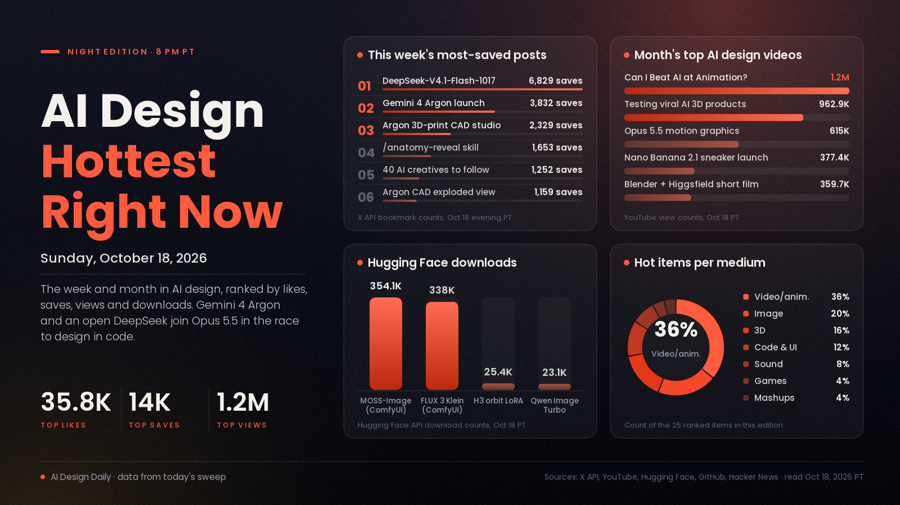

# AI Design Hottest Right Now · Sunday, Oct 18, 2026

## Three frontier models walk into a motion-design studio

This was the week the code-first design fight went three-way. For a month the hottest AI design work has been animation, 3D and UI written as code by Claude Opus 5.5, and the month's most-saved design post is simply a list of the open-source repos that make it work. Then Gemini 4 Argon arrived on Oct 13 and several of its most-shared launch demos were design work: an exploded-view product film built in Blender from a raw CAD file, a 3D-printing CAD studio in Canvas, and a camera you can play like a synth. Four days later DeepSeek-V4.1-Flash-1017 landed as an open model, and within a day creators were racing it against Opus and Argon on the same motion-graphics prompts for a fraction of the cost. On the image side the open models kept coming, and the ComfyUI builds of FLUX 3 Image Klein and MOSS-Image are each past 330,000 downloads. What it means: the skill that matters is giving a model good taste, references and a way to check its own work, because the models themselves are getting cheaper and easier to swap.

*Engagement figures were read from the X API, GitHub trending (weekly and monthly), Hugging Face, Hacker News and YouTube search on the evening of Oct 18 (PT). "This week" means Oct 11 to 18 and "this month" means Sept 18 to Oct 10. Reddit and Product Hunt block direct access from our tools, so they aren't counted.*

## 🔥 Blew up today

Nothing new truly took off today. Sunday's biggest design posts were follow-ups to this week's launches and stacks, mostly in the low hundreds of likes.

## 📈 Hottest this week

- [DeepSeek-V4.1-Flash-1017, open weights (DeepSeek)](https://x.com/deepseek_ai/status/2111375640717033777), code and motion model. An updated open model (MIT licence) that DeepSeek says is stronger, faster and terser than the last version, and creators jumped straight to testing it on motion graphics and 3D. The signal: 35,757 likes, 6,829 bookmarks and about 6.7M views on the launch post, the [number-one trending model on Hugging Face](https://huggingface.co/deepseek-ai/DeepSeek-V4.1-Flash-1017) with 1,367 likes in a day, and Higgsfield's [four-model animation test](https://x.com/higgsfield_ai/status/2111526194248286413) against Gemini 4 Argon, GPT-6.1 Soul and Opus 5.5 drew 495 likes. Try it: give it the same short motion-graphics brief you'd give Opus and compare the result and the bill.
- [Gemini 4 Argon turns a raw Pixel CAD file into an exploded-view product film through Blender MCP (Sundar Pichai)](https://x.com/sundarpichai/status/2110059840957768027), 3D showcase. Working in Google Antigravity, Argon built the exploded view, lighting, camera moves and audio, running 1,000 rounds of checking its own renders and fixing the code. The signal: 6,983 likes and 1,159 bookmarks on this thread, while the [launch post](https://x.com/sundarpichai/status/2110038898009407584) drew 28,463 likes and about 5.9M views and Google's [10-demo video](https://www.youtube.com/watch?v=gRhM1h10T3U) has 302,271 views in five days. Try it: hand an agent a product model you already have and ask for a 10-second exploded-view reveal, with a render-and-check loop.
- [Build a 3D-printing CAD studio in Gemini Canvas (Gemini)](https://x.com/GeminiApp/status/2110772859580895678), 3D and product design. Upload a photo with rough measurements and Argon builds an interactive CAD tool with live sliders that exports printable STL files for furniture accessories. The signal: 2,712 likes and 2,329 bookmarks, nearly one save per like, which says people mean to use it. Try it: measure one awkward spot at home and ask it for a printable bracket, hook or cable tidy.
- [The /anatomy-reveal skill: photo or name in, real-size 3D reveal film out (@0xMovez)](https://x.com/0xMovez/status/2110735931401457935), motion and 3D skill. A Claude skill that builds real-size 3D models from a photo or a name, then renders motion-blurred reveal films and exploded views you can take apart. The signal: 1,237 likes, 1,653 bookmarks and about 85K views, the week's most-saved motion-design post we found. Try it: point it at one product you sell and see whether the reveal is good enough for a launch clip.
- [Higgsfield's flying-car trend (Higgsfield)](https://x.com/higgsfield_ai/status/2111191058721992897), video trend. A run of short, funny "what if cars could fly" clips made on Higgsfield, some with Kling 4.0 and Seedance 2.5, posted by the dozen in one evening. The signal: the lead clip has 2,266 likes and about 162K views, by far the most of the batch. Use it: a simple, repeatable premise is what made this spread, so pick one "what if" and make five variations rather than one perfect shot.
- [How To Make Insane Motion Graphics With Opus 5.5 (Claude Motion) (kaye.creatives, YouTube)](https://www.youtube.com/watch?v=AsvN_feasyY), motion tutorial. A walkthrough of making motion graphics entirely as code with Opus 5.5. The signal: 265,804 views in four days, the most-viewed motion-design tutorial of the week in our YouTube sweep. Try it: follow along for one 15-second piece before you install any of the bigger skill packs.
- [FLUX 3 Image Klein in ComfyUI (Black Forest Labs, Hugging Face)](https://huggingface.co/black-forest-labs/flux-3-image-klein-comfy), image model. The 5.6B-parameter open-weights image model with 4K output and bounding-box layout control, packaged for ComfyUI. The signal: 338,036 downloads, up from about 224,000 a day ago, plus a [Hacker News thread at 213 points](https://news.ycombinator.com/item?id=50123580); [Benji's AI Playground](https://www.youtube.com/watch?v=VtA9vfOVWnU) has already tested it against Qwen Image 2.1. Try it: lay out a poster with bounding boxes and check whether it puts each element where you asked.
- [MOSS-Image, an open 5B image model with layout control (OpenMOSS, GitHub)](https://github.com/OpenMOSS/MOSS-Image), image model. An Apache-licensed text-to-image model with layout control, strong text rendering, 4K-token prompts and a native ComfyUI plugin, plus a prompt-enhancer skill for agents. The signal: the [ComfyUI build on Hugging Face](https://huggingface.co/Comfy-Org/MOSS-Image) has 354,126 downloads since Oct 16, and the repo has 724 stars in under three days. Try it: install it from ComfyUI Manager and test a layout with real text on it, such as a menu or a flyer.
- [ArtCraft, a crafting engine for artists, designers and filmmakers (GitHub)](https://github.com/storytold/artcraft), image and video tool. An open-source creative workspace pitched as an IDE for artists. The signal: 16,379 stars gained this week, second on GitHub's weekly trending list for the second night running, 32,829 stars in total. Try it: run one real job from your current workflow in it side by side with the tool you pay for.
- [Video to 3D animation, with one colour per leg (@Stefan_3D_AI)](https://x.com/Stefan_3D_AI/status/2109568757001756710), 3D workflow. A fix for the classic problem of AI mixing up near and far legs when copying an animal's walk: Tripo makes the model from one image, Opus 5.5 rigs and colours each leg, MiniMax H3 makes the reference video and Opus keyframes the rig against it. The signal: 602 likes and 587 bookmarks, almost one save per like. Try it: borrow the colour-coding trick for any rig where limbs cross over.
- [This Is How I Actually Make Games With AI, My Setup (Stefan 3D AI, YouTube)](https://www.youtube.com/watch?v=czsNiALTgWQ), games tutorial. A creator's full working setup for making games with AI tools. The signal: 91,066 views in six days, and his [11-week AI-built game video](https://www.youtube.com/watch?v=6a5VLKPlJRo) has climbed to 150,303 views. Use it: copy the setup for a one-room prototype before you plan anything bigger.
- [Play your camera like a synthesizer with Gemini 4 Argon (Gemini)](https://x.com/GeminiApp/status/2110105496145576406), sound and code. Argon builds an interactive audio app in Canvas that turns your video or webcam feed into a playable instrument. The signal: 1,308 likes and about 641K views. Try it: make one for a live set or an installation and see how far the vibe settings go.
- [The 40 hands-on accounts to follow for AI creative work (@TaylorLorenz)](https://x.com/TaylorLorenz/status/2109793608111145196), mashups and community. A curated list of creators and founders actually experimenting with image, video and workflow tools. The signal: 635 likes and 1,252 bookmarks, about two saves per like. Use it: follow the list for a week as a cheap way to catch new techniques early.

## 🏆 Hottest this month

- [GPT-6 and Intelligent UI rolling out in ChatGPT (OpenAI)](https://x.com/OpenAI/status/2107894997538525580), code and UI news. ChatGPT answers are now laid out by the model as text, visuals, charts and interactive pieces, built for each question. The signal: 23,860 likes, 6,652 bookmarks and about 6.7M views, and the month's top design-related story on [Hacker News at 761 points](https://news.ycombinator.com/item?id=49996425). Why it matters: AI is now designing its own interfaces on the fly, so expect clients to ask for answers shaped like small apps.
- [20 GitHub repos that turn Opus 5.5 into a motion studio (@N01ennn)](https://x.com/N01ennn/status/2108182955671580771), motion-design stack. A list of open-source skills and engines, from claude-motion to Remotion and HyperFrames skills, that let Opus 5.5 write, check and render animation as code. The signal: 5,866 likes, 14,026 bookmarks and about 479K views, the most-saved design post of the month by a wide margin. Try it: install one skill and one render engine, not all twenty, and make a single launch clip end to end.
- [Can I BEAT AI At Animation? (Prince Artwork, YouTube)](https://www.youtube.com/watch?v=nmqBbX3twrM), animation showcase. An animator goes head to head with AI tools. The signal: 1,209,661 views in two weeks, the most-viewed AI design video of the month in our sweep. Use it: worth watching for where a human animator still wins, which is useful when you decide what to hand off.
- [I tested viral AI 3D products (Blender Guru, YouTube)](https://www.youtube.com/watch?v=qsmDdOi07fI), 3D review. One of Blender's best-known teachers puts the AI 3D tools everyone is sharing to a real test. The signal: 962,939 views in about four weeks. Use it: watch before you pay for an AI 3D subscription, to see which claims hold up in practice.
- [How to Make Insane Motion Graphics With Opus 5.5 (Lukas Margerie, YouTube)](https://www.youtube.com/watch?v=747ZnEtsRbg), motion tutorial. A guide to code-based motion graphics with Opus 5.5. The signal: 615,050 views in two weeks, the month's most-viewed Opus motion tutorial in our sweep. Try it: pair it with the repo list above and rebuild one of his examples with your own brand colours.
- [Nano Banana 2.1 (Google)](https://x.com/Google/status/2107501209154204148), image model. Google's upgraded image generation and editing model, with better visual design, mask-based editing and subject consistency. The signal: 5,382 likes and about 1.18M views, and OpenArt's [sneaker-launch build with it](https://www.youtube.com/watch?v=dPz-pmi5oH0) has 377,408 views in nine days. Try it: test a mask-based edit on a product shot where only one area should change.
- [Qwen-Image-2.1-Turbo, open-weights images in 8 steps (Qwen)](https://x.com/Alibaba_Qwen/status/2108549075218120949), image model. A faster checkpoint of the 7B Qwen-Image-2.1 that creates and edits images in eight denoising steps. The signal: 5,313 likes and 4,045 bookmarks, the month's most-saved image launch, and the base [Qwen Image 2.1 reached 740 points on Hacker News](https://news.ycombinator.com/item?id=49775499). Try it: use the [weights on Hugging Face](https://huggingface.co/Qwen/Qwen-Image-2.1-Turbo) for quick local drafts before a final render.
- [VoiceStudio, a fully local ElevenLabs alternative (GitHub)](https://github.com/debpalash/VoiceStudio), sound tool. Open-source voice cloning, voice design, video dubbing and transcription that run on your own machine. The signal: 42,036 stars gained this month, more than any other repo on GitHub's monthly trending list, 2,082 more today, and 75,607 in total. Try it: dub one short clip in your own cloned voice before you pay for cloud credits.
- [How To Animate a Short Film with Blender + Higgsfield, breakdown (Higgsfield, YouTube)](https://www.youtube.com/watch?v=reFzEtCG_m8), animation breakdown. A behind-the-scenes look at blocking a short in Blender and finishing it with AI video. The signal: 359,688 views in three weeks. Try it: block one shot in Blender with grey boxes, then use it as the motion guide for a video model, so the camera does what you planned.
- [HyperFrames: write HTML, render video (GitHub)](https://github.com/heygen-com/hyperframes), video tool. An open-source tool that turns HTML into MP4, built for agents, and the render engine under many of the motion stacks above. The signal: 15,429 stars this month and 5,883 this week, 66,820 in total. Try it: have an agent build a 30-second explainer as an HTML page and render it.
- [Tells of a Slop UI (Hacker News)](https://news.ycombinator.com/item?id=49867038), code and UI essay. A [short guide](https://hereticpleb.vercel.app/blog/10-tells-of-slop) to the visual habits that make an interface look machine-made. The signal: 386 points and 244 comments. Use it: turn the list into a short rules file for any coding agent that touches your front end.
- [MiniMax H3 360 Orbit LoRA (Hugging Face)](https://huggingface.co/pablodawson/MiniMax-H3-360-Orbit-LoRA), video LoRA. A community LoRA that makes MiniMax H3 orbit the camera a full 360 degrees around a subject. The signal: 512 likes and 25,366 downloads in three weeks, one of the top-trending video add-ons on the site. Try it: orbit one product or character still for a turntable shot without building a 3D model.

---
*Method:* a fresh search of X (lab and creator accounts and keyword searches over the past day, week and month), GitHub trending (daily, weekly and monthly), Hugging Face trending models and Spaces, Hacker News top stories for the week and month, and YouTube's most-viewed uploads from today, this week and this month. Ranked by engagement and velocity, staying power, how widely creators are copying it, and how new it is. Reddit and Product Hunt block our tools, so they aren't counted.

Want a deeper dive on any of these, or a different mix of mediums next time? Say the word and the next edition will steer there.
