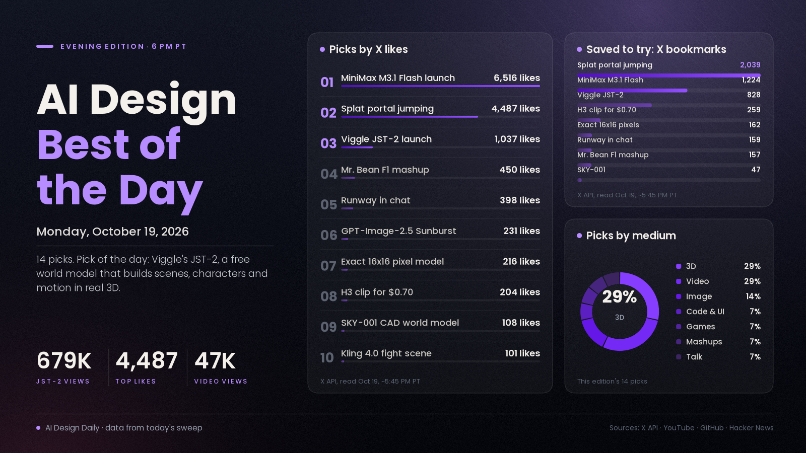

# AI Design Best of the Day · Monday, Oct 19, 2026

## 3D worlds you can step inside are having their moment

The design story that broke out today is Viggle's JST-2, a "physics-native world model" that builds scenes, characters and motion directly in 3D instead of generating flat video frames. Viggle says a scene takes about one second of model time and costs under a cent, that a single photo becomes a 3D character with motion built in and no rigging step, and that you can try it free today. The launch post passed 670K views with more than 800 saves, and it landed on the same day as the most-liked design post of the day: a WebGPU demo of jumping through portals between Gaussian-splat worlds in real time. It matters because 3D has been the slowest, most specialist part of a design pipeline. If photo-to-character and photo-to-scene really work in a browser, you can put real 3D in front of clients without a rigging artist or a game engine. Treat the hype carefully, though. Much of today's JST-2 chatter came as a wave of near-identical "free today" posts that read like a coordinated launch push, and Viggle itself says object physics is still rule-based until JST-3.

*Engagement figures were read from the X API, GitHub, Hacker News and YouTube search on the evening of Oct 19 (PT) and will keep changing. Reddit blocked our tools this evening, so Reddit sentiment is not counted.*

## ⭐ Pick of the day

### 🧊 3D and worlds

- [JST-2, Viggle's physics-native world model (Viggle Research)](https://viggle.ai/jst2), model/tool. One model that generates 3D scenes (and keeps extending them as you move to new viewpoints), turns a single image into a 3D character with motion built in, and pulls full-body motion from text or ordinary phone video, filling in limbs the camera missed. Why people are losing it: the [launch post](https://x.com/ViggleAI/status/2112202242048528540) has 1,037 likes, 828 bookmarks and about 679K views; creators are already comparing it with static splat tools, and Viggle says it beats rival 3D tools, including Meshy and Tripo, in its own blind tests. How to try it: open the free tier, feed it one photo of a room and one photo of a person, and see whether the character and scene are usable as a pitch-stage 3D mockup.

## The ranked picks

### 🧊 3D

- [Portal jumping through Gaussian-splat worlds in real time with WebGPU (@XRarchitect)](https://x.com/XRarchitect/status/2112207444101541962), showcase. Walk through a doorway and you're in a different photoreal captured world, live in the browser, with sound. The creator's bio says he designs at World Labs. Why people are losing it: the most-liked design post of the day at 4,487 likes, 2,039 bookmarks and about 137K views, up from about 1,200 likes at noon. How to use it: a reference for immersive portfolio or launch-site transitions, where each "room" is a captured place instead of a rendered set.
- [SolidCraft, free open-source parametric CAD with a built-in MCP server (GitHub)](https://github.com/tangency-labs/solidcraft), repo/tool. A pure-Rust CAD app with sketches, constraints and a feature timeline that runs on desktop or in the browser, and that AI agents can drive directly. Why people are talking: 7,286 stars since it appeared on Oct 7, and askNK's [video asking whether it ends paid CAD](https://www.youtube.com/watch?v=ToavQdQy5fU) reached 21,624 views in about 7 hours. How to try it: open the browser version, connect Claude through its MCP server, and ask for one small product part you can then edit by changing a dimension.
- [SKY-001, a world model aimed at engineering and CAD (@testingcatalog)](https://x.com/testingcatalog/status/2112274382122865149), news. Skyfall AI's model breaks an object into parts and rebuilds it in CAD as a visual build plan. Skyfall's own tests say it beats GPT-6 Astra and Opus 5.5 on CAD and BIM tasks at a fraction of the cost; nobody independent has checked that yet. Why it's here: 108 likes and 47 bookmarks on a niche engineering launch. How to use it: one to watch if you do product or architectural visualisation.

### 💻 Code and UI

- [MiniMax M3.1 Flash, the cheap fast model behind "Space Bunny" (MiniMax)](https://www.minimax.io/blog/minimax-m31f), model. The finished version of the anonymous model that topped coding leaderboards for days. Why people are losing it: the [launch post](https://x.com/MiniMax_AI/status/2112150867868541221) has 6,516 likes, 1,224 bookmarks and about 905K views, it drew [363 points on Hacker News](https://news.ycombinator.com/item?id=50154540), and [Design Arena ranks it #26 of 183 on frontend design](https://x.com/DesignArena/status/2112187815115342156), a 29-place jump over MiniMax M3. API price is $0.15 per million input tokens and $0.60 per million output, and MiniMax says weights arrive Oct 23. How to try it: it's free for a few days on OpenCode and OpenRouter, so run one landing-page or motion prompt you already have and compare it with your usual model before it goes paid.

### 🖼️ Image

- [GPT-Image-2.5 Sunburst is #1 on three Arena image leaderboards, and free to test for 14 days (Arena)](https://x.com/arena/status/2112199487217434855), news. OpenAI's latest image model leads Arena's Text-to-Image, Image Edit and Multi-Image Edit boards, and can be picked by name in Direct Mode until Nov 2 at 8 AM PT. Arena doesn't say whether it's related to the "aurora" test models spotted over the weekend. Why it's here: 231 likes and about 21K views on the announcement. How to try it: run your hardest edit (text in the picture, or several reference images) in Direct Mode before access closes.
- [A small custom model that makes exact 16×16 pixel art, where frontier models don't (@GrilliotTodd)](https://x.com/GrilliotTodd/status/2112267299378090314), showcase. Asked for "exactly 16x16 pixels", his trained model hits the grid every time while GPT Image 2.5 and Nano Banana come out at whatever size they like. Why people are losing it: 216 likes and 162 bookmarks, nearly one save per like. How to use it: for game sprites, a dedicated pixel model (or a converter that forces a real grid) beats prompting a general image model.

### 🎬 Video and animation

- [Kling 4.0 reaches creators: native 30-second clips, 15 references, 10 keyframes (Kling release notes)](https://kling.ai/release-note/release-history), model. Launched Oct 15 and now spreading through partner apps, so today was first-test day. Why people are talking: AI Samson's [full test against Seedance 2.5](https://www.youtube.com/watch?v=h9ryZx49_J0) reached 6,732 views in about 5 hours, and [a fight scene made from just a first and last frame (@twetsfyp)](https://x.com/twetsfyp/status/2112252123778052196) has 101 likes and about 10K views. Early testers say it needs its own prompting style, not Seedance habits. How to try it: give it a start frame and an end frame of one action and let it fill the motion between.
- [MiniMax H3 reference-to-video for about $0.70 a clip (@simonecanciello)](https://x.com/simonecanciello/status/2112186079533043788), tutorial. Attach a good reference video and swap the person for your own character sheet; he says Seedance 2.5 is still better but far pricier. Why people are losing it: 204 likes and 259 bookmarks, more saves than likes. Higgsfield is running a same-day series of [H3 vs Opus 5.5 3D motion tests](https://x.com/higgsfield_ai/status/2112233537453904320) at roughly 9–10K views each. How to try it: recast one existing clip with a character you already have a sheet for.
- [Mr. Bean enters F1 in his own car, made with Seedance 2.5 and GPT Image 2.5 (@TechieBySA)](https://x.com/TechieBySA/status/2112152540343369929), showcase. A comedy mashup with the prompt shared in the thread. Why people are losing it: 450 likes, 157 bookmarks and about 23.6K views. How to use it: a template for character-in-a-new-world spots: make the key frames as stills first, then animate them.
- [“No One Needs Us Anymore”, a music video animated entirely as code by Claude Opus 5.5 (Degenerative Pixels, YouTube)](https://www.youtube.com/watch?v=zONGVaONKe8), showcase. The channel's songs come from Suno and every scene is a program Claude wrote, not output from a video generator. Why people are talking: 21,792 views in about 10 hours. How to use it: proof that code-built animation can carry a whole song, which is the cheapest route to a music video you can edit scene by scene.

### 🎮 Games

- [The strongest AI models build Battlefield from scratch in Godot: Claude vs GPT vs Gemini vs Muse (НейроЧел+, YouTube)](https://www.youtube.com/watch?v=kyMBuFbt5f4), showcase. A Russian-language head-to-head where each model builds the same shooter in the Godot engine. Why people are losing it: 47,262 views in about 12 hours, the fastest-growing game video in our search. How to use it: a quick way to see which model handles game logic and level layout best before you pick one for a prototype.

### 🧪 Mashups and agent studios

- [Runway's generation tools now plug straight into Grok Bot (Runway)](https://x.com/runwayml/status/2112247791678541845), tool. Runway's MCP connector lets you generate images and video from inside a chat instead of switching apps. Why it's here: 398 likes, 159 bookmarks and about 32K views. How to try it: connect it and ask for a storyboard and a first clip in the same conversation where you wrote the script.

### 🗣️ What people are talking about

- [Fable 5.5, Gemini 4 Carbon and GPT-6.1 Terra all reportedly on deck (@Angaisb_)](https://x.com/Angaisb_/status/2112207072876019982), buzz. Citing a report in The Information, posters say Anthropic, Google and OpenAI are each preparing a new model, with Gemini 4 Carbon pitched as strong at visual web work. Dates are disputed: [some posters now say November](https://x.com/Mr_Salio/status/2112263147960795435). Why it's here: 479 likes and about 39K views, with [a matching summary (@kimmonismus)](https://x.com/kimmonismus/status/2112242007062233122) at 482 likes. What it means: the model you use for code-built design could change within weeks, so keep your best prompts portable.

---
*Method:* starts from today's morning and noon digests, then a fresh evening check of X, YouTube, GitHub trending, Hugging Face trending and Hacker News. Ranked by engagement and velocity, how many creators are copying it, and how new it is. Reddit blocked our tools this evening.

Want a deeper dive on any of these, or more of one medium tomorrow? Say the word and the next edition will steer there.
