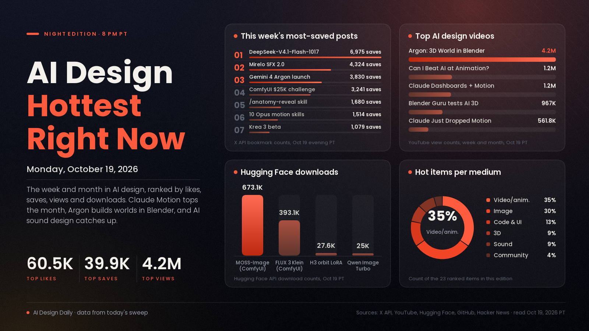

# AI Design Hottest Right Now · Monday, Oct 19, 2026

## Design is turning into something you ask for, and the sound is catching up

The biggest AI design post of the past month came from a lab. On Oct 8, Claude Dashboards and Claude Motion went into beta, letting anyone ask Claude for an animated explainer or a live dashboard, and the announcement drew more than 60,000 likes and almost 40,000 bookmarks. For a month the hottest design work has been animation, 3D and UI written as code, and this week the big labs leaned in hard. Google's own video of Gemini 4 Argon building a 3D world in Blender passed 4.19 million views in six days. DeepSeek's open model is now the cheap option creators race against both. The new part this week is sound and editing. Mirelo SFX 2.0, which rebuilds the sound design of an AI clip without touching the picture, was saved more often than it was liked, and Krea 3 opened as an image model made for editing rather than making from scratch. What it means: the gap between a rough idea and a finished, moving, sound-designed piece keeps shrinking, so taste and a clear brief matter more than any single tool.

*Engagement figures were read from the X API, YouTube search, GitHub (trending pages and repo data), Hugging Face and Hacker News on the evening of Oct 19 (PT), in about 25 minutes of reading. "This week" means Oct 12 to 19 and "this month" means Sept 19 to Oct 11. Reddit blocked our tools again (its pages sent us to a login wall), so it isn't counted. Product Hunt's front page loaded, but it showed no AI design launch with vote counts we could rank, so it isn't counted either.*

## 🔥 Blew up today

Nothing new truly took off today. Monday's most-watched design upload was Futurepedia's [How to Create Insane Motion Graphics With Claude (for free)](https://www.youtube.com/watch?v=Ge1B-Ok1Pfk), with 37,978 views in 11 hours, and the most-saved creator post was [a cozy fishing game made by one person with Opus 5.5, Blender, Tripo and Unity 6 (@sorenxet)](https://x.com/sorenxet/status/2112213933272490380), at 226 likes and 178 bookmarks.

## 📈 Hottest this week

- [Gemini 4 Argon: 3D World in Blender (Google Antigravity, YouTube)](https://www.youtube.com/watch?v=1dAcJEIlQM8), 3D showcase. Google's demo of Argon building a full 3D world inside Blender through an agent. The signal: 4,199,381 views in six days, the most-viewed AI design video of the week in our sweep by more than three times. The [launch post](https://x.com/sundarpichai/status/2110038898009407584) is now at 28,463 likes, 3,830 bookmarks and about 5.9M views, and Google's follow-up on [rebuilding ancient ruins in 3D with Blender MCP](https://x.com/googledevs/status/2111152826940305539) drew 888 likes. Try it: connect Blender to an agent through MCP and ask for one small scene, such as a room or a street corner, before anything bigger.
- [DeepSeek-V4.1-Flash-1017, open weights (DeepSeek)](https://x.com/deepseek_ai/status/2111375640717033777), code and motion model. The updated open model that creators are now testing on motion graphics and 3D against the big paid models. The signal: 36,598 likes, 6,975 bookmarks and about 7.3M views, the week's most-saved post in our sweep, 953 points on [Hacker News](https://news.ycombinator.com/item?id=50129045) and 1,708 likes on [Hugging Face](https://huggingface.co/deepseek-ai/DeepSeek-V4.1-Flash-1017). Higgsfield's post calling it [the new best model for motion design](https://x.com/higgsfield_ai/status/2111499195257700857) has 2,117 likes and 1,138 bookmarks. Try it: run one motion brief through it and through your usual model, then compare the result and the cost.
- [Mirelo SFX 2.0 (Mirelo)](https://x.com/MireloAI/status/2110360787780800611), sound tool. A video-to-sound model that watches a clip, removes music you never asked for, keeps the dialogue and builds new sound effects synced to the action. The signal: 3,832 likes, 4,324 bookmarks and about 1.9M views, more saves than likes, and it [arrived on Runway](https://x.com/MireloAI/status/2111222456945967508) two days later. Try it: take one AI clip where the native audio ruined the take and re-score only the sound.
- [ComfyUI's $25,000 challenge to build an open-source Higgsfield (ComfyUI)](https://x.com/ComfyUI/status/2110870071933645103), community challenge. Pitched as building the open-source Higgsfield that was promised, Comfy and partners including NVIDIA, Runpod and MiniMax are putting up $25,000 in prizes over two weeks for the best open-source builds on the Comfy Developer Platform. The signal: 4,576 likes, 3,241 bookmarks and about 550K views. Use it: if you've built a ComfyUI workflow you're proud of, this is a reason to package it and share it this month.
- [Krea 3, an image model built for editing (Krea)](https://x.com/krea_ai/status/2110760037128012146), image model. A new model for fast image edits, with 2K edits in under eight seconds, bounding-box control and multi-turn edits. The signal: 2,190 likes, 1,079 bookmarks and about 505K views on the beta launch, 352 points on [Hacker News](https://news.ycombinator.com/item?id=50105648), and it's already [in ComfyUI as a partner node](https://x.com/ComfyUI/status/2110840667337642330). Try it: make the same five small edits to one product photo and see how well it keeps everything else unchanged.
- [Kling 4.0 is fully available (Kling)](https://x.com/Kling_ai/status/2110747537187709424), video model. Kuaishou's video model left early access with a new creation interface plus MCP and CLI access for agents. The signal: 1,012 likes on the launch post, and the [KING CARD short made with it](https://x.com/Kling_ai/status/2110747526840361191) has about 1.04M views. Higgsfield's [30-second AAA gameplay concept](https://x.com/higgsfield_ai/status/2110905436371370009) made with it drew 256 likes. Try it: plan a three-shot sequence and drive it from an agent through the CLI instead of the web page.
- [MOSS-Image, now built into ComfyUI (Comfy-Org, Hugging Face)](https://huggingface.co/Comfy-Org/MOSS-Image), image model. The Apache-licensed 5B open image model with layout control and legible text, now supported in ComfyUI itself rather than through community nodes. The signal: 673,110 downloads, nearly double the roughly 354,000 of a day earlier and ahead of the [FLUX 3 Image Klein ComfyUI build](https://huggingface.co/black-forest-labs/flux-3-image-klein-comfy) at 393,062, and [ComfyUI's announcement](https://x.com/ComfyUI/status/2112265117924835409) drew 206 likes and 100 bookmarks today. Try it: update ComfyUI and lay out a flyer with real words on it.
- [Claude Just Dropped MOTION (Tristen O'Brien, YouTube)](https://www.youtube.com/watch?v=yf2OwchM9nw), motion tutorial. An 11-minute walkthrough of making motion graphics with Claude Motion. The signal: 561,839 views in five days, the week's most-viewed motion tutorial in our sweep. Try it: follow along for one 10-second title card before you install any skill packs.
- [10 skills and repos that turn Opus 5.5 into a motion studio (@0xMovez)](https://x.com/0xMovez/status/2111841847408517282), motion-design stack. A list covering explainer figures, 3D, physics, motion and sound, led by the same creator's [/anatomy-reveal skill](https://x.com/0xMovez/status/2110735931401457935). The signal: 869 likes and 1,514 bookmarks since Sunday, while the /anatomy-reveal post has grown to 1,244 likes and 1,680 bookmarks. Use it: pick one skill from the list that fills a gap in your setup rather than installing all ten.
- [How I Make Realistic AI Videos with Seedance 2.5, full guide (Dan Kieft, YouTube)](https://www.youtube.com/watch?v=2hJsvDSPWYM), video tutorial. A complete walkthrough of getting realistic footage out of Seedance 2.5. The signal: 295,394 views in three days. Try it: copy his process for one short scene, then change only the subject to see what carries over.
- [diagram-design, editorial diagrams for coding agents (GitHub)](https://github.com/cathrynlavery/diagram-design), code and UI tool. Diagram design for Claude Code, Codex, Cursor and others with 44 diagram types, output as self-contained HTML and SVG. The signal: 6,638 stars gained this week on GitHub's weekly trending list, 58,485 in total. Try it: ask an agent to redraw one messy flowchart from a deck you already have.

## 🗓️ Hottest this month

- [Claude Dashboards and Claude Motion are in beta (Claude)](https://x.com/claudeai/status/2108271552991252810), motion and UI tool. Ask Claude to turn data into live dashboards and ideas into animated explainers. The signal: 60,486 likes, 39,858 bookmarks and about 11.3M views, the biggest AI design post of the month in our sweep by a wide margin, and the [launch video](https://www.youtube.com/watch?v=en0GuyhieQk) has 1,211,921 views in 11 days. Try it: turn one spreadsheet you already report on into a short animated explainer.
- [GPT-6 and Intelligent UI rolling out in ChatGPT (OpenAI)](https://x.com/OpenAI/status/2107894997538525580), code and UI news. ChatGPT answers are now laid out by the model as text, visuals, charts and interactive pieces. The signal: 23,890 likes, 6,650 bookmarks and about 6.7M views, plus [761 points on Hacker News](https://news.ycombinator.com/item?id=49996425). Why it matters: AI now designs interfaces on the fly, so expect clients to ask for answers that look like this.
- [20 GitHub repos that turn Opus 5.5 into a motion studio (@N01ennn)](https://x.com/N01ennn/status/2108182955671580771), motion-design stack. A list of open-source skills and engines, from claude-motion to Remotion and HyperFrames, that let Opus 5.5 write, check and render animation as code. The signal: 5,877 likes and 14,036 bookmarks, still the most-saved creator post of the month in our sweep. Try it: rebuild one example from it with your own brand colours.
- [PhotoCraft and the open-source Craft suite (storytold, GitHub)](https://github.com/storytold/photocraft), image and video tools. An open-source photo editor written from scratch in Rust, one of a set of creative apps (FilmCraft, VectorCraft, EffectCraft and more) from the same GitHub organisation as [ArtCraft](https://github.com/storytold/artcraft). The signal: 68,661 stars since Sept 30, the fastest-rising new repo of the month in our GitHub search, while ArtCraft gained 13,572 stars this week. Try it: open one real edit from your week in PhotoCraft and note what's missing compared with your paid editor.
- [AI-generated posters don't have to be horrible (Hacker News)](https://news.ycombinator.com/item?id=49764791), graphic design essay. A [post by John Hartnup](https://john.hartnup.uk/2026/06/07/ai-event-posters.html) that tired of identical AI village-fair posters and shows how asking ChatGPT for a specific style gets much more varied results. The signal: 1,902 points and 962 comments, the month's top design story on Hacker News. Use it: read the comments too, which are a good map of what people dislike in AI graphics.
- [Can I BEAT AI At Animation? (Prince Artwork, YouTube)](https://www.youtube.com/watch?v=nmqBbX3twrM), animation showcase. An animator goes head to head with AI tools. The signal: 1,238,059 views in two weeks, the most-viewed creator video on AI design of the month in our sweep. Use it: watch for where the human still wins, which helps when you decide what to hand off.
- [Midjourney is testing an MCP (Midjourney)](https://x.com/midjourney/status/2108717365068509447), image tool news. Midjourney wants a small group of creative and technical people to test connecting its models to agents. The signal: 2,230 likes, 715 bookmarks and about 207K views. Why it matters: once it opens, an agent could art-direct Midjourney images inside a bigger design job.
- [Qwen-Image-2.1-Turbo, open-weights images in 8 steps (Qwen)](https://x.com/Alibaba_Qwen/status/2108549075218120949), image model. A faster checkpoint of the 7B Qwen-Image-2.1 that creates and edits images in eight steps. The signal: 5,311 likes and 4,040 bookmarks, the month's most-saved image launch in our sweep, and the [weights on Hugging Face](https://huggingface.co/Qwen/Qwen-Image-2.1-Turbo) have 998 likes and 25,033 downloads. Try it: use it for quick local drafts before a final render.
- [VoiceStudio, a fully local ElevenLabs alternative (GitHub)](https://github.com/debpalash/VoiceStudio), sound tool. Open-source voice cloning, voice design, dubbing and transcription that run on your own machine. The signal: 44,161 stars this month and 17,291 this week, top of GitHub's monthly trending list, 77,622 in total. Try it: dub one short clip in your own cloned voice before paying for cloud credits.
- [anatomy, an agent skill for isometric illustrations (GitHub)](https://github.com/wheresryan22/anatomy), illustration skill. It makes detailed, interactive isometric drawings of real machines and systems as polished SVGs. The signal: 16,958 stars since Oct 8. Try it: ask for a cutaway of one product you sell and use it as a website hero.
- [impeccable, a design language for AI coding tools (GitHub)](https://github.com/pbakaus/impeccable), code and UI skill. Its author calls it the design language that makes an AI coding setup better at design. The signal: 14,255 stars this month, 83,272 in total. Try it: add it to one project and compare a page built with it against one built without.
- [I tested viral AI 3D products (Blender Guru, YouTube)](https://www.youtube.com/watch?v=qsmDdOi07fI), 3D review. One of Blender's best-known teachers puts the AI 3D tools people share to a real test. The signal: 966,999 views in about four weeks. Use it: watch before paying for an AI 3D subscription.

---
*Method:* a fresh search of X (lab and creator accounts and keyword searches over the past day, week and month), GitHub trending (daily, weekly and monthly) and new-repo star counts, Hugging Face trending models and Spaces, Hacker News top stories for the week and month, and YouTube's most-viewed uploads from today, this week and this month. Ranked by engagement and velocity, staying power, how widely creators are copying it, and how new it is. Reddit blocked our tools and Product Hunt showed no rankable AI design launches, so neither is counted.

Want more of one medium or a deeper dive on any item? Say the word and the next edition will steer that way.
