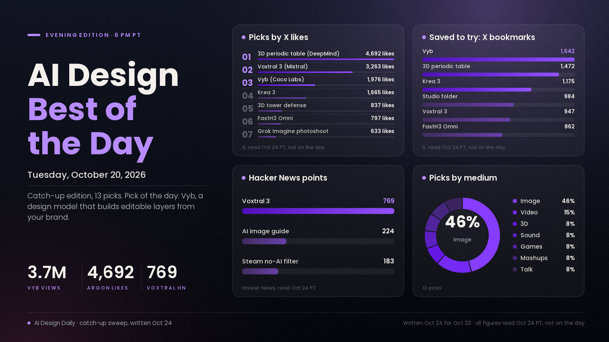

# AI Design Best of the Day · Tuesday, Oct 20, 2026

*Catch-up edition: written on Oct 24, 2026 for the Oct 20 evening slot. Every engagement figure below (likes, bookmarks, views, points, downloads) was read on Oct 24, not on Oct 20, so each one includes four extra days of traffic.*

## Design models, not image models

The design story of Oct 20 is Vyb, the first model from Coco Labs. Co-founder Anusha Ramesh says she launched Google's first image and video generation models before spending two years building it in stealth. Vyb doesn't paint a flat picture. It builds a design in layers from your own logo, fonts, colors and product photos, so text stays text, graphics stay vectors and photos are never redrawn, and the result exports to Figma. The launch post reached about 3.66 million views, the biggest view count in this edition. It landed the same morning Krea said its in-house Krea 3 model had reached the top tier of the image-editing arenas, and Bria shipped Fibo 2.0 as an open-weights editing model. Taken together, Oct 20 was the day the pitch moved from prettier pictures to designs that keep your brand and stay editable. Treat the numbers carefully: Vyb's head-to-head scores are its own, access is through a waitlist, and nobody independent has tested it yet. The most-liked pick in this edition is something else: Google DeepMind's 3D periodic table built by Gemini 4 Argon and synced to Tom Lehrer's song "The Elements".

*Method in one line: picks start from the Oct 20 morning and noon editions, plus a catch-up sweep on Oct 24 of what blew up on Oct 20 (PT) through about 6 PM. All figures were read on Oct 24, not on the day.*

## ⭐ Pick of the day

### 🖼️ Image and graphic design

- [Vyb, Coco Labs' first design model, which builds editable layered designs from your brand (Coco Labs)](https://cocolabs.ai/blog/introducing-vyb), model. Vyb starts from your logo, fonts, colors and photos and builds the design one layer at a time: text stays text, graphics stay vectors, and your product photos go in at full resolution without being redrawn or retouched. Coco Labs says each layer is changed one at a time, so edits don't wreck the rest of the design. The model writes designs in its own design language, "Cocolang", which is what lets the layers export cleanly to Figma. Why people were losing it: the [launch post](https://x.com/anurahk/status/2112581900779012503) has 1,976 likes, 1,642 bookmarks and about 3.66M views (a "comment your website" offer helped spread it). In the launch post's font test, Coco Labs reports a 90.3% shape match for Vyb against 76.0% for GPT Image 2.5, 50.9% for Muse and 46.2% for Recraft 4.1. That's a self-reported benchmark. How to try it: join the waitlist on [Vyb's page](https://cocolabs.ai/vyb), which currently comes with $10 in generation credits. Then give it your real brand and one product photo, change a headline, and check that nothing else shifts and the Figma export keeps its layers.

## The ranked picks

### 🧊 3D and interactive

- [Gemini 4 Argon builds a 3D periodic table synced to Tom Lehrer's "The Elements" (Google DeepMind)](https://x.com/GoogleDeepMind/status/2112557925264752930), showcase. Made in Antigravity, it animates orbiting electrons, atomic data and light spectra in time with the song. Why people were losing it: 4,692 likes, 1,472 bookmarks and about 572K views. [Sundar Pichai's "Sound on!" quote-post](https://x.com/sundarpichai/status/2112648189656616999) added 6,719 likes and about 483K views on top of that. Google also posted a [WebGL2 fur engine Argon coded in the browser](https://x.com/Google/status/2112552114467602487) (594 likes, about 244K views). These are vendor demos, and no project files were shared. How to use it: a pattern worth copying. Give an agent a song or voiceover with a known structure and ask for an interactive 3D explainer whose beats follow it.

### 🔊 Sound and voice

- [Voxtral 3, Mistral's new speech-to-text and text-to-speech family with a voice-agent SDK (Mistral)](https://mistral.ai/news/voxtral-3/), model. The TTS model changes emotion, pace and emphasis to suit the conversation in 35+ languages and 50+ dialects, and "Pro Voice" adapts a specific speaker's voice from about 30 minutes of audio. It's available through Mistral's EU-hosted API or for self-deployment. Why people were talking: the [launch post](https://x.com/MistralAI/status/2112574615318876178) has 3,263 likes, 947 bookmarks and about 269K views, and it drew [769 points and 201 comments on Hacker News](https://news.ycombinator.com/item?id=50168396). How to use it: a candidate voice for game characters, narrated explainers or interactive installations. Test one line of dialogue in two languages before you commit.

### 🖼️ Image

- [Krea 3 reaches the top tier of image-editing arenas (Krea)](https://x.com/krea_ai/status/2112567020353102324), model news. Krea says its in-house model comes in two versions: "Fast" pushes the speed-quality curve, and "Ultra" ranks in the top four, behind only OpenAI's models. [TestingCatalog reports](https://x.com/testingcatalog/status/2112570237874810918) Ultra at #4 on Artificial Analysis's image-editing leaderboard with 1,151 points, one point behind Nano Banana 2.1, with prices starting at $0.03 per 1K image. Why people were losing it: 1,665 likes, 1,175 bookmarks and about 1.31M views, with LoRA training and style references promised next. How to try it: [Krea 3's page](https://www.krea.ai/krea-3). Use its regional, multi-turn edits on a product shot and check whether the logo and highlights hold.
- [Fibo 2.0, Bria's open-weights image-editing model trained on licensed data (Bria)](https://x.com/bria_ai_/status/2112559473458045305), model. Bria calls it the #1 open-weights image-editing model on Artificial Analysis, ahead of 33 closed models. That's Bria's claim. Why it's here: 255 likes on the launch post, and the [dev weights on Hugging Face](https://huggingface.co/briaai/Fibo-2.0-dev) have 136 likes. How to try it: in [Bria Create](https://create.bria.ai/home), or locally from the Hugging Face weights if licensed training data matters for your client work.
- [Grok Imagine turns a snapshot into a studio photoshoot (@imagine)](https://x.com/imagine/status/2112613486845120758), feature. Take a phone photo and edit it into a styled studio shoot. Why people are talking: 633 likes and about 150K views on the product account's demo. How to try it: [grok.com/imagine](https://grok.com/imagine). Start from a plain photo of a product or person and ask for one specific lighting setup at a time.
- [11 broken images, 7 AI editors, one try each: a tier list (@VORTEX_Promos)](https://x.com/VORTEX_Promos/status/2112657082998473013), test. Extra hands, a third leg, duplicate people and typos were handed to Krea 3, GPT Image 2.5, Nano Banana 2, Seedream 5, Flux 3, Grok Imagine and Ideogram 4.5. His ranking: Ideogram 4.5 on top, then GPT Image 2.5 and Grok Imagine, with Krea 3 in the B tier, which pushes back on the day's arena headlines. Why it's here: 320 likes and about 75K views. It's one person's single-try test. How to use it: run your own repair test on the kind of image you actually fix.
- [A practical guide to AI image generation, from diffusion to agents (Daniel Ball)](https://danielball.com/notes/ai_image_generation.html), tutorial. How the models work, what you get from ChatGPT, and how to build image generation into your own code and agents, from weeks of API experiments. It also explains why per-image prices vary more than 100 times over, from a fraction of a cent to 15 cents or more. Why people are talking: [224 points on Hacker News](https://news.ycombinator.com/item?id=50171379). How to use it: read the section "Describe the camera, not the view", then rewrite one of your own prompts that way.

### 🎬 Video and animation

- [FastH3 Omni goes open source, training code included (@haoailab)](https://x.com/haoailab/status/2112625528805208257), model. FastVideo's distilled MiniMax H3 does multi-reference video. The team says it runs in real time, 12× faster on NVIDIA Blackwell, with NVFP4 and FP8 builds for DGX Spark and RTX cards, and ComfyUI supported it on [day 0](https://x.com/ComfyUI/status/2112645504769413283). Why people are saving it: 797 likes, 862 bookmarks and about 129K views, and the [ComfyUI weights](https://huggingface.co/FastVideo/FastH3-Omni-Comfy) show 154,490 downloads on Hugging Face. How to try it: load the ComfyUI build, feed it a character and a location reference, and time a short clip on your own card. The [FastVideo repo](https://github.com/hao-ai-lab/FastVideo) has the code.
- [A short film about a paperclip and a sticky note, every frame drawn in code (@kevin_t_ngo)](https://x.com/kevin_t_ngo/status/2112584730856366140), showcase. The creator says Claude Opus 5.5 drew every frame in code. Why it's here: 265 likes and 108 bookmarks. How to use it: a reference for character animation made entirely as code, like the motion-design studio folder further down.

### 🎮 Games

- [A full 3D tower-defense game built with Claude Opus 5.5 (@MrTacticalX)](https://x.com/MrTacticalX/status/2112708402367639740), showcase. He lists 5 maps, 14 towers, boss fights, volcano eruptions and hordes of hundreds of enemies, with 60 seconds of real gameplay. Posted at 5:51 PM PT, right at the end of the day. Why people were losing it: 837 likes, 594 bookmarks and about 38K views. The feature list is his own. For a version with receipts, see [@froessell's Mowtopia breakdown](https://x.com/froessell/status/2112629173441495320) (125 likes, 143 bookmarks): about 7,010 Magnific credits paid for concepts, every 3D model, an icon sheet and audio, and he says Claude Code built most of the cozy Unity 6 game in two days from a 7-milestone PRD with 60 passing tests. How to use it: write your game as milestones in a PRD and have the agent clear one milestone at a time, with tests.

### 🧪 Mashups and agent studios

- [A full motion-design studio inside one Claude Code folder, on a weekly schedule (@thegreatest_sv)](https://x.com/thegreatest_sv/status/2112609040962359354), workflow. A STUDIO folder with a brand/ directory and a CLAUDE.md, plus HyperFrames, Remotion's skills, a GSAP skill, LottieFiles' motion-design skill and Blender. A /schedule routine turns last week's launches into three promo clips every Monday and waits for approval. Why people are saving it: 543 likes and 984 bookmarks (more saves than likes), about 38K views. How to use it: set up the brand/ folder first, since every later clip inherits it.

### 🗣️ What people are talking about

- [Steam players ask for a "no AI" filter as Next Fest fills with generated games (IGN)](https://www.ign.com/articles/steam-fans-are-begging-for-a-no-ai-filter-as-steam-next-fest-is-filled-with-slop), news. One Steam player quoted by IGN asks to filter out every game with AI-generated content, pointing out that Steam already requires developers to disclose it. Why people are talking: [183 points and 231 comments on Hacker News](https://news.ycombinator.com/item?id=50168190). What it means: on the same day agent-built games drew big numbers on X, players were asking for a way to opt out. If you ship one, disclose clearly.

---
*Method:* a catch-up edition, written on Oct 24, 2026. Picks start from the Oct 20 morning and noon editions. A fresh sweep on Oct 24 then checked X (launch accounts and keyword search limited to Oct 20, midnight to about 6 PM PT), Hacker News (Algolia API) and the Hugging Face API. Ranked by engagement, saves, how many creators are copying it, and how new it is. **All engagement figures were read on Oct 24, not on Oct 20**, so they include four extra days of traffic. Hugging Face downloads are the site's own running count. Vendor claims and creators' own numbers are labelled as such. Gaps: Reddit, YouTube trending, GitHub trending and Hugging Face trending can't be read as they stood on Oct 20, so this sweep leaned on X and Hacker News. Reddit and YouTube are represented only through the morning and noon editions.

Want a deeper dive on any of these, or more of one medium next time? Say the word and the next edition will steer there.
