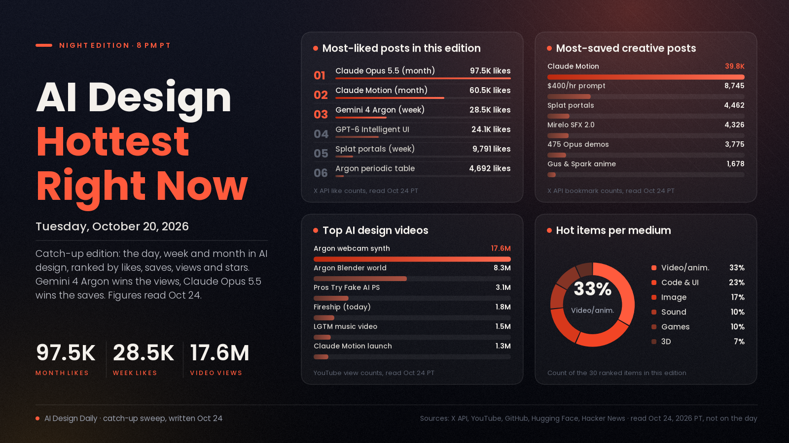

# AI Design Hottest Right Now · Tuesday, Oct 20, 2026

*Catch-up edition: written on Oct 24, 2026 for the Oct 20 night slot. Every engagement figure below (likes, bookmarks, views, points, stars, downloads) was read on Oct 24, not on Oct 20, so each one includes up to four extra days of traffic.*

## Google owns the week's views, Claude owns the month's saves

Gemini 4 Argon was the loudest AI launch of the week. Sundar Pichai's launch post on Oct 13 has more than 28,000 likes, and Google's own demo videos, a webcam you play like a synthesizer and a 3D pagoda built in Blender from one prompt, have racked up about 17.6 million and 8.3 million YouTube views. On Oct 20 itself, Argon came back with a 3D periodic table that animates in time with Tom Lehrer's "The Elements". But when people decide what to keep, they keep Claude. Over the past month, Claude Opus 5.5 and Claude Motion are still the most-liked and most-saved design launches by far. This week's most-bookmarked creative post was a single Opus 5.5 prompt billed as a "$400/hr motion graphics designer", and creators shipped a 475-demo gallery and a 25-minute anime written entirely in code. The backlash grew alongside the hype. Kotaku's report on vibe-coded game decompiles and ports spread widely, and a widely shared reminder told newcomers that an AI game needs to be fun before it needs fancy art. What it means: views follow the big labs' demos, but saves follow prompts and repos you can reuse tomorrow.

*Engagement figures were read from the X API, YouTube, GitHub repo data, Hugging Face and Hacker News on Oct 24 (PT), four days after the slot, and will keep changing. "Today" means Oct 20, "this week" means Oct 13 to 20 and "this month" means Sept 20 to Oct 12, all PT. Reddit sent our tools to a login wall, so it isn't counted. GitHub star counts are current totals, not stars gained in the window.*

## 🔥 Blew up today

- [Gemini 4 Argon builds a 3D periodic table synced to Tom Lehrer's "The Elements" (Google DeepMind)](https://x.com/GoogleDeepMind/status/2112557925264752930), 3D/code showcase. Made in Antigravity, it animates orbiting electrons, atomic data and light spectra along with the song. The signal: 4,692 likes, 1,472 bookmarks and about 572K views, and [Sundar Pichai's "Sound on!" quote-post](https://x.com/sundarpichai/status/2112648189656616999) added 6,719 likes and about 483K views. It's a vendor demo, and no project files were shared. Try it: hand an agent a song or voiceover with a clear structure and ask for an interactive 3D explainer that hits each beat.
- [Vyb, Coco Labs' first design model, which builds editable layered designs from your brand (Coco Labs)](https://cocolabs.ai/blog/introducing-vyb), design model. It starts from your logo, fonts, colors and photos and builds the design layer by layer, so text stays text, graphics stay vectors and photos aren't redrawn, and the result exports to Figma. The signal: the [launch post](https://x.com/anurahk/status/2112581900779012503) has 1,976 likes, 1,642 bookmarks and about 3.66M views, the biggest view count of the day. Coco Labs reports a 90.3% font shape match in its own test (self-reported), and access is through a waitlist. Use it: join the waitlist if client work means brand-locked social and ad layouts you'd otherwise rebuild by hand.
- [Did Google just dethrone OpenAI and Anthropic? (Fireship, YouTube)](https://www.youtube.com/watch?v=b2tjnxX8IHU), video review. Fireship puts Google's new model up against GPT-6 and Opus 5.5 in a hands-on test drive. The signal: about 1.85M views since it went up on the morning of Oct 20. Use it: a fast way to see where Argon actually beats the other two before you switch tools.
- [Voxtral 3, Mistral's new speech-to-text and text-to-speech models (Mistral)](https://mistral.ai/news/voxtral-3/), voice model. The models power Mistral's new voice-agents API. The signal: the [launch post](https://x.com/MistralAI/status/2112574615318876178) has 3,263 likes, 947 bookmarks and about 269K views, plus [769 points on Hacker News](https://news.ycombinator.com/item?id=50168396). Try it: a candidate voice for game characters or narrated explainers. Test one line in two languages first.
- [Krea 3 reaches the top of the image arenas (Krea)](https://x.com/krea_ai/status/2112567020353102324), image model. Krea says "Fast" pushes the speed-and-quality curve and "Ultra" ranks top-4, behind only OpenAI's models (Krea's claim). The signal: 1,665 likes, 1,175 bookmarks and about 1.31M views. Use it: worth a side-by-side with your usual model on edit-heavy jobs.
- [FastH3 Omni, open-sourced with training code (FastVideo, Hugging Face)](https://huggingface.co/FastVideo/FastH3-Omni-Comfy), open video model. FastVideo open-sourced MiniMax's FastH3 Omni with ComfyUI support from day one and says it generates in real time, 12x faster on NVIDIA Blackwell (self-reported). The signal: the [announcement](https://x.com/haoailab/status/2112625528805208257) has 797 likes and 862 bookmarks, and the ComfyUI build shows about 154K downloads on Hugging Face. Try it: if you run ComfyUI locally, it's a free way to test fast video drafts.

## 📈 Hottest this week

- [Gemini 4 Argon is here (Sundar Pichai)](https://x.com/sundarpichai/status/2110038898009407584), model launch. Out Oct 13 in the Gemini API, Antigravity, the Gemini app and Search. The signal: 28,456 likes and about 5.96M views. Google's demo [Turn Your Webcam Into a Playable Synthesizer](https://www.youtube.com/watch?v=KSTOF3s-r4E) shows about 17.6M views, and [3D World in Blender](https://www.youtube.com/watch?v=1dAcJEIlQM8) about 8.3M. View counts on official brand channels can include paid promotion, so read them as reach rather than buzz. Try it: the webcam synth is a ready-made idea for an interactive installation or a music visual.
- [Portal jumping through gaussian splat worlds with WebGPU (@XRarchitect)](https://x.com/XRarchitect/status/2112207444101541962), 3D/real-time. Real-time portal jumps between captured splat scenes in the browser. The signal: 9,791 likes, 4,462 bookmarks and about 421K views, the most-liked creative post we found this week. Use it: splat captures plus portal transitions make a strong format for spatial portfolios or venue walkthroughs.
- [Vibe coding is creating a serious problem for the video game industry (@Pirat_Nation, via Kotaku)](https://x.com/Pirat_Nation/status/2111593348293128535), industry talk. A summary of Kotaku's report that Opus 5.5 has made decompiling and recompiling games easier, which has led to a wave of unofficial ports, mods and clones and to DMCA takedowns. The signal: 6,182 likes, 1,637 bookmarks and about 384K views. On Hacker News, [Steam Client is now faster than Epic's new vibe coded launcher](https://news.ycombinator.com/item?id=50105635) took 350 points. Use it: if you build games or game art, keep your own work's source and licenses tidy, because this fight is just starting.
- [Make sure your game is fun without a bunch of fancy art (@pvncher)](https://x.com/pvncher/status/2111613394143027269), craft talk. The argument: LLMs make it too easy to build visually rich levels with no real gameplay, and that's backwards. The signal: 5,707 likes and about 164K views. Use it: block out the gameplay in grey boxes before you generate a single texture.
- ["This Opus 5.5 prompt is literally a $400/hr motion graphics designer" (@minchoi)](https://x.com/minchoi/status/2111306174259691669), prompt. A shared prompt for getting motion-graphics work out of Opus 5.5. The signal: 4,396 likes and 8,745 bookmarks (about two saves for every like), the most-saved creative post we found this week. The price tag is the poster's framing. Try it: run it on one of your own briefs and judge the timing and easing yourself.
- [Paris City Tours, now 50% off, an AI satire (@Wytsekoetse)](https://x.com/Wytsekoetse/status/2112211697008075021), video short. A fake tourism ad, with the full toolchain listed: ChatGPT for prompts, GPT Image 2.5 and Nano Banana 2.1 for images, Seedance 2.5 for video, Suno v6 for music and Adobe Creative Cloud for the edit. The signal: 3,722 likes, 1,092 reposts and about 4.03M views, the most-viewed creative post we found this week. Use it: the toolchain list is a working recipe for a one-person comedy spot.
- [475 video demos built with Claude Opus 5.5 in one GitHub repo (@hurricodes)](https://x.com/hurricodes/status/2111531584037785970), resource. Motion graphics, explainers, 3D scenes and games made with HTML, Canvas, SVG and Three.js, each with its original prompt and source post. The signal: 2,553 likes, 3,775 bookmarks and about 323K views. The repo link sits in the replies. Try it: pick one demo near your style and remake it from its prompt.
- [Gus & Spark, billed as the first Claude-made anime (@ziwenxu_)](https://x.com/ziwenxu_/status/2111212505947357651), animation. A 25-minute episode the creator says Opus 5.5 wrote in code over more than 15 hours, with no AI-generated video: 34K lines of code and 986M tokens, about $370 at API prices (all self-reported). The signal: 2,136 likes, 1,678 bookmarks and about 356K views. Use it: proof that code-drawn animation can run long, which is useful when you need consistent characters.
- [DeepSeek V4.1 Flash as "the new SOTA for motion design" (Higgsfield)](https://x.com/higgsfield_ai/status/2111499195257700857), model demo. Higgsfield shows 3D detail and UI transitions made with [DeepSeek-V4.1-Flash-1017](https://x.com/deepseek_ai/status/2111375640717033777), which was the week's biggest launch post (37,127 likes, about 8.0M views). The signal: Higgsfield's demo has 2,144 likes and 1,157 bookmarks. "SOTA" is Higgsfield's claim. Try it: a cheaper model to test for code-built motion pieces.
- [FLUX 3 Image Klein, ComfyUI build (Black Forest Labs, Hugging Face)](https://huggingface.co/black-forest-labs/flux-3-image-klein-comfy), open image model. Released Oct 14. The signal: 1,479 likes and about 591K downloads on Hugging Face. Late in the week fal launched [FLUX 3 Max](https://x.com/fal/status/2112251022047412492), a video model built with Black Forest Labs, at 75% off for three weeks (1,429 likes, about 442K views). Use it: Klein is the open option to keep in your local ComfyUI kit.
- [Mirelo SFX 2.0, sound design for AI video (Mirelo)](https://x.com/MireloAI/status/2110360787780800611), audio. It watches a clip, keeps the dialogue, cuts music you never asked for and builds synced sound design, through its API, Runway and fal. The signal: 3,839 likes, 4,326 bookmarks and about 1.89M views. Use it: run your silent AI shots through it before you hand-mix.
- [earshot, ears for coding agents (GitHub)](https://github.com/Leonxlnx/earshot), open-source tool. It lets an AI agent hear, review and make sound, on CPU only. The signal: about 2,600 stars since it was created Oct 15. Use it: lets an agent check its own audio when it builds sound for games or motion pieces.

## 🗓️ Hottest this month

- [Introducing Claude Opus 5.5 (Claude)](https://x.com/claudeai/status/2102435511222890900), model launch. Out Sept 22. The signal: 97,487 likes, 13,305 bookmarks and about 28.6M views, the most-liked post in this edition. The [early-explorations thread](https://x.com/claudeai/status/2102471866635919731), opening with a watermelon short story by @kevin_t_ngo, added 11,356 likes. Use it: the model behind most of the code-built video in this edition.
- [Claude Dashboards and Claude Motion are in beta (Claude)](https://x.com/claudeai/status/2108271552991252810), design tool. You ask, and Claude turns data into live dashboards and ideas into animated explainers. The signal: 60,550 likes and 39,790 bookmarks, the most-saved post of the month, plus about 1.31M views on the [launch video](https://www.youtube.com/watch?v=en0GuyhieQk). Use it: start explainer animatics here, then polish in your usual tools.
- [GPT-6 and Intelligent UI for everyone (OpenAI)](https://x.com/OpenAI/status/2107894997538525580), product launch. Intelligent UI makes ChatGPT answers more visual and interactive. The signal: 24,059 likes and about 6.9M views, plus [761 points on Hacker News](https://news.ycombinator.com/item?id=49996425). Use it: watch which answer layouts it picks. They hint at where interface design is heading.
- [Pros Try Fake AI Photoshop (Linus Tech Tips, YouTube)](https://www.youtube.com/watch?v=fr0WIIZxvx0), video. LTT has professionals try a free "fake AI Photoshop" and asks whether the wave of AI clones and decompiled games is piracy or a step toward AI-assisted open source. The signal: about 3.1M views since Oct 10. Use it: a fair read on whether these clones are good enough for real work yet.
- [LGTM (Looks Good to Me), a Claude Opus 5.5 music video (Degenerative Pixels, YouTube)](https://www.youtube.com/watch?v=3TNpOD6bov8), music video. A song made with Suno v6 and animation Opus 5.5 wrote in TypeScript and three.js, all satirizing unread code reviews. The signal: about 1.53M views since Oct 5. Use it: a strong example of code-drawn animation carrying a whole track.
- [awesome-opus5-5-videos (GitHub)](https://github.com/yihui-dev/awesome-opus5-5-videos), resource. A growing collection of viral Opus 5.5 videos and the prompts behind them, each shown next to a live remake. The signal: about 10,400 stars since Sept 27. Use it: a prompt library to browse before your next motion brief.
- [universal-modder, point Claude at any game (GitHub)](https://github.com/rehan-remade/universal-modder), tool. Skills and tools that let Claude Code mod almost any PC game you own, including fal-generated art, 3D and audio. The signal: about 8,900 stars since Sept 30. Mod only games you own and respect each game's terms. Use it: a sandbox for testing generated textures and sounds inside a real engine.
- [lemo-opuscar, film styles made in code (GitHub)](https://github.com/lemomo-ai/lemo-opuscar), resource. A toolbox of 59 film styles for Claude Code, each with a style prompt and a demo film made in code by Opus 5.5 with no video model. The signal: about 6,600 stars since Sept 26. Try it: borrow a style prompt as the look for a title sequence.
- [How to Make Insane Motion Graphics With Opus 5.5 (Lukas Margerie, YouTube)](https://www.youtube.com/watch?v=747ZnEtsRbg), tutorial. A walkthrough of making motion graphics with Opus 5.5. The signal: about 657K views since Sept 28. Use it: a quick start if you haven't tried code-built motion yet.
- [I gave Opus 5.5 one prompt and six hours to visualize Invisible Cities (Quesma)](https://quesma.com/blog/invisible-cities-one-shot/), experiment. A one-prompt, six-hour run at visualizing Calvino's book. The signal: [418 points on Hacker News](https://news.ycombinator.com/item?id=50004790). Use it: a model for long, unattended art runs. Write the brief well, then let it go.
- [ChatGPT is adding real cartoonists' signatures to fake New Yorker cartoons (Nieman Lab)](https://www.niemanlab.org/2026/10/chatgpt-is-adding-real-cartoonists-signatures-to-fake-new-yorker-cartoons/), talk. The signal: [559 points on Hacker News](https://news.ycombinator.com/item?id=49971846), the month's most-upvoted AI-art ethics story. Use it: check generated images for stray signatures or marks before anything ships.
- [Qwen-Image-2.1-Turbo, open-weights images in 8 steps (Qwen)](https://x.com/Alibaba_Qwen/status/2108549075218120949), open image model. It creates and edits 2K images in 8 denoising steps. The signal: 5,317 likes and 4,019 bookmarks, plus 1,047 likes on [Hugging Face](https://huggingface.co/Qwen/Qwen-Image-2.1-Turbo). Try it: a fast local option for quick edits and drafts.

---
*Method:* a catch-up sweep written on Oct 24, 2026 for the Oct 20 slot, with every figure read Oct 24 (PT). It covers X (lab and creator accounts, keyword search split across each window, and direct post lookups), YouTube search with week and month filters and exact upload dates, GitHub repos created in each window, Hugging Face models created in each window, and Hacker News stories in each window. Ranked by engagement, staying power, how widely creators are adopting it, and how new it is. Self-reported claims are marked. Reddit was blocked by a login wall. GitHub and Hugging Face trending pages as they stood on Oct 20 can't be read back, so star and download counts are current totals.

Want a deeper dive on any of these, or more of one medium next time? Say the word and the next edition will steer there.
