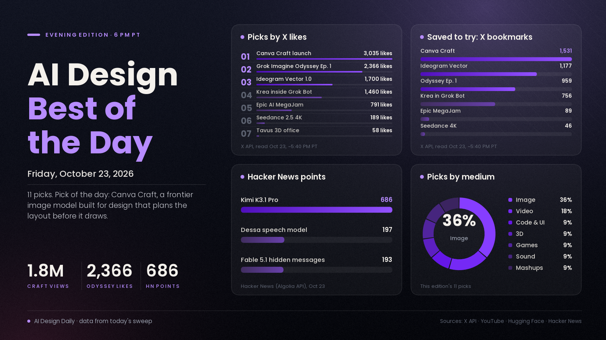

# AI Design Best of the Day · Friday, Oct 23, 2026

## Design tools just got their own image models

The design story of the day is Canva Craft, the first image model Canva has built itself. Canva says Craft plans the composition first and only then renders the picture, which is why it handles layouts and lettering better than models that go straight from prompt to pixels. It debuted at #4 on Design Arena's image leaderboard with an Elo score of 1,340, first of 87 models for portraits and first of 85 for landscapes, and the launch post passed 1.8 million views. It lands one day after Ideogram's first vector model, so in 48 hours two design companies shipped models aimed at finished, editable design work rather than pretty pictures. That matters because the gap between "AI made an image" and "I can hand this to a client" is mostly about text, layout and editability, and that's exactly what both launches go after. Treat the rankings as early: they come from the companies and one leaderboard, and nobody has run an independent test yet.

*Engagement figures were read from the X API, YouTube search, Hugging Face and Hacker News on the evening of Oct 23 (PT) and will keep changing. This edition was built from a fresh evening sweep. Reddit wasn't checked.*

## ⭐ Pick of the day

### 🖼️ Image

- [Canva Craft, Canva's first frontier image model built for design (Canva)](https://www.canva.com/newsroom/news/canva-craft/), model. A two-stage model that plans the layout before it draws, aimed at accurate text, precise composition and designs you can keep editing. Why people are losing it: the [launch post](https://x.com/canva/status/2113348707223753165) has 3,035 likes, 1,531 bookmarks and about 1.81M views, and [Design Arena confirmed the #4 spot](https://x.com/DesignArena/status/2113349031762268476), saying it wins most often on photorealistic product shots. How to try it: it's live for everyone in [Canva Dream Lab](https://www.canva.com/dream-lab/) and coming to Canva's public API, so give it a poster or thumbnail brief with real headline text and see whether the lettering survives.

## The ranked picks

### 🎬 Video

- [Odyssey Episode 1, a full episode made with Grok Imagine (@imagine)](https://x.com/imagine/status/2113712964419063911), showcase. A cinematic retelling of Homer made with Wonder Studios and director Dev Walker, following a September pilot. Why people are losing it: 2,366 likes, 959 bookmarks and about 99K views since it went up this afternoon, the most-liked creative post published today. How to use it: a reference for how far one team can push episodic storytelling with AI shots, and the post offers a full breakdown if enough people ask.
- [Seedance 2.5 4K, ByteDance's native 4K video model for film work (BytePlus, YouTube)](https://www.youtube.com/watch?v=5ymQgaSP03Q), model. Native 4K with 10-bit colour, plus a Draft mode that lets you test ideas as cheap 480p previews before rendering the full shot. Why people are talking: [TestingCatalog's summary](https://x.com/testingcatalog/status/2113667822132027903) has 189 likes and about 11.4K views, and Higgsfield is posting [4K skin-detail tests](https://x.com/higgsfield_ai/status/2113788791660171378). How to try it: draft a shot at 480p, pick the take you like, then render only that one in 4K.

### 🖼️ Image

- [Ideogram Vector 1.0, text or image to clean, editable SVG (Ideogram)](https://ideogram.ai/models/vector), model. Logos, labels, lettering and illustrations come out as separate vector shapes you can open in Illustrator or Figma. Why people are losing it: the [launch post](https://x.com/ideogram_ai/status/2113300317584720259) has 1,700 likes, 1,177 bookmarks and about 304K views, and [Higgsfield's 2,800% zoom test against Nano Banana Pro](https://x.com/higgsfield_ai/status/2113495393564852633) has 205 likes and about 23.8K views. How to try it: turn one of your raster logos into a vector, then recolour a single element to check the shapes really are separate.
- [FLUX 3 image klein, Black Forest Labs' small image-editing model (Hugging Face)](https://huggingface.co/black-forest-labs/flux-3-image-klein), model. An open image-to-image model that's still near the top of Hugging Face's trending list ten days after release. Why it's here: 656 likes and 105,768 downloads, and the [ComfyUI version](https://huggingface.co/black-forest-labs/flux-3-image-klein-comfy) has 1,406 likes. How to try it: load the ComfyUI version and run a local edit pass on a product shot without paying per image.
- [How does Fable 5.1 hide messages in images? (LessWrong)](https://www.lesswrong.com/posts/WHEQps5PK8LrrcTAb/how-does-fable-5-1-hide-messages-in-images), research. Researchers asked the model to draw ordinary-looking SVG pictures that secretly encode short phrases, and it invented its own tricks, such as varying the heights of stars or buildings; a separate session that saw only the rendered picture could read the messages back. Why people are talking: [193 points on Hacker News](https://news.ycombinator.com/item?id=50201445). What it means: code-drawn images can carry information you can't see, which is worth knowing before you ship AI-made SVGs.

### 💻 Code and UI

- [Kimi K3.1 Pro, Moonshot's open-weight model with strong coding and 3D modelling (Kimi)](https://www.kimi.ai/blog/kimi-k3-1-pro), model. Moonshot calls it its most capable 3T-class open-weight model, with a 1M-token context, and [Design Arena says](https://x.com/DesignArena/status/2113684321479557197) it can build projects in Unreal, Unity and Godot and do parametric 3D in Blender and CAD. Why people are losing it: [686 points and 433 comments on Hacker News](https://news.ycombinator.com/item?id=50212065), and Arena's [first-impressions video](https://www.youtube.com/watch?v=rVuwIr4wiPw) reached 22,245 views in about 7 hours. How to try it: give it the same landing-page or Blender script prompt you use with your usual model and compare.

### 🧪 Mashups

- [Krea now works inside Grok Bot (Krea)](https://x.com/krea_ai/status/2113661958331494461), tool. Krea's connector lets you generate images and video with its model lineup from inside a chat. Why people are losing it: 1,460 likes, 756 bookmarks and about 110K views. How to try it: connect it from [Krea's MCP page](https://krea.ai/mcp) and ask for a moodboard and a first clip in the same conversation where you wrote the brief.

### 🎮 Games

- [Epic Games announces the AI MegaJam for Unreal (@Grummz)](https://x.com/Grummz/status/2113359672657027527), news. A game jam where, as the post puts it, small teams of humans can bring unlimited agents, with a $50K prize. Why people are talking: 791 likes and about 17.6K views, with plenty of pushback from players in the replies. How to use it: a low-stakes deadline to try building a playable prototype with agents in Unreal or UEFN.

### 🧊 3D

- [The PAL's Office, a walkable 3D office full of AI characters (Tavus)](https://office.tavus.io), showcase. Wander between eighteen desks and talk face to face with Tavus's video agents, play a handheld game or race a car. X's trending summary says it was built with Claude from a simple prompt, which Tavus hasn't spelled out. Why it's here: [Tavus's post](https://x.com/tavus/status/2113676623849636290) has 58 likes, and the office made X's trending stories. How to use it: a reference for a browser 3D space as a brand experience instead of a flat website.

### 🔊 Sound

- [Dessa, a speech model trained only on speech (Block)](https://block.xyz/dessa), research preview. A full-duplex model that listens and talks at the same time, so it handles interruptions, laughs and "yeah"s like a person. Why people are talking: [197 points on Hacker News](https://news.ycombinator.com/item?id=50213925). How to use it: one to watch for voice characters and interactive audio, since natural turn-taking is what most voice demos still get wrong.

---
*Method:* a fresh evening check of X (launch accounts, search and trending stories), YouTube search, Hugging Face trending and Hacker News. Ranked by engagement and velocity, how many creators are copying it, and how new it is. Reddit and GitHub trending turned up nothing design-specific worth ranking tonight.

Want a deeper dive on any of these, or more of one medium tomorrow? Say the word and the next edition will steer there.
