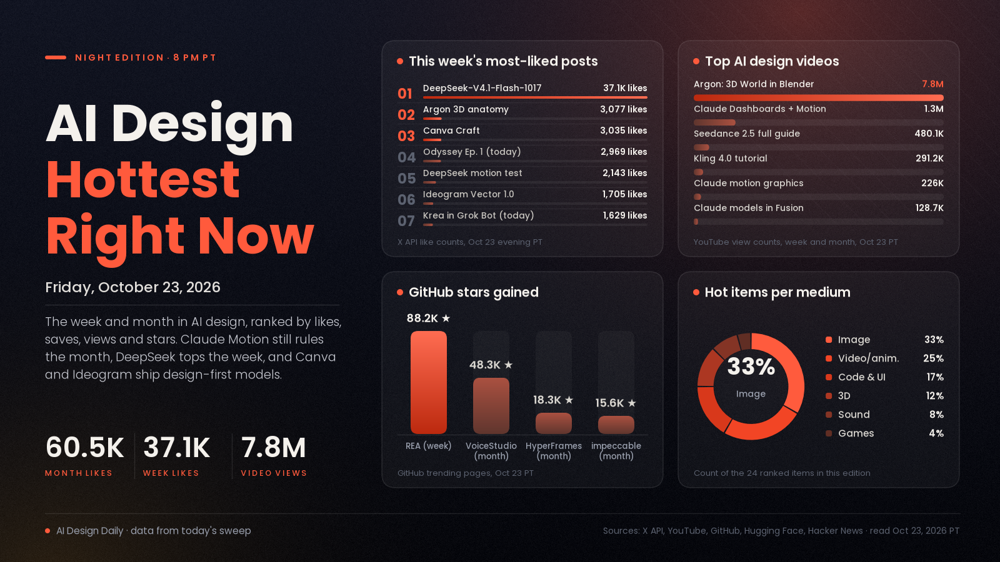

# AI Design Hottest Right Now · Friday, Oct 23, 2026

## Design tools are building their own models, and the open stack is catching up fast

The month still belongs to design you ask for in plain words. Claude Motion and Claude Dashboards, which turn a prompt into an animated explainer or a live dashboard, remain the most-liked and most-saved AI design launch of the past month by a wide margin, and Google's video of Gemini 4 Argon building a 3D world in Blender has now passed 7.7 million views. This week the story shifted to who owns the model. Canva shipped Craft, its first image model built for design work, a day after Ideogram released its first vector model, so two design companies now train models aimed at editable, client-ready output rather than pretty pictures. At the same time the open side surged: DeepSeek's updated open model became the week's biggest launch post, creators are calling it a new benchmark for motion design, and on GitHub an agent toolkit for taking apart apps and games gained more than 88,000 stars in seven days. What it means: the gap between a rough idea and a finished, editable piece keeps shrinking, so the edge is moving to taste, a clear brief and knowing which model to point at which job.

*Engagement figures were read from the X API, YouTube search, GitHub (trending pages and repo data), Hugging Face and Hacker News on the evening of Oct 23 (PT) and will keep changing. "This week" means Oct 16 to 23 and "this month" means Sept 23 to Oct 15. Reddit sent our tools to a login wall, so it isn't counted, and Product Hunt wasn't ranked.*

## 🔥 Blew up today

- [Kimi K3.1 Pro, Moonshot's open-weight model for coding, games and 3D (Kimi)](https://www.kimi.ai/blog/kimi-k3-1-pro), code and 3D model. Moonshot calls it its most capable open-weight model, and [Design Arena says](https://x.com/DesignArena/status/2113684321479557197) it can build projects in Unreal, Unity and Godot and do parametric 3D in Blender and CAD. The signal: [744 points on Hacker News](https://news.ycombinator.com/item?id=50212065) in about ten hours. Try it: give it the same three.js scene or Blender script prompt you use with your usual model and compare the results side by side.
- [Odyssey Episode 1, a full episode made with Grok Imagine (@imagine)](https://x.com/imagine/status/2113712964419063911), video showcase. A cinematic retelling of Homer made with Wonder Studios and director Dev Walker. The signal: 2,969 likes, 1,221 bookmarks and about 127K views in roughly five hours, the most-liked creative post published today. Use it: a reference for how far one small team can push episodic storytelling with AI shots.
- [Krea now works inside Grok Bot (Krea)](https://x.com/krea_ai/status/2113661958331494461), image and video tool. A connector that generates images and video with Krea's model lineup from inside a chat. The signal: 1,629 likes, 844 bookmarks and about 129K views since this morning. Try it: ask for a moodboard and a first clip in the same conversation where you wrote the brief.

## 📈 Hottest this week

- [DeepSeek-V4.1-Flash-1017, open weights (DeepSeek)](https://x.com/deepseek_ai/status/2111375640717033777), code and motion model. An updated open model that DeepSeek says is faster and cheaper than the previous version. The signal: 37,104 likes, 7,021 bookmarks and about 8M views, the biggest launch post of the week by far, #1 on Hugging Face trending with [2,594 likes](https://huggingface.co/deepseek-ai/DeepSeek-V4.1-Flash-1017), and Higgsfield's post calling it [the new state of the art for motion design](https://x.com/higgsfield_ai/status/2111499195257700857) drew 2,143 likes and 1,157 bookmarks. Try it: run the motion-graphics or landing-page prompt you'd give a paid model and compare the cost and the result.
- [REA, Reverse Engineer Anything (GitHub)](https://github.com/morluto/rea), games and code toolkit. An agent toolkit for picking apart how apps and games behave, all the way down to the binaries. The signal: 88,243 stars this week, #1 on GitHub's weekly trending, and Stefan 3D AI's [New Crazy Way To Make Games With AI, /REA + Claude Opus 5.5](https://www.youtube.com/watch?v=6MpHBHw30OE) reached 87,450 views in a day. Try it: study how a game you admire handles a mechanic, then rebuild that mechanic in your own prototype rather than copying assets.
- [Canva Craft, Canva's first image model built for design (Canva)](https://x.com/canva/status/2113348707223753165), image model. A model that plans the layout before it draws, aimed at accurate text and compositions you can keep editing. The signal: 3,035 likes, 1,541 bookmarks and about 1.82M views, and [Design Arena placed it #4](https://x.com/DesignArena/status/2113349031762268476) on its image leaderboard. Try it: it's live in Canva Dream Lab, so give it a poster brief with a real headline and check whether the lettering holds up.
- [Gemini 4 Argon builds an interactive 3D anatomy model (Google DeepMind)](https://x.com/GoogleDeepMind/status/2112974723659247896), 3D showcase. Argon combined three open datasets into a 3D body you can peel back layer by layer, down to a beating heart. The signal: 3,077 likes and 1,181 bookmarks. Use it: a reference for interactive 3D explainers, where you supply the data and the model builds the viewer.
- [Ideogram Vector 1.0, text or image to editable SVG (Ideogram)](https://ideogram.ai/models/vector), image and vector model. Logos, lettering and illustrations come out as separate vector shapes for Illustrator or Figma. The signal: the [launch post](https://x.com/ideogram_ai/status/2113300317584720259) has 1,705 likes, 1,178 bookmarks and about 307K views. Try it: convert one raster logo, then recolour a single shape to confirm the layers are really separate.
- [Kling AI 4.0 Tutorial: How to Make Cinematic AI Videos (FILM CRUX, YouTube)](https://www.youtube.com/watch?v=PzOH1v5GaW0), video tutorial. A walkthrough of Kling 4.0, which went fully live on Oct 15 and opened its API on Oct 21. The signal: 291,206 views in three days, the most-watched AI video tutorial of the week in our sweep, and Kling is now offered unlimited for a limited time on [Runway](https://x.com/runwayml/status/2112925874144030784). Try it: follow the tutorial with one 10-second product shot before committing to a longer piece.
- [How I Make Realistic AI Videos with Seedance 2.5, Full Guide (Dan Kieft, YouTube)](https://www.youtube.com/watch?v=2hJsvDSPWYM), video tutorial. A start-to-finish guide to ByteDance's video model, which [added a native 4K mode today](https://x.com/testingcatalog/status/2113667822132027903) with cheap 480p drafts. The signal: 480,144 views in a week, and JSFILMZ's [Popeye horror short made with Seedance 2.5](https://www.youtube.com/watch?v=nKiaMMDbObI) drew 125,943 views. Try it: draft a shot at 480p, pick the best take, then render only that one at full quality.
- [How to Create Insane Motion Graphics With Claude, for free (Futurepedia, YouTube)](https://www.youtube.com/watch?v=Ge1B-Ok1Pfk), motion tutorial. Prompt-to-animation explainers built in code with Claude. The signal: 226,023 views in four days, and [10 skills and repos that turn Opus 5.5 into a motion studio (@0xMovez)](https://x.com/0xMovez/status/2111841847408517282) has 899 likes and 1,559 bookmarks, saved more than liked. Try it: make a 15-second animated explainer for one product or idea and judge the timing and easing yourself.
- [FLUX 3 Image Klein for ComfyUI (Black Forest Labs, Hugging Face)](https://huggingface.co/black-forest-labs/flux-3-image-klein-comfy), image-editing model. A small open model for image-to-image edits that runs locally. The signal: 534,837 downloads and 1,409 likes on the ComfyUI version, plus [213 points on Hacker News](https://news.ycombinator.com/item?id=50123580). Try it: load it in ComfyUI and run a local edit pass on a product shot without paying per image.
- [Claude Can Now Model in Fusion, Here's How In 1 Minute (Autodesk Fusion, YouTube)](https://www.youtube.com/watch?v=-ONWO9r7PFk), 3D and CAD tutorial. Autodesk's own one-minute demo of Claude building parts inside Fusion. The signal: 128,650 views in four days on Autodesk's channel. Try it: describe a simple bracket or enclosure in plain words and see how close the first model gets.

## 🏆 Hottest this month

- [Claude Dashboards and Claude Motion are in beta (Claude)](https://x.com/claudeai/status/2108271552991252810), motion and UI tool. Ask Claude to turn data into live dashboards and ideas into animated explainers. The signal: 60,545 likes, 39,814 bookmarks and about 11.4M views, the biggest AI design post of the month in our sweep by more than double, and the [launch video](https://www.youtube.com/watch?v=en0GuyhieQk) has 1,300,741 views. Try it: turn one spreadsheet into a live dashboard and one idea into a short animated explainer.
- [Gemini 4 Argon: 3D World in Blender (Google, YouTube)](https://www.youtube.com/watch?v=1dAcJEIlQM8), 3D showcase. Google's demo of Argon building a full 3D world inside Blender through an agent. The signal: 7,785,315 views in ten days, the most-viewed AI design video of the month, and the [launch post](https://x.com/sundarpichai/status/2110038898009407584) has 28,457 likes. Try it: connect Blender to an agent and ask for one small scene, such as a room, before anything bigger.
- [GPT-6 and Intelligent UI rolling out in ChatGPT (OpenAI)](https://x.com/OpenAI/status/2107894997538525580), code and UI news. ChatGPT answers are now laid out by the model as text, charts and interactive pieces. The signal: 24,034 likes, 6,667 bookmarks and about 6.9M views, plus [761 points on Hacker News](https://news.ycombinator.com/item?id=49996425). Why it matters: the model now designs the interface of its own answers, which raises the bar for what a plain web page has to offer.
- [VoiceStudio, an open-source, fully local ElevenLabs alternative (GitHub)](https://github.com/debpalash/VoiceStudio), sound tool. Voice cloning, voice design, video dubbing and audiobooks on your own machine. The signal: 48,343 stars this month, #1 on GitHub's monthly trending, and still gaining 12,526 this week. Try it: dub a short clip into a second language locally before paying for a cloud voice.
- [HyperFrames: write HTML, render video (HeyGen, GitHub)](https://github.com/heygen-com/hyperframes), video and code tool. A framework built for agents that turns web pages into rendered video. The signal: 18,268 stars this month and 5,553 this week. Try it: have an agent build an animated title card as HTML and render it straight to MP4.
- [Qwen-Image-2.1-Turbo, open weights (Qwen)](https://x.com/Alibaba_Qwen/status/2108549075218120949), image model. A sped-up version of Qwen's 7B image model that creates and edits in eight steps. The signal: 5,317 likes and 4,023 bookmarks, one of the most-saved model launches of the month. Try it: use it for fast local drafts, then finish the keepers in a heavier model.
- [Mirelo SFX 2.0 (Mirelo)](https://x.com/MireloAI/status/2110360787780800611), sound tool. A video-to-sound model that watches a clip, removes unwanted music, keeps the dialogue and builds synced sound effects. The signal: 3,840 likes, 4,327 bookmarks and about 1.89M views, saved more often than liked. Try it: run an AI clip with a weak soundtrack through it and compare before and after.
- [anatomy, an agent skill for isometric illustrations (GitHub)](https://github.com/wheresryan22/anatomy), illustration skill. It makes detailed, interactive isometric drawings of real machines and systems as SVGs. The signal: 19,711 stars since Oct 8, and the follow-up [/anatomy-reveal skill (@0xMovez)](https://x.com/0xMovez/status/2110735931401457935) has 1,262 likes and 1,721 bookmarks. Try it: ask for a cutaway of one product and use it as a website hero.
- [impeccable, a design language for AI coding tools (GitHub)](https://github.com/pbakaus/impeccable), code and UI skill. Its authors pitch it as a design language that makes AI coding tools better at design, aimed at less generic interfaces. The signal: 15,614 stars this month, 85,574 in total. Try it: add it to your agent setup before your next landing page and compare against a page built without it.
- [Krea 3, an image model built for editing (Krea)](https://www.krea.ai/krea-3), image model. Fast 2K edits with bounding-box control and multi-turn changes. The signal: the [beta launch post](https://x.com/krea_ai/status/2110760037128012146) has 2,216 likes, 1,092 bookmarks and about 524K views, plus [352 points on Hacker News](https://news.ycombinator.com/item?id=50105648). Try it: generate several angles of one product shot and compare them.
- [MOSS-Image for ComfyUI (Hugging Face)](https://huggingface.co/Comfy-Org/MOSS-Image), image model. A 5B open model known for clean text rendering, packaged for ComfyUI. The signal: 1,606,363 downloads on the ComfyUI package, and it sits near the top of Hugging Face's trending list. Try it: test it on a poster or label where the lettering has to be right.

---
*Method:* a fresh evening sweep of X (lab and creator accounts, keyword search and direct post lookups), YouTube search with week and month filters, GitHub trending (daily, weekly, monthly) and new-repo star counts, Hugging Face trending and Hacker News. Ranked by engagement and velocity, staying power, how widely creators are adopting it, and how new it is. Reddit was blocked by a login wall and Product Hunt wasn't ranked.

Want a deeper dive on any of these, or more of one medium next time? Say the word and the next edition will steer there.
