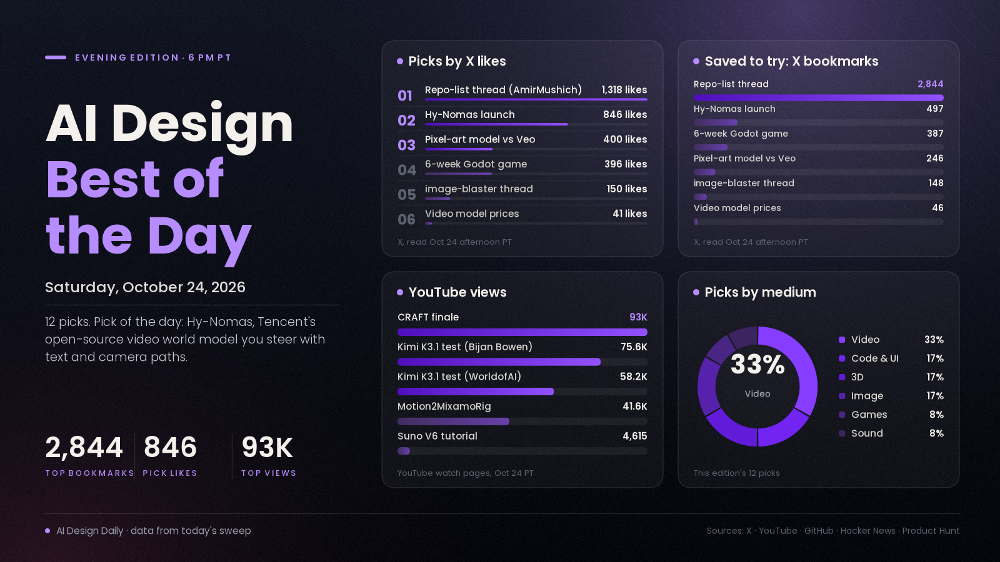

# AI Design Best of the Day · Saturday, Oct 24, 2026

## An open world model you can steer is the story of the day

The pick of the day is Hy-Nomas, Tencent's open-source video world model, which you steer with text prompts and camera paths instead of rendering a clip and hoping. The launch post has 846 likes, 497 bookmarks and about 48.9K views, and a community port already runs it inside ComfyUI with WASD keys. Tencent says it keeps a memory of the world over long runs and is built to run on consumer GPUs; the repo lists a single RTX 4090 with quantised weights. It beats the day's other big stories because it is free, Apache 2.0, and people could build on it within hours. The rest of the list shows what the community is doing with the wider stack: a thread of ten design and motion repos was bookmarked 2,844 times, a no-code builder shared a full eight-step game pipeline, and a free module is making older RTX 30-series cards faster. Treat the world model's quality as unproven: the technical report isn't out yet, and so far the demos come from Tencent and early adopters.

*Engagement figures were read from X, YouTube, GitHub, Hugging Face, Hacker News and Product Hunt on the afternoon of Oct 24 (PT) and will keep changing. Reddit blocked our tools, so it wasn't counted.*

## ⭐ Pick of the day

### 🎬 Video

- [Hy-Nomas, Tencent's open-source interactive video world model (Tencent Hunyuan)](https://github.com/Tencent-Hunyuan/Hy-Nomas), model. Text prompts and camera trajectories steer a generated world segment by segment, with a persistent memory so a place stays consistent, plus LoRA tuning code. Why people are losing it: the [launch post](https://x.com/TencentHunyuan/status/2113676827114053892) has 846 likes, 497 bookmarks and about 48.9K views, and [@LatentSpacer's ComfyUI nodes](https://x.com/LatentSpacer/status/2113759158985998502) let you start from your own image and drive the camera with WASD (the author reports 1.02 s per 720p step on 12 GB cards). The repo has 113 stars and the [Hugging Face weights](https://huggingface.co/tencent/Hy-Nomas) 54 likes, which are modest numbers for a launch that is about a day old. How to try it: the repo says it runs on one RTX 4090 with INT8 weights, an FP8 decoder and optional CPU offload; otherwise try the ComfyUI nodes with your own still image.

## The ranked picks

### 💻 Code and UI

- [10 GitHub repos to turn you into a design and motion studio (@AmirMushich)](https://x.com/AmirMushich/status/2113692928824484078), buzz. A curated list covering impeccable, UI UX Pro Max, Blender MCP, img2threejs, HyperFrames, Penpot, Remotion and more, with the author's star counts for each. Why people are losing it: 1,318 likes, 2,844 bookmarks and about 89.5K views, saved more than twice as often as it was liked. How to use it: pick one repo that fits a job you have this week; [impeccable](https://github.com/pbakaus/impeccable) (86,365 stars on GitHub) is a sensible first install for less generic interfaces.
- [Update: Kimi K3.1 Pro gets its first independent hands-on tests (Bijan Bowen, YouTube)](https://www.youtube.com/watch?v=4MRMLerpcQc), update. Yesterday's open-weight coding and 3D model now has long video tests covering a browser OS, a C++ skate game, a Blender and Godot wrestling game and a CAD engine. Why it's here: 75,600 views in about 20 hours, and [WorldofAI's test](https://www.youtube.com/watch?v=5Z_Y7SRd_oo) reached 58,178. How to use it: watch the test closest to your own work before deciding whether to switch.

### 🎬 Video

- [Why Veo and Sora can't animate pixel art, and the model one developer trained instead (@GrilliotTodd)](https://x.com/GrilliotTodd/status/2114015306633081340), showcase. A side-by-side of Veo and a custom pixel-art animation model: Veo is smooth but loses the pixel grid and the right frame rate, while the trained model keeps both. Why people are losing it: 400 likes, 246 bookmarks and about 22.1K views. How to use it: a reminder that a small model trained for one style can beat a general video model on that style, so test your own niche before assuming the biggest model wins.
- [Seedance 2.5, Kling 4.0 and Wan 3.0 priced per shot (@johnmccoyx)](https://x.com/johnmccoyx/status/2113929742848266708), tutorial. Six video models got the same real TikTok and one new face, ranked with the price of nine seconds: Wan 3.0 Prime $2.32 in first, Kling 4.0 $0.39 second, Seedance 2.5 $6.19 third. Why people are talking: 41 likes and 46 bookmarks, plus [@ohneisserdemy's rule of thumb](https://x.com/ohneisserdemy/status/2114037433650082055) of Seedance for cinematic shots, Kling for UGC and Wan for animation, and Nafay 3D's [Seedance 2.5 vs Kling 4.0 vs Omni 1.1 test](https://www.youtube.com/watch?v=l5IUcC_nS-8) with 2,909 views. Kling 4.0 also [arrived in Luma](https://lumalabs.ai/news/kling-4-in-luma-ai-video) on Oct 23. How to use it: run one 10-second shot through two models and compare cost against quality before committing a project. Prices and rankings are the posters' own.
- [CRAFT (1979), Season 1 finale (LatentDiffusion, YouTube)](https://www.youtube.com/watch?v=tqWFG8GfcRg), showcase. A fan-made, 1970s-style film series inspired by a block-building game, finishing its tenth episode. The creator lists Seedance 2.0 and 2.5 through Runway and other services, Midjourney, Nano Banana Pro, ChatGPT image 2.5 and ElevenLabs, plus manual editing, compositing and sound design, and says the story and script were written by people. Why it's here: 92,959 views since 10 AM PT, the most-viewed video in our sweep.

### 🎮 Games

- [A game in six weeks with no coding background, and the eight-step setup behind it (@rewind02)](https://x.com/rewind02/status/2113934403478999211), tutorial. Run Opus 5.5 in Claude Code inside a Godot project and build one feature at a time. Keep every working image prompt as JSON so the art style doesn't drift, make big 3D assets in Tripo P2, small props in Blender, animate in Cascadeur and log every shader in Obsidian. Why people are losing it: 396 likes, 387 bookmarks and about 16K views. How to use it: copy the prompt-library trick first; it is cheap and keeps a whole game looking like one game. The dev credited is afterthewinddev.

### 🧊 3D

- [image-blaster, one picture becomes meshes, a splat and sound (neilsonnn, GitHub)](https://github.com/neilsonnn/image-blaster), repo/tool. A Claude skill set that turns one image into .glb and .obj models of its objects, a Gaussian splat of the room and ambient audio and sound effects. Why people are losing it: [@0xbobaaa's post](https://x.com/0xbobaaa/status/2113976144269586804) has 150 likes, 148 bookmarks and about 5.1K views; the repo (created in April, MIT) is at 11,971 stars. It needs World Labs and FAL API keys, and the "under 5 minutes" figure is the author's own claim. How to try it: drop in a concept painting of a room and see how usable the meshes are in Godot or three.js.
- [New local AI turns any video into Mixamo animation (Stefan 3D AI, YouTube)](https://www.youtube.com/watch?v=58UpDAnbdkM), tutorial. Motion2MixamoRig puts the motion from a video of one person onto a Mixamo character, free and on your own machine. The test took a single drawing to a rigged 3D character, with the raw idle and dance shown next to versions cleaned up in Blender. Why it's here: 41,599 views in about 11 hours. How to use it: film yourself acting out a move and clean it up in Blender; the raw output was rough.

### 🖼️ Image

- [gpu-unlock, free faster BF16 maths on RTX 30-series cards (Zagitta, GitHub)](https://github.com/Zagitta/gpu-unlock), repo/tool. A Linux module that raises how fast older RTX 30-series cards issue FP16/BF16 maths, which speeds up local image and video models. Why people are losing it: 2,844 stars in six days and [162 points on Hacker News](https://news.ycombinator.com/item?id=50219700); a [port for RTX 4090 and 4070 Ti SUPER](https://github.com/JustAResearcher/gpu-unlock-ada) has 696 stars after one day. [Notebookcheck's coverage](https://www.notebookcheck.net/Nvidia-RTX-3090-performance-nearly-doubles-with-free-GPU-unlock-but-there-s-a-catch.1432805.0.html) notes a catch, and the project calls itself experimental. How to try it: read the README first, then time one BF16 workflow before and after.
- [Fibo 2.0 for ComfyUI, an open image and edit model (Comfy-Org, Hugging Face)](https://huggingface.co/Comfy-Org/Fibo-2.0), model. Bria's text-to-image and edit models, repackaged for ComfyUI. Why it's here: 111,611 downloads in the last month and 161 likes. Check the licence first: it is CC BY-NC 4.0, so non-commercial only. How to try it: follow the folder layout on the model page and run an edit pass on a photo.

### 🔊 Sound

- [ElevenLabs Realtime, voice-agent models with 570 ms to first audio (Product Hunt)](https://www.producthunt.com/posts/elevenlabs-realtime), news. Two speech-to-speech models, Mini for natural conversation and Max for harder tasks, covering 90+ languages through ElevenAgents or an OpenAI-compatible Realtime API. Why people are talking: 185 points on Product Hunt's daily board. The latency figures are ElevenLabs' own. How to use it: a candidate voice for interactive characters and installations. For music, The Mix University's [Suno V6 tutorial](https://www.youtube.com/watch?v=zxHGpAE4hJo) reached 4,615 views on prompts and arrangement tricks to avoid samey songs.

---
*Method:* the 27 X posts gathered for this edition were each opened and their metrics re-read, then checked against a fresh sweep of YouTube, GitHub (trending pages and repo data), Hugging Face trending, Hacker News and Product Hunt, with web searches for sound. Ranked by engagement and velocity, how many creators are copying it, and how new it is. The most-liked image posts today were Nano Banana Pro prompt sets built on celebrity likenesses, which we left out. Seedance 2.5 showcase clips (up to 372 likes) added little beyond hype. Reddit blocked our tools, and sound was thin on X, so the sound pick comes from Product Hunt and YouTube.

Say the word and I'll steer the next edition there.
