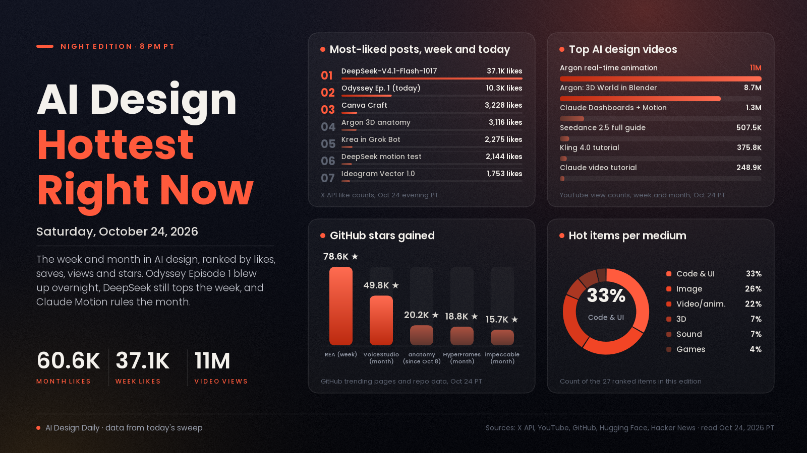

# AI Design Hottest Right Now · Saturday, Oct 24, 2026

## An AI-made episode took off overnight, and the tools aimed at finished work keep multiplying

The biggest mover of the last 24 hours is Odyssey Episode 1, a series episode from the Grok Imagine account whose post has climbed to 10,308 likes, 4,969 bookmarks and about 1.86M views. This week the pattern was design tools building for finished, editable work: Canva's first image model, Craft, hit 3,228 likes and 1.87M views, Ideogram's vector model reached 546K views, and Figma shipped Code Layers that turn a design layer into interactive code. At the same time the open stack kept gaining ground: DeepSeek's updated open model remains the week's biggest launch post at 37,122 likes, Kimi K3.1 Pro passed 1,000 points on Hacker News, and a free unlock for older RTX 30-series cards is at 3,153 stars after six days. The month is still shaped by prompt-to-motion and prompt-to-3D, led by Claude Dashboards and Claude Motion and by Google's Gemini 4 Argon demos, which have passed 10.9M and 8.7M views. What it means: the quick demo is no longer the hard part, so the edge is moving to who can hand over something a client can edit.

*Engagement figures were read from the X API, YouTube search, GitHub (trending pages and repo data), Hugging Face and Hacker News on the evening of Oct 24 (PT) and will keep changing. "This week" means Oct 17 to 24 and "this month" means Sept 24 to Oct 16. Reddit sent our tools to a login wall, so it isn't counted, and Product Hunt wasn't ranked.*

## 🔥 Blew up today

- [Odyssey Episode 1, a series episode made with Grok Imagine (@imagine)](https://x.com/imagine/status/2113712964419063911), video showcase. The first episode of an Odyssey series from the Grok Imagine account. The signal: 10,308 likes, 4,969 bookmarks and about 1.86M views, up from about 3,000 likes at 8 PM last night. Use it: a reference for how far episodic AI video has come, and a model of how a launch episode can be packaged.
- [10 GitHub repos to turn you into a design and motion studio (@AmirMushich)](https://x.com/AmirMushich/status/2113692928824484078), code and motion buzz. A list covering impeccable, UI UX Pro Max, Blender MCP, HyperFrames, Penpot, Remotion and more, with the author's star counts. The signal: 1,370 likes, 2,925 bookmarks and about 92.3K views, saved more than twice as often as liked. Try it: pick the one repo that fits a job you have this week.
- [Kimi K3.1 Pro, Moonshot's open-weight model for coding and 3D (Kimi)](https://www.kimi.ai/blog/kimi-k3-1-pro), code and 3D model. Moonshot calls it its most capable open-weight model, and [Design Arena says](https://x.com/DesignArena/status/2113684321479557197) it builds projects in Unreal, Unity and Godot. The signal: 1,060 points on [Hacker News](https://news.ycombinator.com/item?id=50212065) and 75,600 views on Bijan Bowen's [hands-on test](https://www.youtube.com/watch?v=4MRMLerpcQc). Try it: give it the landing-page or Blender prompt you use with your usual model and compare.
- [Why Veo and Sora can't animate pixel art, and the model one developer trained (@GrilliotTodd)](https://x.com/GrilliotTodd/status/2114015306633081340), video showcase. A side-by-side of Veo and a custom pixel-art animation model; Veo is smooth but loses the pixel grid and frame rate. The signal: 527 likes, 334 bookmarks and about 31.5K views since this morning. Use it: a reminder that a small model trained on one style can beat a big general model on that style.
- [gpu-unlock, free faster BF16 maths on RTX 30-series cards (GitHub)](https://github.com/Zagitta/gpu-unlock), image and video tool. A Linux module that raises how fast older cards issue FP16/BF16 maths, which speeds up local image and video models. The signal: 3,153 stars in six days and 195 points on [Hacker News](https://news.ycombinator.com/item?id=50219700). Try it: read the README and its caveats first (it calls itself experimental), then time one BF16 workflow before and after.

## 📈 Hottest this week

- [DeepSeek-V4.1-Flash-1017, open weights (DeepSeek)](https://x.com/deepseek_ai/status/2111375640717033777), code and motion model. An updated open model that DeepSeek says has stronger benchmark performance. The signal: 37,122 likes, 7,019 bookmarks and about 8.0M views, the biggest launch post of the week by far, with [2,796 likes on Hugging Face](https://huggingface.co/deepseek-ai/DeepSeek-V4.1-Flash-1017), and Higgsfield's post calling it [the new state of the art for motion design](https://x.com/higgsfield_ai/status/2111499195257700857) has 2,144 likes and 1,157 bookmarks. Try it: run your motion-graphics or landing-page prompt and compare cost and result with a paid model.
- [REA, Reverse Engineer Anything (GitHub)](https://github.com/morluto/rea), games and code toolkit. An agent toolkit for picking apart how apps and games behave, down to native binaries. The signal: 78,562 stars this week and #1 on GitHub's weekly trending, and Stefan 3D AI's [reverse-engineering video](https://www.youtube.com/watch?v=6MpHBHw30OE) has 118,252 views. Try it: study how a game you admire handles one mechanic, then rebuild that mechanic in your own prototype rather than copying assets.
- [Canva Craft, Canva's first image model built for design (Canva)](https://x.com/canva/status/2113348707223753165), image model. It plans the layout before it draws, aimed at accurate text and editable compositions. The signal: 3,228 likes, 1,639 bookmarks and about 1.87M views, and [Design Arena placed it #4](https://x.com/DesignArena/status/2113349031762268476) on its image leaderboard. Try it: give it a poster brief with a real headline and check whether the lettering holds up.
- [Gemini 4 Argon builds an interactive 3D anatomy model (Google DeepMind)](https://x.com/GoogleDeepMind/status/2112974723659247896), 3D showcase. Argon combined three open datasets into a 3D body you can peel back layer by layer. The signal: 3,116 likes and 1,210 bookmarks. Use it: a reference for interactive 3D explainers where you supply the data and the model builds the viewer.
- [Ideogram Vector 1.0, text or image to editable SVG (Ideogram)](https://x.com/ideogram_ai/status/2113300317584720259), image and vector model. Logos, lettering and illustrations come out as separate vector shapes. The signal: 1,753 likes, 1,207 bookmarks and about 546K views. Try it: convert one raster logo, then recolour a single shape to confirm the layers are separate.
- [Krea now works inside Grok Bot (Krea)](https://x.com/krea_ai/status/2113661958331494461), image and video tool. A connector that generates images and video with Krea's models from inside a chat. The signal: 2,275 likes, 1,288 bookmarks and about 203K views. Try it: ask for a moodboard and a first clip in the same conversation where you wrote the brief.
- [Kling AI 4.0 Tutorial: How to Make Cinematic AI Videos (FILM CRUX, YouTube)](https://www.youtube.com/watch?v=PzOH1v5GaW0), video tutorial. A walkthrough of Kling 4.0. The signal: 375,751 views in four days, the most-watched AI video tutorial of the week in our sweep, and Runway offers [unlimited Kling 4](https://x.com/runwayml/status/2112925874144030784) on its Max and Team plans. Try it: follow it with one 10-second product shot before committing to a longer piece.
- [I Made A $1200 Popeye Horror Short Film Using Seedance 2.5 (JSFILMZ, YouTube)](https://www.youtube.com/watch?v=nKiaMMDbObI), video showcase. A short film with the creator's own cost in the title. The signal: 170,057 views in six days, and Seedance 2.5 [added a 4K mode](https://x.com/testingcatalog/status/2113667822132027903) with cheap drafts (259 likes). Try it: draft at low resolution first and render only the keeper at full quality.
- [Claude Makes a New Kind of Video, Full Tutorial (Futurepedia, YouTube)](https://www.youtube.com/watch?v=Ge1B-Ok1Pfk), motion tutorial. Prompt-to-animation explainers built in code with Claude. The signal: 248,923 views in five days, and [@0xMovez's skills thread](https://x.com/0xMovez/status/2111841847408517282) has 900 likes and 1,571 bookmarks, saved more than liked. Try it: make a 15-second animated explainer for one idea and judge the timing yourself.
- [Code Layers in Figma, turn a design layer into interactive code (Figma)](https://x.com/figma/status/2113330876407054503), UI tool. Capture what's live on your site as a code layer, or duplicate one to explore variations. The signal: 328 likes, 159 bookmarks and about 27.6K views; the [iPhone Duo presets post](https://x.com/figma/status/2113662622373736559) from the same account has 875 likes. Try it: capture one live page and iterate on it without leaving the canvas.
- [FLUX 3 Image Klein for ComfyUI (Black Forest Labs, Hugging Face)](https://huggingface.co/black-forest-labs/flux-3-image-klein-comfy), image-editing model. A small open model for local image-to-image edits. The signal: 590,742 downloads, 1,507 likes and [213 points on Hacker News](https://news.ycombinator.com/item?id=50123580). Try it: run a local edit pass on a product shot without paying per image.

## 🏆 Hottest this month

- [Claude Dashboards and Claude Motion are in beta (Claude)](https://x.com/claudeai/status/2108271552991252810), motion and UI tool. Ask Claude to turn data into live dashboards and ideas into animated explainers. The signal: 60,551 likes, 39,782 bookmarks and about 11.4M views, the biggest AI design post of the month in our sweep, and the [launch video](https://www.youtube.com/watch?v=en0GuyhieQk) has 1,318,562 views. Try it: turn one spreadsheet into a dashboard and one idea into a short explainer.
- [Building Real-Time Animation with Gemini 4 Argon (Google Antigravity, YouTube)](https://www.youtube.com/watch?v=T2Wfds62ZjM), code and UI showcase. Google's demo of Argon building real-time animation as code. The signal: 10,966,208 views in 11 days, the most-viewed AI design video of the month in our sweep. Try it: ask a model for one small interactive sketch and iterate on it a line at a time.
- [Gemini 4 Argon: 3D World in Blender (Google, YouTube)](https://www.youtube.com/watch?v=1dAcJEIlQM8), 3D showcase. Argon building a 3D world inside Blender through an agent. The signal: 8,747,148 views in 11 days, and the [launch post](https://x.com/sundarpichai/status/2110038898009407584) has 28,459 likes and about 6.0M views. Try it: connect Blender to an agent and ask for one small scene, such as a room, before anything bigger.
- [GPT-6 and Intelligent UI rolling out in ChatGPT (OpenAI)](https://x.com/OpenAI/status/2107894997538525580), code and UI news. ChatGPT answers are laid out by the model as text, charts and interactive pieces. The signal: 24,063 likes, 6,663 bookmarks and about 6.9M views, plus [761 points on Hacker News](https://news.ycombinator.com/item?id=49996425). Why it matters: the model now designs the interface of its own answers.
- [VoiceStudio, an open-source, fully local ElevenLabs alternative (GitHub)](https://github.com/debpalash/VoiceStudio), sound tool. Voice cloning, voice design, video dubbing and audiobooks on your own machine. The signal: 49,780 stars this month, #1 on GitHub's monthly trending. Try it: dub a short clip into a second language locally before paying for a cloud voice.
- [HyperFrames: write HTML, render video (HeyGen, GitHub)](https://github.com/heygen-com/hyperframes), video and code tool. A framework built for agents that turns web pages into rendered video. The signal: 18,759 stars this month and 5,633 this week on GitHub trending. Try it: have an agent build an animated title card as HTML and render it to MP4.
- [Qwen-Image-2.1-Turbo, open weights (Qwen)](https://x.com/Alibaba_Qwen/status/2108549075218120949), image model. A sped-up open image model that creates and edits in eight steps. The signal: 5,317 likes and 4,014 bookmarks. Try it: use it for fast local drafts, then finish the keepers in a heavier model.
- [Mirelo SFX 2.0 (Mirelo)](https://x.com/MireloAI/status/2110360787780800611), sound tool. A video-to-sound model that watches a clip and builds synced sound effects. The signal: 3,839 likes, 4,326 bookmarks and about 1.89M views, saved more often than liked. Try it: run an AI clip with a weak soundtrack through it and compare before and after.
- [anatomy, an agent skill for isometric illustrations (GitHub)](https://github.com/wheresryan22/anatomy), illustration skill. It makes detailed, interactive isometric drawings of real machines and systems as SVGs. The signal: 20,185 stars since Oct 8, and the [/anatomy-reveal follow-up](https://x.com/0xMovez/status/2110735931401457935) has 1,263 likes and 1,721 bookmarks. Try it: ask for a cutaway of one product and use it as a website hero.
- [impeccable, a design language for AI coding tools (GitHub)](https://github.com/pbakaus/impeccable), code and UI skill. Its authors pitch it as a way to make AI coding tools better at design. The signal: 15,700 stars this month and 86,476 in total. Try it: add it to your agent setup before your next landing page and compare against a page built without it.
- [MOSS-Image for ComfyUI (Hugging Face)](https://huggingface.co/Comfy-Org/MOSS-Image), image model. An open model known for clean text rendering, packaged for ComfyUI. The signal: 1,944,278 downloads and 437 likes on the ComfyUI package. Try it: test it on a poster or label where the lettering has to be right.

---
*Method:* a fresh evening sweep of X (post lookups by ID, including posts from earlier editions), YouTube search with week and month filters, GitHub trending (daily, weekly, monthly) and repo data, Hugging Face trending and Hacker News. Ranked by engagement and velocity, staying power, how widely creators are adopting it, and how new it is. Reddit was blocked by a login wall and Product Hunt wasn't ranked.

Say the word and I'll steer the next edition there.
