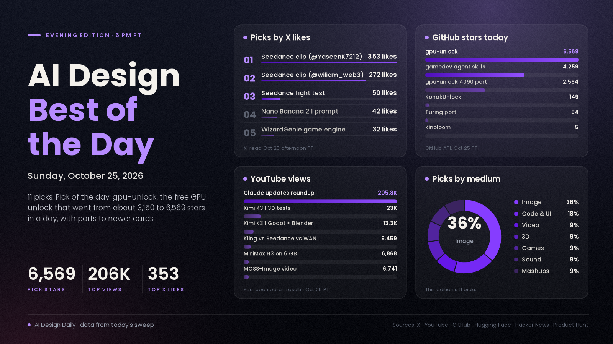

# AI Design Best of the Day · Sunday, Oct 25, 2026

## The free GPU unlock became a movement, and a quiet Sunday made it the clear pick

The pick of the day is the gpu-unlock family. The original module for RTX 30-series cards has gone from about 3,150 GitHub stars on Saturday evening to 6,569 tonight, its Hacker News thread has grown from 195 to 336 points, and a port for RTX 4090 and 4070 Ti SUPER cards has climbed from 696 to 2,564 stars in a day. It matters because it makes the local image and video models designers actually run (MOSS-Image, Qwen-Image, MiniMax H3) faster on cards people already own, at no cost. It is also risky: it is Linux only, the projects call themselves experimental, and the newer ports warn that full-speed tensor cores can damage hardware. The rest of the day was quiet. Lab accounts stayed silent, the most-liked creative posts on X were Seedance 2.5 clips with a few hundred likes each, and the most-watched design-adjacent video was a roundup of Claude updates with 205,848 views in 13 hours.

*Engagement figures were read from X, YouTube, GitHub, Hugging Face, Hacker News and Product Hunt on the afternoon of Oct 25 (PT) and will keep changing. Reddit mostly rate-limited our tools (only r/StableDiffusion and r/singularity answered), and Behance, Dribbble and ArtStation blocked or returned nothing, so none of those are counted.*

## ⭐ Pick of the day

### 🖼️ Image

- [gpu-unlock, a free kernel module that speeds up BF16 maths on RTX 30-series cards (Zagitta, GitHub)](https://github.com/Zagitta/gpu-unlock), repo/tool. It raises the rate at which older NVIDIA cards issue FP16/BF16 maths, which shortens local image and video runs. Why people are losing it: 6,569 stars (up from 4,788 this morning and about 3,150 on Saturday evening) and [336 points on Hacker News](https://news.ycombinator.com/item?id=50219700). Forks are spreading it: [a port for RTX 4090 and 4070 Ti SUPER](https://github.com/JustAResearcher/gpu-unlock-ada) has 2,564 stars, the [Turing port](https://github.com/nlzy/turing-unlock) has 94 and [KohakUnlock](https://github.com/KohakuBlueleaf/KohakUnlock) has 149, and an r/StableDiffusion thread says to [lower your power limit if you unlock a card](https://www.reddit.com/r/StableDiffusion/comments/1xf4gld/if_unlocking_your_card_lodestone_recommends_to/). How to try it: read the README and its warnings first, use a machine you can recover, then time one BF16 workflow before and after. Treat the speed-ups as community reports, not guarantees.

## The ranked picks

### 🎬 Video

- [Seedance 2.5 clips lead the day's most-liked posts (@YaseenK7212, @wiliam_web3)](https://x.com/YaseenK7212/status/2114457595159491015), showcase. The top two creative posts in the X list we were given are short Seedance 2.5 clips: 353 likes, 247 bookmarks and about 3.9K views for [this one](https://x.com/YaseenK7212/status/2114457595159491015), and [272 likes with 171 reposts](https://x.com/wiliam_web3/status/2114418489465442642) for the other. Why it's here: it is where the engagement is, but these posts name the tool and show no process. For comparisons, [@zelia_ai_verse ran one fight prompt through Seedance 2.0, Seedance 2.5 and Kling 4.0](https://x.com/zelia_ai_verse/status/2114352011642826970) (50 likes), and Tao Prompts' [Kling 4.0 vs Seedance 2.5 vs WAN 3.0 test](https://www.youtube.com/watch?v=9Y784B8T4to) has 9,459 views. How to use it: copy a comparison's prompt and run it on your own shot before picking a model.

### 💻 Code and UI

- [Claude 2.0 is Insane, All Updates Explained (Ben AI, YouTube)](https://www.youtube.com/watch?v=J5EbL1UaqG8), buzz. One of the two biggest AI videos in our sweep today, behind only a weekly news roundup (252,772 views). Why it's here: 205,848 views in about 13 hours. We could not read its description, so what it covers beyond its title is unverified. How to use it: check it against Anthropic's own announcements before acting on any claim.
- [Hallmark and impeccable, design skills for coding agents (GitHub)](https://github.com/Nutlope/hallmark), update. Both were on GitHub's daily trending list again, with Hallmark at 33,681 stars and [impeccable](https://github.com/pbakaus/impeccable) at 87,641. Why people are talking: [@Voxyz_ai's post on Hallmark v2](https://x.com/Voxyz_ai/status/2114039214660850098) has 128 likes and 186 bookmarks, more saves than likes. How to try it: per that post, `npx skills add nutlope/hallmark -g`, then run `/hallmark audit` on a page you already built.

### 🖼️ Image

- [MOSS-Image keeps spreading, with a 192-prompt comparison against Kromoss and Krea 2 (r/StableDiffusion)](https://www.reddit.com/r/StableDiffusion/comments/1xfe5qy/moss_vs_kromoss_vs_krea_2_192_images_for_each/), showcase. The poster ran the same 192 prompts through each model and shares a gallery and exact settings (50 steps, CFG 3, 158 s per image). Why it's here: the ComfyUI package of [MOSS-Image](https://huggingface.co/Comfy-Org/MOSS-Image) has 2,161,961 downloads and 450 likes, and Aitrepreneur's [video calling it the best model ever made](https://www.youtube.com/watch?v=1m4qAow11gg) has 6,741 views, which is a title claim, not a measurement. How to try it: start from ComfyUI's [official MOSS-Image template](https://docs.comfy.org/tutorials/image/moss-image/moss-image) and compare it with your current model on a poster brief.
- [Nano Banana 2.1 candid-shot prompt (@Faeiz4Ai)](https://x.com/Faeiz4Ai/status/2114387078653862282), showcase. A prompt share (Arabic text) for turning your photo into a candid, photographer-caught-you-off-guard shot. Why it's here: 42 likes, 28 bookmarks and about 2.9K views, the most-saved image post in the seed. How to use it: copy the prompt structure with your own reference photo and judge the likeness yourself.
- [⏪ Nikon contest winner loses title after scientists spot signs of AI (TechSpot)](https://www.techspot.com/news/114171-nikon-photography-contest-winner-loses-title-after-scientists.html), news. Reports say Nikon disqualified the winner of a microscopy video contest on Oct 9 after scientists questioned the footage; the winner says AI was used only in post-processing. Why people are talking: [128 points and 68 comments on Hacker News](https://news.ycombinator.com/item?id=50229827) today. What it means: proof requirements for AI-assisted work are tightening.

### 🧊 3D

- [Kimi K3.1 Pro gets a wave of 3D and Blender tests (Stefan 3D AI, YouTube)](https://www.youtube.com/watch?v=cxxGMz-YXU0), update. Friday's open-weight coding model is now being tested in Blender and Godot. Why it's here: this video has 22,956 views, and Fazt's [test of Godot games, Blender scenes and spreadsheets](https://www.youtube.com/watch?v=3IWodw_GfCk) has 13,304. How to use it: give it the Blender script task you normally hand to another model and compare.

### 🎮 Games

- [awesome-gamedev-agent-skills, 74 game-dev skills for coding agents (GitHub)](https://github.com/gamedev-skills/awesome-gamedev-agent-skills), repo/tool. Portable skills for Godot, Unity, Unreal, Phaser, PixiJS, three.js, Bevy, pygame, LÖVE and Roblox. Why it's here: 4,259 stars, up from 4,110 this morning. A solo developer's beta [AI game engine](https://x.com/oldgamesnob/status/2114333568738771099) (32 likes, 21 bookmarks) is the same trend, but it is self-promotion. How to try it: add it to Claude Code or Codex and ask for one concrete task in your engine.

### 🧪 Mashups

- [Kinoloom, an open-source local film studio for an 8 GB graphics card (harlixay7, GitHub)](https://github.com/harlixay7/Kinoloom), repo/tool. A web app on top of ComfyUI that takes a story, casts characters and renders the shots with LTX-2.5, MiniMax H3 (bring your own weights) and Qwen-Image 2.1, joining takes in latent space so there is no visible jump. Why it's here: it appeared on [r/StableDiffusion](https://www.reddit.com/r/StableDiffusion/comments/1xfd1tv/i_built_an_opensource_local_film_studio_for_8_gb/) today and has only 5 stars, so the signal is novelty, not popularity. The author says a 16-second take took about 28 minutes on an RTX 3070 and has tested only that machine. Related: CG Pixel's [4K MiniMax H3 on a 6 GB GPU in ComfyUI](https://www.youtube.com/watch?v=sJbhZjAzkE0) has 6,868 views. How to try it: check H3's licence terms for your region first, as the author notes.

### 🔊 Sound

- [VoiceStudio, an open-source local alternative to ElevenLabs (debpalash, GitHub)](https://github.com/debpalash/VoiceStudio), update. Voice cloning, voice design, dubbing and audiobooks on your own machine. Why it's here: 86,734 stars, with 1,588 gained on one daily trending list earlier today. For video makers, [Clips by Plastic](https://www.producthunt.com/products/clips-by-plastic) (a Product Hunt launch, #10 on the Oct 25 board) turns a finished song and your footage into lyric videos cut on the beat. Sound was quiet: we found no new Suno, Udio or ElevenLabs music release dated this week. How to try it: dub a short clip into a second language locally before paying for a cloud voice.

---
*Method:* the 25 X posts supplied by Research were each opened by ID and their metrics re-read, then checked against a fresh sweep of YouTube (last-day uploads), GitHub trending (daily, weekly) and repo data, Hugging Face trending, Hacker News, Product Hunt's Oct 24 and 25 boards, Reddit (r/StableDiffusion and r/singularity only) and web searches for sound and creative-site coverage. Ranked by engagement and velocity, how many creators are copying it, and how new it is. Quiet Sunday: few posts passed 300 likes, so several picks rest on GitHub stars and views. Behance and ArtStation returned 403, Dribbble returned an empty page, and web search found nothing dated today.

Say the word and I'll steer the next edition there.
