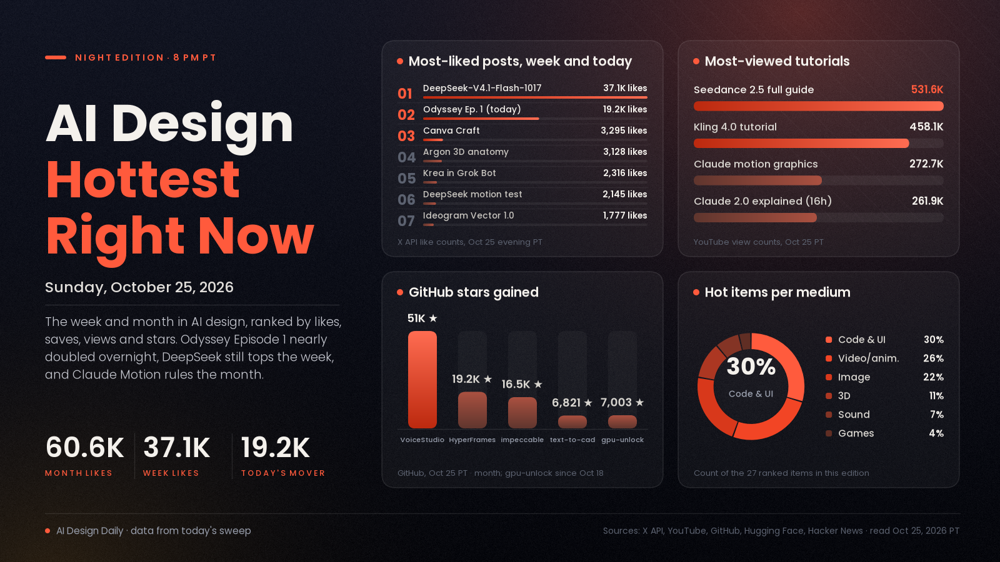

# AI Design Hottest Right Now · Sunday, Oct 25, 2026

## An AI series episode doubled overnight, and design tools for coding agents are the month's fastest climbers

The biggest mover again is Odyssey Episode 1 from the Grok Imagine account, which nearly doubled in a day to 19,210 likes, 12,036 bookmarks and about 5.83M views. On a quiet Sunday the other real spike was explainer video: Ben AI's rundown of the latest Claude updates passed 261,000 views in 16 hours. The week still belongs to finished, editable design work and to the open stack: Canva Craft is at 1.90M views, Ideogram's vector model at 559K, and DeepSeek's updated open model holds the week's biggest launch post at 37,146 likes. Over the month, the strongest staying power is in tools that teach coding agents to design and animate: VoiceStudio gained 50,977 GitHub stars this month, HyperFrames 19,211 and impeccable 16,493, while Claude Dashboards and Claude Motion remain the month's top post at 60,552 likes. What it means: the skills and harnesses around the models are now spreading faster than most single model launches.

*Engagement figures were read from the X API, YouTube search, GitHub (trending pages and repo data), Hugging Face and Hacker News on the evening of Oct 25 (PT) and will keep changing. Two Gemini 4 Argon video counts could not be refreshed tonight and are the figures read on Oct 24, as marked. "This week" means Oct 18 to 25 and "this month" means Sept 25 to Oct 17. Reddit and Product Hunt weren't ranked tonight.*

## 🔥 Blew up today

- [Odyssey Episode 1, a series episode made with Grok Imagine (@imagine)](https://x.com/imagine/status/2113712964419063911), video showcase. The first episode of an Odyssey series from the Grok Imagine account. The signal: 19,210 likes, 12,036 bookmarks and about 5.83M views, up from 10,308 likes and 1.86M views at this time last night. Use it: study how the episode is cut and paced if you plan a multi-part AI series.
- [Claude 2.0 is Insane, All Updates Explained (Ben AI, YouTube)](https://www.youtube.com/watch?v=J5EbL1UaqG8), code and UI buzz. A walkthrough of the latest Claude updates for building and design work. The signal: 261,858 views in about 16 hours, the fastest-rising AI design video in tonight's sweep. Use it: skim it for the one feature that fits a design job you already do.
- [Seedance 2.5 clips lead today's most-saved creative posts (@YaseenK7212)](https://x.com/YaseenK7212/status/2114457595159491015), video showcase. A short Seedance 2.5 clip posted this afternoon, with a [similar post from @wiliam_web3](https://x.com/wiliam_web3/status/2114418489465442642) close behind. The signal: 369 likes and 256 bookmarks in under five hours, and 287 likes and 155 bookmarks for the second. Try it: use these as motion references for your own Seedance tests; the posts don't share prompts.
- [Hallmark, an anti-AI-slop design skill for coding agents (GitHub)](https://github.com/Nutlope/hallmark), code and UI skill. A design skill for Claude Code, Cursor and Codex that pushes generated pages away from generic AI looks. The signal: 1,317 stars today on GitHub's daily trending, 34,010 in total. Try it: build the same landing page with and without it and compare.

## 📈 Hottest this week

- [DeepSeek-V4.1-Flash-1017, open weights (DeepSeek)](https://x.com/deepseek_ai/status/2111375640717033777), code and motion model. An updated open model that DeepSeek says has stronger benchmark performance. The signal: 37,146 likes, 7,013 bookmarks and about 8.0M views, still the week's biggest launch post, with [3,000 likes on Hugging Face](https://huggingface.co/deepseek-ai/DeepSeek-V4.1-Flash-1017); Higgsfield's post calling it [the new state of the art for motion design](https://x.com/higgsfield_ai/status/2111499195257700857) has 2,145 likes. Try it: run your motion-graphics prompt and compare cost and result with a paid model.
- [Canva Craft, Canva's first image model built for design (Canva)](https://x.com/canva/status/2113348707223753165), image model. It plans the layout before it draws, aimed at accurate text and editable compositions. The signal: 3,295 likes, 1,653 bookmarks and about 1.90M views, and [Design Arena placed it #4](https://x.com/DesignArena/status/2113349031762268476) on its image leaderboard. Try it: give it a poster brief with a real headline and check the lettering.
- [Kling AI 4.0 Tutorial: How to Make Cinematic AI Videos (FILM CRUX, YouTube)](https://www.youtube.com/watch?v=PzOH1v5GaW0), video tutorial. A walkthrough of Kling 4.0. The signal: 458,087 views in five days, the most-watched AI video tutorial of the week in our sweep, up from 375,751 last night. Try it: follow it with one 10-second product shot before a longer piece.
- [Gemini 4 Argon builds an interactive 3D anatomy model (Google DeepMind)](https://x.com/GoogleDeepMind/status/2112974723659247896), 3D showcase. Argon combined three open datasets into a 3D body you can peel back layer by layer. The signal: 3,128 likes, 1,215 bookmarks and about 189K views. Use it: a reference for interactive 3D explainers where you supply the data and the model builds the viewer.
- [Krea now works inside Grok Bot (Krea)](https://x.com/krea_ai/status/2113661958331494461), image and video tool. A connector that generates images and video with Krea's models from inside a chat. The signal: 2,316 likes, 1,304 bookmarks and about 209K views. Try it: ask for a moodboard and a first clip in the same conversation as the brief.
- [Ideogram Vector 1.0, text or image to editable SVG (Ideogram)](https://x.com/ideogram_ai/status/2113300317584720259), image and vector model. Logos, lettering and illustrations come out as separate vector shapes. The signal: 1,777 likes, 1,225 bookmarks and about 559K views. Try it: convert one raster logo, then recolour a single shape to confirm the layers are separate.
- [10 GitHub repos to turn you into a design and motion studio (@AmirMushich)](https://x.com/AmirMushich/status/2113692928824484078), code and motion buzz. A list covering impeccable, Blender MCP, HyperFrames, Penpot, Remotion and more. The signal: 1,438 likes and 3,108 bookmarks, saved more than twice as often as liked. Try it: pick the one repo that fits a job you have this week.
- [How to Create Insane Motion Graphics With Claude, for free (Futurepedia, YouTube)](https://www.youtube.com/watch?v=Ge1B-Ok1Pfk), motion tutorial. Prompt-to-animation explainers built in code with Claude. The signal: 272,693 views in six days. Try it: make a 15-second animated explainer for one idea and judge the timing yourself.
- [A first game built in six weeks with no coding background (@rewind02)](https://x.com/rewind02/status/2113934403478999211), games showcase. A creator's account of shipping a game with Claude Opus 5.5 after six weeks. The signal: 930 likes and 1,028 bookmarks, saved more than liked. Use it: a realistic scope reference for a first AI-assisted game.
- [gpu-unlock, faster BF16 maths on RTX 30-series cards (GitHub)](https://github.com/Zagitta/gpu-unlock), image and video tool. A Linux module that raises how fast older cards issue FP16/BF16 maths, which speeds up local image and video models. The signal: 7,003 stars since Oct 18, up from 3,153 last night, and 338 points on [Hacker News](https://news.ycombinator.com/item?id=50219700). Try it: read its caveats first (it calls itself experimental), then time one workflow before and after.
- [Kimi K3.1 Pro, Moonshot's open-weight model for coding and 3D (Kimi)](https://www.kimi.ai/blog/kimi-k3-1-pro), code and 3D model. Moonshot calls it its most capable open-weight model. The signal: 1,081 points on [Hacker News](https://news.ycombinator.com/item?id=50212065). Try it: give it the landing-page or Blender prompt you use with your usual model and compare.

## 🏆 Hottest this month

- [Claude Dashboards and Claude Motion are in beta (Claude)](https://x.com/claudeai/status/2108271552991252810), motion and UI tool. Ask Claude to turn data into live dashboards and ideas into animated explainers. The signal: 60,552 likes, 39,775 bookmarks and about 11.4M views, the biggest AI design post of the month in our sweep. Try it: turn one spreadsheet into a dashboard and one idea into a short explainer.
- [Building Real-Time Animation with Gemini 4 Argon (Google Antigravity, YouTube)](https://www.youtube.com/watch?v=T2Wfds62ZjM), code and UI showcase. Google's demo of Argon building real-time animation as code. The signal: 10,966,208 views as read on Oct 24, the most-viewed AI design video of the month in our sweep. Try it: ask a model for one small interactive sketch and iterate on it.
- [Gemini 4 Argon: 3D World in Blender (Google, YouTube)](https://www.youtube.com/watch?v=1dAcJEIlQM8), 3D showcase. Argon building a 3D world inside Blender through an agent. The signal: 8,747,148 views as read on Oct 24, and the [launch post](https://x.com/sundarpichai/status/2110038898009407584) has 28,452 likes and about 5.97M views. Try it: connect Blender to an agent and ask for one small room first.
- [GPT-6 and Intelligent UI rolling out in ChatGPT (OpenAI)](https://x.com/OpenAI/status/2107894997538525580), code and UI news. ChatGPT answers are laid out by the model as text, charts and interactive pieces. The signal: 24,084 likes, 6,662 bookmarks and about 6.95M views, plus [761 points on Hacker News](https://news.ycombinator.com/item?id=49996425). Why it matters: the model now designs the interface of its own answers.
- [VoiceStudio, an open-source, fully local ElevenLabs alternative (GitHub)](https://github.com/debpalash/VoiceStudio), sound tool. Voice cloning, voice design, video dubbing and audiobooks on your own machine. The signal: 50,977 stars this month and 86,998 in total, top of GitHub's monthly trending. Try it: dub a short clip into a second language locally.
- [How I Make Realistic AI Videos with Seedance 2.5, Full Guide (Dan Kieft, YouTube)](https://www.youtube.com/watch?v=2hJsvDSPWYM), video tutorial. A full guide to realistic shots in Seedance 2.5. The signal: 531,593 views in nine days, the most-viewed Seedance tutorial in our sweep. Try it: draft at low resolution first and render only the keeper at full quality.
- [HyperFrames: write HTML, render video (HeyGen, GitHub)](https://github.com/heygen-com/hyperframes), video and code tool. A framework built for agents that turns web pages into rendered video. The signal: 19,211 stars this month and 5,612 this week, 72,224 in total. Try it: have an agent build an animated title card as HTML and render it to MP4.
- [impeccable, a design language for AI coding tools (GitHub)](https://github.com/pbakaus/impeccable), code and UI skill. Its authors pitch it as a way to make AI coding tools better at design. The signal: 16,493 stars this month, 87,830 in total, and still on today's daily trending. Try it: add it to your agent setup before your next landing page.
- [anatomy, an agent skill for isometric illustrations (GitHub)](https://github.com/wheresryan22/anatomy), illustration skill. It makes detailed, interactive isometric drawings of real machines and systems as SVGs. The signal: 20,648 stars since Oct 8, and the [/anatomy-reveal follow-up](https://x.com/0xMovez/status/2110735931401457935) has 1,264 likes and 1,726 bookmarks. Try it: ask for a cutaway of one product as a website hero.
- [Mirelo SFX 2.0 (Mirelo)](https://x.com/MireloAI/status/2110360787780800611), sound tool. A video-to-sound model that watches a clip and builds synced sound effects. The signal: 3,837 likes, 4,318 bookmarks and about 1.89M views, saved more often than liked. Try it: run an AI clip with a weak soundtrack through it and compare.
- [text-to-cad, CAD skills for coding agents (GitHub)](https://github.com/earthtojake/text-to-cad), 3D tool. Its tagline: give your agent CAD superpowers. The signal: 6,821 stars this month on GitHub's monthly trending, 23,146 in total. Try it: ask an agent for one simple printable part and open it in your CAD tool.
- [MOSS-Image for ComfyUI (Hugging Face)](https://huggingface.co/Comfy-Org/MOSS-Image), image model. An open model known for clean text rendering, packaged for ComfyUI. The signal: 2,161,961 downloads and 453 likes on the ComfyUI package. Try it: test it on a poster or label where the lettering has to be right.

---
*Method:* a fresh evening sweep of X (post lookups by ID, including posts from earlier editions), YouTube search, GitHub trending (daily, weekly, monthly) and repo data, Hugging Face and Hacker News. Ranked by engagement and velocity, staying power, how widely creators are adopting it, and how new it is. Reddit and Product Hunt weren't ranked tonight.

Say the word and I'll steer the next edition there.
