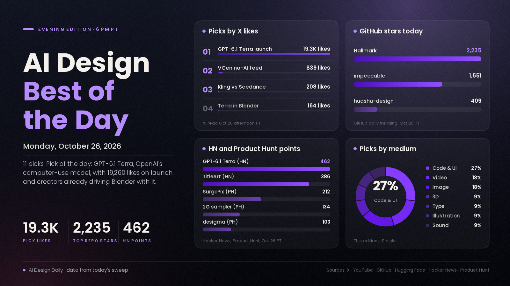

# AI Design Best of the Day · Monday, Oct 26, 2026

## OpenAI's new computer-use model became the day's design story, and agents started driving Blender

The pick of the day is GPT-6.1 Terra, which OpenAI released this morning. It is a cheaper, faster model built to read what is on screen and work inside apps, and OpenAI's own examples are design jobs: turning architectural and technical drawings into 3D models, editing videos and reviewing an animated film shot by shot. The launch post has 19,260 likes, 3,000 bookmarks and about 2.15M views in under six hours, and the Hacker News thread has 462 points. It matters for designers because creators were already using it in Blender within three hours: Matt Workman's roadster pipeline (image, Blender model, camera move, then a photoreal pass) drew 164 likes and 122 bookmarks. The benchmarks and prices are OpenAI's own claims. The rest of the day backs up the agent theme. Hallmark, a design skill that keeps coding agents from producing generic AI pages, topped GitHub's daily trending list with 2,235 new stars, and Kling 4.0 reached more apps as creators kept testing it against Seedance 2.5.

*Engagement figures were read from X, YouTube, GitHub, Hugging Face, Hacker News and Product Hunt on the afternoon of Oct 26 (PT) and will keep changing. Reddit mostly rate-limited our tools (only r/StableDiffusion and r/aivideo answered, without vote counts), and Behance and ArtStation returned 403 while Dribbble returned an empty page, so none of those are counted.*

## ⭐ Pick of the day

### 💻 Code and UI

- [GPT-6.1 Terra, a fast computer-use model that works inside your apps (OpenAI)](https://openai.com/index/introducing-gpt-6-1-terra/), model/news. Per OpenAI, it understands what's on screen and takes actions across apps. The company's examples include turning architectural drawings into a 3D model, editing videos and logging an animated film shot by shot, and it says Terra matches GPT-6 Astra on its Agents' Last Exam benchmark at one-tenth the price per token. Why people are losing it: [OpenAI's launch post](https://x.com/OpenAI/status/2114780711664398349) has 19,260 likes, 3,000 bookmarks and about 2.15M views, [Sam Altman's post](https://x.com/sama/status/2114818620782248024) has 3,598 likes, and the [Hacker News thread](https://news.ycombinator.com/item?id=50248124) has 462 points. How to try it: it is live for Plus, Pro, Enterprise and Edu users in ChatGPT Work and Codex, and in the API as `gpt-6.1-terra` at $1 per million input tokens and $5 per million output tokens. Give it one boring task in your own design tool first, and treat the benchmark numbers as OpenAI's claims.

## The ranked picks

### 🧊 3D

- [GPT-6.1 Terra builds and animates a car in Blender (@mattworkman)](https://x.com/mattworkman/status/2114825275167175105), workflow. A full pipeline run through Codex with the fal plugin: generate an image of a roadster, have Terra model the car in Blender and animate the camera, turn the first CG frame photoreal with GPT Image 2.5, then use Seedance 2.5 reference-to-video to make the whole 3D render photoreal. Why it's here: 164 likes, 122 bookmarks and about 15K views within three hours of the launch, and he says it used only 3% of his Pro plan. How to try it: copy the order of steps with a simple prop before you try a full scene.

### 💻 Code and UI

- [Hallmark tops GitHub's daily trending, with impeccable close behind (Nutlope, GitHub)](https://github.com/Nutlope/hallmark), update. Hallmark is a design skill for Claude Code, Cursor and Codex that replaces template defaults with real hierarchy, type and spacing. Why it's here: 2,235 stars today, the most of any repo on the daily list, and 36,224 in total, up from 34,010 last night. [impeccable](https://github.com/pbakaus/impeccable) added 1,551 today (89,134 in total) and [huashu-design](https://github.com/alchaincyf/huashu-design) 409. How to try it: install one, build the same landing page with and without it, and compare.
- [desigma, a free, open-source Figma alternative written in Rust (Product Hunt)](https://www.producthunt.com/products/desigma), tool. An Apache-licensed design editor whose [code is on GitHub](https://github.com/deepfounder-ai/desigma). Why it's here: 103 points on today's Product Hunt board and 683 GitHub stars for a repo made on Oct 11. How to try it: open a simple frame in it and see whether it covers what you use Figma for before moving anything real.

### 🎬 Video

- [Kling 4.0 vs Seedance 2.5, same prompt (@AIwithkhan)](https://x.com/AIwithkhan/status/2114688186937192711), showcase. A side-by-side of one prompt in both models. Why it's here: 208 likes and about 21.6K views, the most-liked video post in our X list, as Kling 4.0 spreads to more apps (the [Deevid launch post](https://x.com/Deevid_AI/status/2114718692353446010) has about 113K views; per the makers, up to 30-second clips, 10 keyframes and 15 references). Zinho Automates' [Kling 4.0 vs Seedance 2.5 battle](https://www.youtube.com/watch?v=p_kMQOMRDhI) has 13,396 views in about seven hours, JSFILMZ's [8-model showdown](https://x.com/JSFILMZ0412/status/2114712666686316552) has 46 bookmarks, and one creator says the same clip cost [$4 with Kling 4.0 and $13 with Seedance 2.5](https://x.com/simonecanciello/status/2114734686954205368), which is his own figure. How to use it: run your own hardest shot through both before you commit credits.
- [I Made an Editor and AI Edit the Same Video (Ali Abdaal, YouTube)](https://www.youtube.com/watch?v=C0jOKDJtK9s), buzz. A head-to-head between a human editor and AI editing on the same footage. Why it's here: 48,346 views in about 10 hours, the most-watched AI design video in tonight's sweep. We could not read its description, so the result is described from the title alone. How to use it: watch for the steps where the AI cut needed a human, before you hand over your own edits.

### 🖼️ Image

- [SurgePix, AI images you can keep editing layer by layer (Product Hunt)](https://www.producthunt.com/products/surgepix), tool. Per the makers, you can edit any layer, swap text, repaint a region and stay on brand with a brand kit, and open-source agent skills let Claude Code and Cursor make and edit visuals for you. Why it's here: 212 points, second on today's Product Hunt board. How to try it: take one social graphic through a text swap and a regional repaint and check whether the brand colours hold.
- [MOSS-Image edit vs Fibo-2.0-edit (r/StableDiffusion)](https://www.reddit.com/r/StableDiffusion/comments/1xg526w/moss_image_edit_vs_fibo20edit/), showcase. A side-by-side of two open image-editing models on the same edits. Why it's here: it is one of several MOSS posts on r/StableDiffusion today, alongside a [sharpness LoRA](https://www.reddit.com/r/StableDiffusion/comments/1xg55p3/moss_sharpness_lora_blur_what_blur/), and the ComfyUI package of [Fibo-2.0](https://huggingface.co/Comfy-Org/Fibo-2.0) has 146,049 downloads and is on Hugging Face's trending list. We couldn't read vote counts. How to try it: run one product-photo edit through each and compare the edges.

### 🔤 Type

- [TitleArt, make text like it's 1997 (Show HN)](https://titleart.dvy.io/), tool. A browser editor that brings back WordArt-style text: gradients, 3D shadows, arcs and waves, with PNG, SVG, GIF and video export. Not an AI tool, but the design post of the day. Why people are loving it: [386 points and 42 comments on Hacker News](https://news.ycombinator.com/item?id=50238708). How to try it: make one retro title card for a Halloween post.

### ✏️ Illustration

- [VGen shows a way to remove AI from your feed (@_VGen_)](https://x.com/_VGen_/status/2114772734341480499), counterpoint. A short clip from the artist-commissions site about filtering AI out of what you see. Why it's here: 839 likes, 66 reposts and about 16K views, the most-liked post in our X list today. What it means: artist platforms are treating "no AI" as a feature, so label AI work clearly when you share it there.

### 🔊 Sound

- [2G, a sampler that imagines neural synthesis in the early 2000s (Product Hunt)](https://www.producthunt.com/products/2g), tool. Describe a sound and 2G makes it, then you edit it and play it from your computer keyboard, or load your own audio. Per the makers it is free for Windows and macOS as a plugin or standalone app with 20 starter credits, and Studio is $10 a month for 200. Why it's here: 134 points on today's Product Hunt board. Sound was otherwise quiet: we found no new Suno, Udio or ElevenLabs release dated today. How to try it: make one UI sound or sting for a video and drop it into your timeline.

---
*Method:* the 28 X posts gathered for this edition were each opened by ID and their metrics re-read, then checked against a fresh sweep of X launch posts, YouTube (last-day uploads), GitHub trending (daily, weekly) and repo data, Hugging Face trending, Hacker News, Product Hunt's Oct 26 board, Reddit (r/StableDiffusion and r/aivideo only) and web searches for sound. Ranked by engagement and velocity, how many creators are copying it, and how new it is. Most of the 28 posts were Nano Banana and Kling or Seedance shares with under 100 likes; the most-liked image posts were celebrity portraits, which we left out. Behance and ArtStation returned 403, Dribbble returned an empty page, and Reddit's other design subreddits rate-limited us.

Say the word and I'll steer the next edition there.
