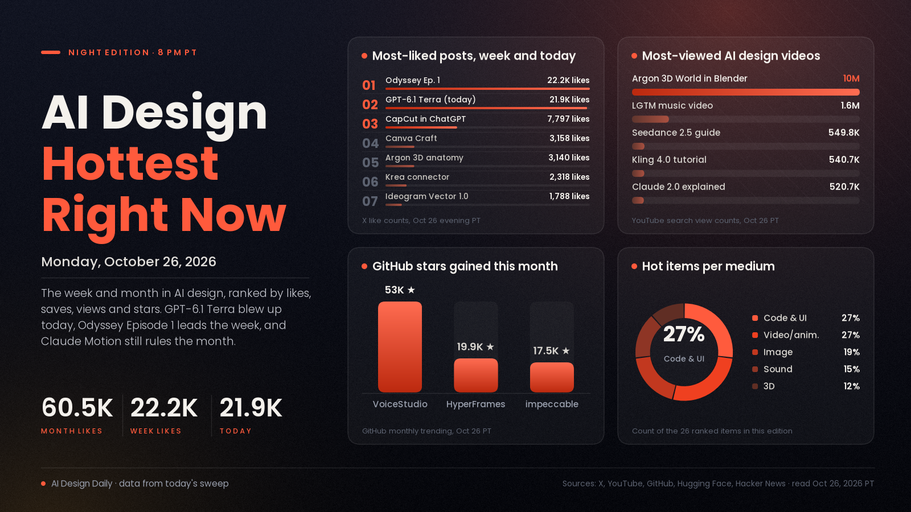

# AI Design Hottest Right Now · Monday, Oct 26, 2026

## Computer-use models moved into design software today, and agent design skills keep owning the month

Today's one real explosion is GPT-6.1 Terra, OpenAI's cheaper model for working inside apps. Its launch post reached 21,938 likes and about 2.93M views in under nine hours, the launch video passed 270,900 views in eight hours, and creators were already driving Blender with it the same afternoon. That fits the week's pattern: the biggest gains are going to tools that sit inside the apps and chats designers already use, like CapCut's coming ChatGPT plugin (7,797 likes) and Krea's chat connector, while Grok Imagine's Odyssey Episode 1 is still the week's most-liked creative post at 22,222 likes and about 7.27M views. Over the month, staying power belongs to work that teaches agents to design and animate: Claude Dashboards and Claude Motion still lead at 60,543 likes, and VoiceStudio, HyperFrames and impeccable gained a combined 90,392 GitHub stars this month. Two more design skills, Hallmark and the new MotionSites skill, were the day's fastest risers in that lane.

*Engagement figures were read from X (post lookups by ID), YouTube search results, GitHub trending pages and repo data, Hugging Face and Hacker News on the evening of Oct 26 (PT) and will keep changing. "This week" means Oct 19 to 26 and "this month" means Sept 26 to Oct 18. Reddit refused our requests tonight and Product Hunt wasn't ranked, so neither is counted.*

## 🔥 Blew up today

- [GPT-6.1 Terra, a fast computer-use model (OpenAI)](https://x.com/OpenAI/status/2114780711664398349), code, UI and 3D model. A cheaper model that reads what's on screen and acts across apps; OpenAI's own examples include turning drawings into 3D models and editing video. The signal: 21,938 likes, 3,421 bookmarks and about 2.93M views since this morning, [Sam Altman's post](https://x.com/sama/status/2114818620782248024) at 5,109 likes, the [launch video](https://www.youtube.com/watch?v=tTuk4pGnT0A) at 270,900 views in about eight hours, and 519 points on [Hacker News](https://news.ycombinator.com/item?id=50248124). Matt Workman's [Blender car build with Terra](https://x.com/mattworkman/status/2114825275167175105) has 326 likes and 276 bookmarks. Try it: hand it one tedious, repeatable task in your own design app and watch every step; the benchmark claims are OpenAI's.
- [The MotionSites skill, 700+ animated site designs in one agent skill (@viktoroddy)](https://x.com/viktoroddy/status/2114684257109254434), code and UI skill. A free, open-source skill for Claude Code, Codex and Cursor that steers agents toward cinematic, animated landing pages, with [the code on GitHub](https://github.com/Motionsites-AI/claude-skill). The signal: 897 likes, 1,340 bookmarks and about 60K views since this morning, saved far more often than liked. Try it: build one landing page with it and one without, and compare the motion.
- [Hallmark, an anti-AI-slop design skill for coding agents (GitHub)](https://github.com/Nutlope/hallmark), code and UI skill. It pushes Claude Code, Cursor and Codex away from template defaults toward real hierarchy, type and spacing. The signal: 2,244 stars today, top of GitHub's daily trending for a second day, 36,576 in total; [impeccable](https://github.com/pbakaus/impeccable) added 1,506 on the same list. Try it: run your next page through it before you touch the styling yourself.
- [CorridorKey 2.0, a neural green and blue screen keyer](https://corridorkey.com/), video tool. Per its makers, it rebuilds hair, motion blur, defocus and glass into a clean alpha across a whole clip, on Windows and Mac. The signal: 185 points on [Hacker News](https://news.ycombinator.com/item?id=50251127) within hours of posting. Try it: key one messy shot with flyaway hair and compare it with your usual keyer.

## 📈 Hottest this week

- [Odyssey Episode 1, a series episode made with Grok Imagine (@imagine)](https://x.com/imagine/status/2113712964419063911), video showcase. The first episode of an Odyssey series from the Grok Imagine account. The signal: 22,222 likes, 14,068 bookmarks and about 7.27M views, up from 19,210 likes and 5.83M views last night, the week's most-liked creative post. Use it: study the cutting and pacing if you plan a multi-part AI series.
- [CapCut's plugin is coming to ChatGPT (CapCut)](https://x.com/capcutapp/status/2114062937094823955), video tool news. Start an idea in ChatGPT, generate and edit it with CapCut inside the chat, then refine the draft in CapCut's web editor. The signal: 7,797 likes, 5,295 bookmarks and about 1.51M views in two days. Use it: plan which short-form edits you'd hand to a chat first; it isn't out yet.
- [Kling AI 4.0 Tutorial: How to Make Cinematic AI Videos (FILM CRUX, YouTube)](https://www.youtube.com/watch?v=PzOH1v5GaW0), video tutorial. A walkthrough of Kling 4.0. The signal: 540,680 views in six days, the most-watched AI video tutorial of the week in our sweep, up from 458,087 last night. Try it: follow it with one 10-second product shot before a longer piece.
- [Claude 2.0 is Insane, All Updates Explained (Ben AI, YouTube)](https://www.youtube.com/watch?v=J5EbL1UaqG8), code and UI buzz. A rundown of the latest Claude updates for building and design work. The signal: 520,665 views in about a day, roughly double last night's 261,858. Use it: skim it for the one feature that fits a design job you already do.
- [Canva Craft, Canva's first image model built for design (Canva)](https://x.com/canva/status/2113348707223753165), image model. It plans the layout before it draws, aimed at accurate text and editable compositions. The signal: 3,158 likes, 1,582 bookmarks and about 1.91M views, and [Design Arena placed it #4](https://x.com/DesignArena/status/2113349031762268476) on its image leaderboard. Try it: give it a poster brief with a real headline and check the lettering.
- [Gemini 4 Argon builds an interactive 3D anatomy model (Google DeepMind)](https://x.com/GoogleDeepMind/status/2112974723659247896), 3D showcase. Argon combined three open datasets into a 3D body you can peel back layer by layer. The signal: 3,140 likes, 1,213 bookmarks and about 202K views. Use it: a reference for interactive 3D explainers where you supply the data and the model builds the viewer.
- [Ideogram Vector 1.0, text or image to editable SVG (Ideogram)](https://x.com/ideogram_ai/status/2113300317584720259), image and vector model. Logos, lettering and illustrations come out as separate vector shapes. The signal: 1,788 likes, 1,237 bookmarks and about 569K views. Try it: convert one raster logo, then recolour a single shape to check the layers are separate.
- [Krea as a chat connector (Krea)](https://x.com/krea_ai/status/2113661958331494461), image and video tool. Generate images and video with Krea's models from inside a chat assistant. The signal: 2,318 likes, 1,303 bookmarks and about 212K views. Try it: ask for a moodboard and a first clip in the same conversation as the brief.
- [Kimi K3.1 Pro, Moonshot's open-weight model, tested on 3D and Blender](https://www.kimi.ai/blog/kimi-k3-1-pro), 3D and code model. Moonshot calls it its most capable open-weight model, and Stefan 3D AI's [Blender test](https://www.youtube.com/watch?v=cxxGMz-YXU0) calls it the best open-source AI for 3D. The signal: 1,090 points on [Hacker News](https://news.ycombinator.com/item?id=50212065), the week's top AI model thread there, and 44,068 views in a day for the Blender video. Try it: give it the Blender prompt you use with a paid model and compare.
- [gpu-unlock, faster BF16 maths on RTX 30-series cards (GitHub)](https://github.com/Zagitta/gpu-unlock), image and video tool. A Linux module that raises how fast older cards issue FP16/BF16 maths, which speeds up local image and video models; [ComfyUI](https://github.com/Comfy-Org/ComfyUI) itself added 4,109 stars on this week's trending list. The signal: 9,884 stars since Oct 18, up from 7,003 last night, and 348 points on [Hacker News](https://news.ycombinator.com/item?id=50219700). Try it: read its experimental caveats first, then time one workflow before and after.
- [Voxtral 3, speech, emotional voices and voice agents (Mistral)](https://mistral.ai/news/voxtral-3/), sound model. Real-time speech in 50+ languages, transcription and expressive text-to-speech, per Mistral. The signal: 770 points on [Hacker News](https://news.ycombinator.com/item?id=50168396), the week's biggest sound thread there. Try it: voice one narration line in two emotions and pick the one that fits your edit.

## 🏆 Hottest this month

- [Claude Dashboards and Claude Motion are in beta (Claude)](https://x.com/claudeai/status/2108271552991252810), motion and UI tool. Ask Claude to turn data into live dashboards and ideas into animated explainers. The signal: 60,543 likes, 39,750 bookmarks and about 11.44M views, still the biggest AI design post of the month in our sweep; Futurepedia's [tutorial on it](https://www.youtube.com/watch?v=Ge1B-Ok1Pfk) has 296,779 views in a week. Try it: turn one spreadsheet into a dashboard and one idea into a short explainer.
- [Gemini 4 Argon: 3D World in Blender (Google, YouTube)](https://www.youtube.com/watch?v=1dAcJEIlQM8), 3D showcase. Argon building a 3D world inside Blender through an agent. The signal: 10,027,674 views, the most-viewed AI design video of the month in tonight's sweep, and the [launch post](https://x.com/sundarpichai/status/2110038898009407584) has 28,449 likes and about 5.97M views. Try it: connect Blender to an agent and ask for one small room first.
- [DeepSeek-V4.1-Flash-1017, open weights (DeepSeek)](https://x.com/deepseek_ai/status/2111375640717033777), code and motion model. An updated open model that creators quickly tested on motion design. The signal: 37,162 likes, 7,012 bookmarks and about 8.07M views, [3,200 likes on Hugging Face](https://huggingface.co/deepseek-ai/DeepSeek-V4.1-Flash-1017) where it tops trending, and Higgsfield's [motion-design post](https://x.com/higgsfield_ai/status/2111499195257700857) at 2,147 likes. Try it: run your motion-graphics prompt and compare cost and result with a paid model.
- [GPT-6 and Intelligent UI rolling out in ChatGPT (OpenAI)](https://x.com/OpenAI/status/2107894997538525580), code and UI news. ChatGPT answers are laid out by the model as text, charts and interactive pieces. The signal: 24,106 likes, 6,661 bookmarks and about 6.98M views, plus [761 points on Hacker News](https://news.ycombinator.com/item?id=49996425). Why it matters: the model now designs the interface of its own answers.
- [VoiceStudio, an open-source, fully local ElevenLabs alternative (GitHub)](https://github.com/debpalash/VoiceStudio), sound tool. Voice cloning, voice design, video dubbing and audiobooks on your own machine. The signal: 53,014 stars this month and 89,448 in total, top of GitHub's monthly trending, and still adding 2,297 today. Try it: dub a short clip into a second language locally.
- [LGTM (Looks Good to Me), a Claude Opus 5.5 music video (Degenerative Pixels, YouTube)](https://www.youtube.com/watch?v=3TNpOD6bov8), music and video creation. An AI-made music video about AI coding culture. The signal: 1,625,254 views in about three weeks, the most-viewed AI music video in our sweep. Use it: a reference for how far a single creator can take a song-plus-visuals piece.
- [How I Make Realistic AI Videos with Seedance 2.5, Full Guide (Dan Kieft, YouTube)](https://www.youtube.com/watch?v=2hJsvDSPWYM), video tutorial. A full guide to realistic shots in Seedance 2.5. The signal: 549,847 views in ten days, the most-viewed AI video tutorial of the month in our sweep. Try it: draft at low resolution first and render only the keeper at full quality.
- [HyperFrames: write HTML, render video (HeyGen, GitHub)](https://github.com/heygen-com/hyperframes), video and code tool. A framework built for agents that turns web pages into rendered video. The signal: 19,856 stars this month and 5,540 this week, 73,155 in total, on both trending lists. Try it: have an agent build an animated title card as HTML and render it to MP4.
- [impeccable, a design language for AI coding tools (GitHub)](https://github.com/pbakaus/impeccable), code and UI skill. Its authors pitch it as a way to make AI coding tools better at design. The signal: 17,522 stars this month, 89,297 in total, and on the daily, weekly and monthly trending lists at once. Try it: add it to your agent setup before your next landing page.
- [Mirelo SFX 2.0 (Mirelo)](https://x.com/MireloAI/status/2110360787780800611), sound tool. A video-to-sound model that watches a clip and builds synced sound effects. The signal: 3,843 likes, 4,315 bookmarks and about 1.89M views, saved more often than liked. Try it: run an AI clip with a weak soundtrack through it and compare.
- [MOSS-Image for ComfyUI (Hugging Face)](https://huggingface.co/Comfy-Org/MOSS-Image), image model. An open model known for clean text rendering, packaged for ComfyUI. The signal: 2,442,344 downloads and 484 likes on the ComfyUI package, up from 2,161,961 downloads last night. Try it: test it on a poster or label where the lettering has to be right.

---
*Method:* a fresh evening sweep of X (post lookups by ID and a search of today's posts), YouTube search across video, animation, 3D, design and music queries, GitHub trending (daily, weekly, monthly) and repo data, Hugging Face trending and Hacker News top stories for the day and week. Ranked by engagement and velocity, staying power, how widely creators are adopting it, and how new it is. Reddit refused our requests and Product Hunt wasn't ranked tonight.

Say the word and I'll steer the next edition there.
