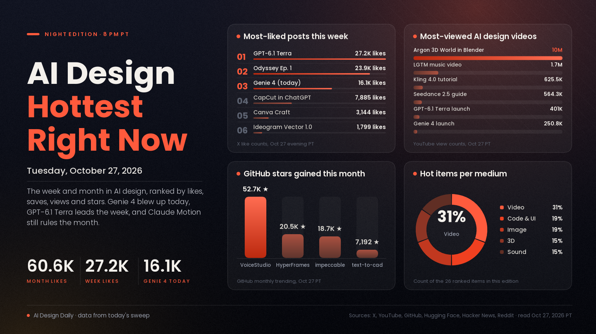

# AI Design Hottest Right Now · Tuesday, Oct 27, 2026

## Genie 4 turned world models into today's design story, while computer-use models and agent design skills own the week and month

Today's one real explosion is Genie 4, Google DeepMind's new world model: you steer a live, explorable scene with prompts and the keyboard, and it now makes the sound and dialogue too. Its launch post reached 16,104 likes, 6,624 bookmarks and about 1.84M views in roughly eleven hours, and it sits at 750 points on Hacker News. The week belongs to models that work inside the tools designers already use: GPT-6.1 Terra, OpenAI's computer-use model, has grown to 27,157 likes and about 5.83M views in a day and a half, and CapCut's coming ChatGPT plugin is at 7,885 likes. On the video side, Grok Imagine's Odyssey Episode 1 is still the most-saved creative post of the week (15,007 bookmarks), and creators spent the week running the same prompt through Kling 4, Seedance 2.5, Wan 3.0 and MiniMax H3. Over the month, staying power belongs to tools that teach agents to design and animate. Claude Motion is still the biggest AI design post at 60,553 likes, and VoiceStudio, HyperFrames and impeccable gained a combined 91,910 GitHub stars this month.

*Engagement figures were read from X (post lookups by ID and searches), YouTube, GitHub trending and repo data, Hugging Face, Hacker News and Reddit's r/comfyui top-of-week feed on the evening of Oct 27 (PT), and they will keep changing. "This week" means Oct 20 to 27 and "this month" means Sept 27 to Oct 19. Most subreddits returned empty feeds tonight and Product Hunt wasn't ranked, so neither is counted beyond r/comfyui.*

## 🔥 Blew up today

- [Genie 4, a world model you can walk into (Google DeepMind)](https://x.com/GoogleDeepMind/status/2115114028338962672), video, 3D and games model. You prompt a world into being and then explore and change it live; this version generates ambient audio and real-time dialogue, and DeepMind says testers use it for previs and game prototyping. The signal: 16,104 likes, 6,624 bookmarks and about 1.84M views since this morning, [Sundar Pichai's post](https://x.com/sundarpichai/status/2115115252690145519) at 13,581 likes, the [launch video](https://www.youtube.com/watch?v=sFfPkUJd_Jk) at 250,818 views, and 750 points on [Hacker News](https://news.ycombinator.com/item?id=50261319). Try it: it's with trusted testers now, with a waitlist on [DeepMind's blog post](https://deepmind.google/blog/genie-4-a-new-generation-of-world-simulation/); meanwhile, reuse its example prompts as shot briefs in your video model.
- [MAI-Image-2.7-Preview climbs the image-editing boards (Artificial Analysis)](https://x.com/ArtificialAnlys/status/2115097540320506069), image model. Microsoft's new editing model for relighting, restyling and swapping text inside images. The signal: #2 on Artificial Analysis's editing board, a post with 404 likes and about 316K views, and [#3 in Arena's Image Edit ranking](https://x.com/arena/status/2115101113666134276). Smaller than Genie 4, but the day's biggest image move. Try it: it's in MAI Playground for editing; relight one product shot and swap its label text.

## 📈 Hottest this week

- [GPT-6.1 Terra, a fast computer-use model (OpenAI)](https://x.com/OpenAI/status/2114780711664398349), code, UI and 3D model. A cheaper model that reads the screen and acts across apps; OpenAI's examples include drawings to 3D models and video edits. The signal: 27,157 likes, 4,220 bookmarks and about 5.83M views, the [launch video](https://www.youtube.com/watch?v=tTuk4pGnT0A) at 400,998 views, and 625 points on [Hacker News](https://news.ycombinator.com/item?id=50248124). Try it: give it one repetitive task in your design app and watch every step.
- [Odyssey Episode 1, made with Grok Imagine (@imagine)](https://x.com/imagine/status/2113712964419063911), video showcase. The first episode of a series made with Grok Imagine. The signal: 23,892 likes, 15,007 bookmarks and about 7.77M views, the most-saved creative post of the week. Use it: study its cutting and pacing before planning a multi-part AI series.
- [CapCut's plugin is coming to ChatGPT (CapCut)](https://x.com/capcutapp/status/2114062937094823955), video tool news. Start an idea in the chat, generate and edit with CapCut there, then finish in CapCut's web editor. The signal: 7,885 likes, 5,330 bookmarks and about 1.55M views. Use it: list the short-form edits you'd hand to a chat first; it isn't out yet.
- [Hallmark, an anti-AI-slop design skill for coding agents (GitHub)](https://github.com/Nutlope/hallmark), code and UI skill. Pushes Claude Code, Cursor and Codex past template defaults toward real hierarchy, type and spacing. The signal: 2,830 stars today on GitHub's daily trending and 39,153 in total; the same list has [impeccable](https://github.com/pbakaus/impeccable) (+1,449) and [ai-design-skills](https://github.com/elayadesign/ai-design-skills) (+1,395), and the new [MotionSites skill](https://x.com/viktoroddy/status/2114684257109254434) post has 2,884 bookmarks. Try it: build one page with and one without it, and compare.
- [Kling AI 4.0 Tutorial: How to Make Cinematic AI Videos (FILM CRUX, YouTube)](https://www.youtube.com/watch?v=PzOH1v5GaW0), video tutorial. A walkthrough of Kling 4.0 for cinematic shots. The signal: 625,512 views in a week, up from 540,680 last night, the most-watched AI video tutorial of the week in our sweep. Try it: follow it with one 10-second product shot.
- [Canva Craft, Canva's first image model built for design (Canva)](https://x.com/canva/status/2113348707223753165), image model. It plans the layout before drawing, aiming at accurate text and editable compositions. The signal: 3,144 likes, 1,546 bookmarks and about 1.92M views. Try it: give it a poster brief with a real headline and check the lettering.
- [Ideogram Vector 1.0, text or image to editable SVG (Ideogram)](https://x.com/ideogram_ai/status/2113300317584720259), image and vector model. Logos and illustrations come out as separate vector shapes. The signal: 1,799 likes, 1,243 bookmarks and about 575K views, and creators were still posting about it today. Try it: convert one raster logo and recolour a single shape.
- [MiniMax H3 character swaps in ComfyUI (r/comfyui)](https://www.reddit.com/r/comfyui/comments/1xbljy9/character_swap_minimax_h3_referencetovideo_lora/), video model and workflow. Reference-to-video with LoRAs for swapping a character into footage. The signal: MiniMax H3 posts hold three of the top spots in r/comfyui's top-of-week feed, and a [four-model comparison](https://x.com/rom1trs/status/2115008848800968756) of Kling 4, Seedance 2.5, Wan 3.0 Prime and H3 has 223 likes and 243 bookmarks. Try it: run one shot through H3 locally and then through a paid model, and compare cost against quality.
- [Kimi K3.1 Pro, an open-weight model tested on 3D and Blender (Moonshot)](https://www.kimi.ai/blog/kimi-k3-1-pro), 3D and code model. Moonshot's most capable open-weight model, per Moonshot. The signal: 1,091 points on [Hacker News](https://news.ycombinator.com/item?id=50212065), and Stefan 3D AI's [Blender test](https://www.youtube.com/watch?v=cxxGMz-YXU0) at 52,538 views. Try it: give it the Blender prompt you use with a paid model.
- [I Rebuilt 3ds Max With AI (Jake Denham, YouTube)](https://www.youtube.com/watch?v=74TsKdNWEaA), 3D showcase. A creator rebuilds a 3ds Max-style 3D tool using AI. The signal: 107,713 views in five days, the top 3D result in tonight's week-range YouTube search. We could only read the title and listing. Use it: a reference for how far vibe-coded creative tools now go.
- [gpu-unlock, faster BF16 maths on RTX 30-series cards (GitHub)](https://github.com/Zagitta/gpu-unlock), image and video tool. An experimental Linux module that speeds up local image and video models on older cards. The signal: 11,448 stars since Oct 18, up from 9,884 last night, 349 points on [Hacker News](https://news.ycombinator.com/item?id=50219700), and two posts about it in r/comfyui's top of the week. Try it: read its caveats first, then time one workflow before and after.
- [Voxtral 3, speech and expressive voices (Mistral)](https://mistral.ai/news/voxtral-3/), sound model. Real-time speech in 50+ languages, transcription and expressive text-to-speech, per Mistral. The signal: 770 points on [Hacker News](https://news.ycombinator.com/item?id=50168396), the week's biggest sound thread there. Try it: voice one narration line in two emotions.

## 🏆 Hottest this month

- [Claude Dashboards and Claude Motion are in beta (Claude)](https://x.com/claudeai/status/2108271552991252810), motion and UI tool. Turn data into live dashboards and ideas into animated explainers. The signal: 60,553 likes, 39,748 bookmarks and about 11.45M views, still the month's biggest AI design post in our sweep, and Futurepedia's [tutorial](https://www.youtube.com/watch?v=Ge1B-Ok1Pfk) at 317,122 views. Try it: turn one spreadsheet into a dashboard and one idea into a short explainer.
- [Gemini 4 Argon: 3D World in Blender (Google, YouTube)](https://www.youtube.com/watch?v=1dAcJEIlQM8), 3D showcase. Argon building a 3D world inside Blender through an agent. The signal: 10,025,462 views, the most-viewed AI design video of the month in our sweep, and the [launch post](https://x.com/sundarpichai/status/2110038898009407584) at 28,455 likes. Try it: connect Blender to an agent and ask for one small room.
- [DeepSeek-V4.1-Flash-1017, open weights (DeepSeek)](https://x.com/deepseek_ai/status/2111375640717033777), code and motion model. An open model creators quickly tested on motion design. The signal: 37,165 likes and about 8.08M views, [3,396 likes on Hugging Face](https://huggingface.co/deepseek-ai/DeepSeek-V4.1-Flash-1017) where it still tops trending, and Higgsfield's [motion-design post](https://x.com/higgsfield_ai/status/2111499195257700857) at 2,148 likes. Try it: run your motion-graphics prompt and compare with a paid model.
- [GPT-6 and Intelligent UI in ChatGPT (OpenAI)](https://x.com/OpenAI/status/2107894997538525580), code and UI news. Answers laid out by the model as text, charts and interactive pieces. The signal: 24,108 likes, 6,661 bookmarks and about 6.99M views, plus 761 points on [Hacker News](https://news.ycombinator.com/item?id=49996425). Why it matters: the model now designs the interface of its own answers.
- [VoiceStudio, a fully local ElevenLabs alternative (GitHub)](https://github.com/debpalash/VoiceStudio), sound tool. Voice cloning, voice design, dubbing and audiobooks on your own machine. The signal: 52,726 stars this month and 91,481 in total, top of GitHub's monthly trending. Try it: dub a short clip into a second language locally.
- [LGTM (Looks Good to Me), a Claude Opus 5.5 music video (Degenerative Pixels, YouTube)](https://www.youtube.com/watch?v=3TNpOD6bov8), music and video creation. An AI-made music video about AI coding culture. The signal: 1,673,147 views in about three weeks, the most-viewed AI music video in our sweep. Use it: a reference for a one-person song-plus-visuals piece.
- [HyperFrames: write HTML, render video (HeyGen, GitHub)](https://github.com/heygen-com/hyperframes), video and code tool. A framework built for agents that turns web pages into rendered video. The signal: 20,501 stars this month and 74,016 in total. Try it: have an agent build an animated title card as HTML and render it to MP4.
- [impeccable, a design language for AI coding tools (GitHub)](https://github.com/pbakaus/impeccable), code and UI skill. Built to make AI coding tools better at design. The signal: 18,683 stars this month and 90,682 in total, on the daily and monthly trending lists at once. Try it: add it to your agent setup before your next landing page.
- [How I Make Realistic AI Videos with Seedance 2.5, Full Guide (Dan Kieft, YouTube)](https://www.youtube.com/watch?v=2hJsvDSPWYM), video tutorial. A full guide to realistic shots in Seedance 2.5. The signal: 564,255 views in eleven days, the month's most-watched AI video tutorial in our sweep. Try it: draft at low resolution and render only the keeper at full quality.
- [Mirelo SFX 2.0 (Mirelo)](https://x.com/MireloAI/status/2110360787780800611), sound tool. A video-to-sound model that builds synced sound effects for a clip. The signal: 3,845 likes, 4,317 bookmarks and about 1.90M views, saved more often than liked. Try it: re-sound one AI clip with a weak soundtrack.
- [text-to-cad, design physical products with AI (GitHub)](https://github.com/earthtojake/text-to-cad), 3D and CAD tool. Describes itself as a way to design physical products with AI. The signal: 7,192 stars this month and 23,601 in total, on GitHub's monthly trending list. Try it: describe one simple bracket or enclosure and check the model before printing.
- [FLUX.3 image klein for ComfyUI (Black Forest Labs, Hugging Face)](https://huggingface.co/black-forest-labs/flux-3-image-klein-comfy), image model. A small FLUX.3 image-to-image model packaged for ComfyUI. The signal: 750,694 downloads and 1,868 likes since Oct 14, on Hugging Face's trending list. Try it: load it in ComfyUI and run your usual edit workflow against it.

---
*Method:* a fresh evening sweep of X (post lookups by ID and searches of today's and this week's posts), YouTube (week-range searches across video, animation, 3D, design and music), GitHub trending (daily, weekly, monthly) and repo data, Hugging Face trending models and spaces, Hacker News top stories for the day and week, and r/comfyui's top-of-week feed. Ranked by engagement and velocity, staying power, how widely creators are adopting it, and how new it is.

Say the word and I'll steer the next edition toward any medium or tool you want to go deeper on.
