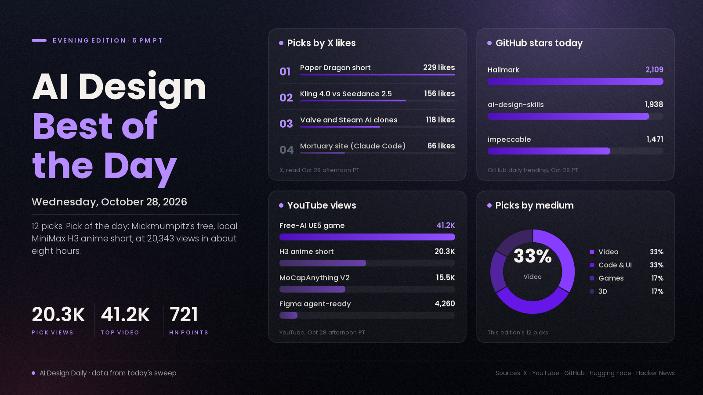

# AI Design Best of the Day · Wednesday, Oct 28, 2026

## One free local model, a full anime short and a flood of design-skill stars: the open-model crowd had the day

The pick of the day is Mickmumpitz's "One AI Model to RULE THEM ALL (FREE & LOCAL)", a 12-minute walkthrough of making a whole anime short film, SHIBUWAKA, with the MiniMax H3 model running in ComfyUI on one home GPU. It matters because it takes the day's open-model chatter (H3 upscalers, face passes and fan films all over the morning's feeds) and turns it into a start-to-finish recipe: character sheets, turnarounds, consistent voices, storyboards, Blender layouts, music and a 4K upscale. It had 20,343 views in about eight hours, and the model it uses has 6,423 likes on Hugging Face. The video is sponsored by NVIDIA and the workflow files sit on the maker's Patreon, so treat "free" as the creator's wording. The rest of the day split three ways: a free-AI Unreal Engine 5 game build passed 41,000 views, Google announced Gemini 4 Carbon (721 points on Hacker News) with a web-development score attached, and three agent design-skill repos added about 5,500 GitHub stars between them.

*Engagement figures were read from X, YouTube, GitHub, Hugging Face and Hacker News on the afternoon of Oct 28 (PT) and will keep changing. Reddit blocked our tools today, and Product Hunt's front page showed no AI design launch with a readable vote count, so neither is counted.*

## ⭐ Pick of the day

### 🎬 Video

- [One AI Model to RULE THEM ALL (FREE & LOCAL) (Mickmumpitz, YouTube)](https://www.youtube.com/watch?v=xwTJ3E3NU7A), workflow. Per the description, the team makes an anime short about two wannabe daredevils racing through rural Japan with one model, [MiniMax H3](https://huggingface.co/MiniMaxAI/MiniMax-H3), in ComfyUI on a local NVIDIA RTX GPU, with no cloud credits. The chapters cover character sheets, turnarounds, environments and image editing, consistent voices, video generation, steering motion with video references, storyboards, Blender 3D layouts, music and sound effects, then the full film. Why people are losing it: 20,343 views in about eight hours, up from 1,826 views when the noon edition listed the same video (an update on that listing); H3 itself has 6,423 likes and about 5.44M downloads on Hugging Face, and the model was the open-source story all morning. The video is an advertisement for NVIDIA RTX, and the free workflows and example files are Patreon posts, so check what is actually downloadable before you plan around it. How to try it: install H3 in ComfyUI following the 1:21 chapter, then copy the character-sheet to turnaround step with your own character before attempting a film.

## The ranked picks

### 🎮 Games and interactive

- [I Made UE 5 Game Using Only Free AI in 4 Days (Stefan 3D AI, YouTube)](https://www.youtube.com/watch?v=UtY2DsOUCjE), showcase. A playable Unreal Engine 5 obstacle course with rotating platforms, ragdoll physics, checkpoints and NPCs. Per the description: concept images from Gemini, 3D models from Hunyuan 3D Studio, and animation and game logic from DeepSeek V4.1 Flash, all on free tiers for $0. Why it's here: 41,245 views in about ten hours, the most-watched AI design showcase or tutorial we could verify today. The project files and written report are on the maker's Patreon, and the description carries a Tripo referral link. How to try it: follow the chapters for one asset, "Generating 2D 3D Assets" at 1:17 and "AI Rigging and Animations" at 4:05, before building the level.
- [Valve tells developers to make games harder to copy, as AI clones flood Steam (Eurogamer)](https://www.eurogamer.net/steam-ai-clone-game-problem-valve-response), news. At a Steam developer conference in Korea, Valve's Tom Giardino reportedly said Valve doesn't want to be a gatekeeper on which tools developers use, and advised building a community, making the real version the best one and adding features and personality that are hard to copy. Eurogamer notes the remarks are second-hand, via a machine translation that InvenGlobal checked with a native speaker, and it has asked Valve for clarification. Why it's here: [Eurogamer's post](https://x.com/eurogamer/status/2115455440209506363) has 118 likes, 49 replies, 33 bookmarks and about 51,000 views, and the article cites the indie game Needle in a Haystack Simulator, copied so often that its developer joked about a mode where you find the original. What it means: if you ship AI-assisted games, assume a clone can appear within days.

### 💻 Code and UI

- [Gemini 4 Carbon, Google's next frontier model (Google)](https://blog.google/innovation-and-ai/models-and-research/gemini-models/introducing-gemini-4-carbon/), model/news. Google calls it its strongest model, aimed at cybersecurity and long-running coding work. For designers the line to note is web development: per Google, Carbon rises 89 Elo points to #4 (1768) on WebDev Arena, and ranks #1 on the [Artificial Analysis Intelligence Index v5](https://artificialanalysis.ai/articles/artificial-analysis-intelligence-index-v5) at 59. Why it's here: the [Hacker News thread](https://news.ycombinator.com/item?id=50276792) has 721 points and 589 comments. It is not generally available: Google says a subset of cyber defenders get it this week, with developers and consumers "as soon as possible", and introductory pricing is $2 per million input tokens and $10 per million output tokens. The benchmark claims are Google's own. How to try it: not yet; when it opens, rerun one of your own landing-page prompts against your current model.
- [The agent design-skills wave: ai-design-skills, Hallmark and impeccable are all on GitHub's daily list (GitHub)](https://github.com/elayadesign/ai-design-skills), tool. Update on repos we covered earlier this week. [ai-design-skills](https://github.com/elayadesign/ai-design-skills) gained 1,938 stars today and is at 11,043 (it was 9,245 yesterday); [Hallmark](https://github.com/Nutlope/hallmark) gained 2,109 and is at 40,631; [impeccable](https://github.com/pbakaus/impeccable) gained 1,471 and is at 92,508, with 6,713 this week; and [taste-skill](https://github.com/Leonxlnx/taste-skill), at 104,392, added 3,941 this week. Why it's here: all three daily gainers are on GitHub's daily trending list at once, and creators are making tutorials about it, such as [Claude Code Just Solved AI SLOP FOREVER](https://www.youtube.com/watch?v=kvXb9GriTy0), 3,754 views in about nine hours, where the maker shares a free prompt for calmer admin apps. How to try it: install one of the skills and ask your agent for the same page you built last week.
- [Make your Figma design system agent-ready (Figma, YouTube)](https://www.youtube.com/watch?v=yj90StgN70w), tutorial. Figma's own video on preparing a design system for its Figma agent: thoughtful component design, consistent naming and descriptive documentation, then guidance for agents through examples, guidelines and skills. Why it's here: 4,260 views in about seven hours, a sign the design-tool vendors are now teaching agent-readiness. How to try it: rename a handful of components consistently and add short descriptions, which is the cheapest step in the video.
- [A mortuary landing page built with Claude Code (@IwuDesigns)](https://x.com/IwuDesigns/status/2115339088744128915), showcase. A calm "Restora — Professional Mortuary Care" site, with a [live demo](https://restora-alpha.vercel.app/), built with Claude Code. Why it's here: 66 likes, 14 reposts, 18 replies and about 3,900 views, a dull-sounding niche made to look considered. How to try it: pick an unglamorous business and ask your agent for one landing page in a single tone.

### 🎬 Video

- ["Paper Dragon," a one-minute AI short film (@xIrissy)](https://x.com/xIrissy/status/2115379237234549125), showcase. A boy's kite flies away and comes back that night as a 20-metre dragon. The poster says it was made entirely with NadouPro, a tool whose details we did not verify. Why it's here: 229 likes, 55 reposts, 162 bookmarks and about 30,900 views, the highest-engagement video post in the X posts gathered for this edition and a high save rate. How to try it: write the one-sentence story first, then give the tool that sentence and nothing else.
- [Same prompt, Kling 4.0 against Seedance 2.5 (@doctorwasif)](https://x.com/doctorwasif/status/2115424536510537748), showcase. A Korean beauty-shop scene with early-2000s nostalgia, run on Pollo AI with the same prompt through both models. Why it's here: 156 likes and 31 replies, the most replies of any video post in the X posts gathered for this edition. The poster asks followers to vote, so it shows no verdict. How to try it: run your own scene through both models before paying for either. This comparison keeps recurring; we list it only because of the reply count.
- [Digital Human Koubo: one photo and one sentence to a talking-head video (andyhuo520, GitHub)](https://github.com/andyhuo520/digital-human-koubo), tool. An MIT-licensed agent skill that scripts, voices, lip-syncs and captions a presenter video; the README's 27-second sample ad cost 482 credits on Renoise, the video service it calls through MCP. Why it's here: 1,299 stars two days after it was created. Because it runs on a paid third-party service, check pricing before you build on it.

### 🧊 3D

- [Animate ANY 3D Character From Just a Video (Free & Open Source) (PixelArtistry, YouTube)](https://www.youtube.com/watch?v=D-n-zdb59lo), tutorial. A walkthrough of MoCapAnything V2, which per the video turns an ordinary video into animation for any rigged 3D character, including animals and creatures, with BVH and GLB export into Blender. Why it's here: 15,481 views in about nine hours. There is a [free Hugging Face demo](https://huggingface.co/spaces/kehong/MoCapAnythingV2), a [project page](https://animotionlab.github.io/MoCapAnythingV2/), the [paper's code](https://github.com/phongdaot/MocapAnything) (425 stars) and a creator-made [one-click installer](https://github.com/pixelartistry/PixelArtistry-MoCapAnything); the video also promotes the creator's paid workflow pack. How to try it: start with the browser demo, since the local install needs about 20 GB of disk.
- [DeepOpen 3D Webs: one image and a prompt become a Gaussian-splat scene you can fly through (deepopen-com, GitHub)](https://github.com/deepopen-com/deepopen-3d-webs), tool. A web studio that takes a reference image and a Chinese prompt, plans a camera path and produces stills, colour and depth animations and a point cloud you can open in SuperSplat or MeshLab. Why it's here: 488 stars within two days of its creation. The README says demo mode needs no GPU, while full generation needs CUDA and model weights, and the page calls for Chinese-language prompts. How to try it: run the Docker image in demo mode and browse the sample scenes before deciding whether to install the full engine.

---
*Method:* the 23 X posts gathered for this edition were each opened by ID and their text and metrics re-read; none were taken on trust. They were checked against a fresh sweep of YouTube (uploads from the last day, descriptions read), GitHub trending (daily, weekly) and new-repo search, Hugging Face trending, Hacker News and the day's morning and noon editions. Ranked by engagement and velocity, how many creators are copying it, and how new it is. Left out: a cluster of near-identical paid-looking API promo posts, the Flux 3 Max promotion inside Arcads (the 22x-faster claim comes from a promotional post), and Genie 4, which is still climbing on Hacker News but had no new news since yesterday's edition. Reddit blocked our tools, Product Hunt's front page showed no AI design launch with a readable vote count, and a YouTube video titled "Claude 2.0" with 413,805 views could not be tied to any announcement we could find, so we did not list it.

Say the word and I'll steer the next edition there.
