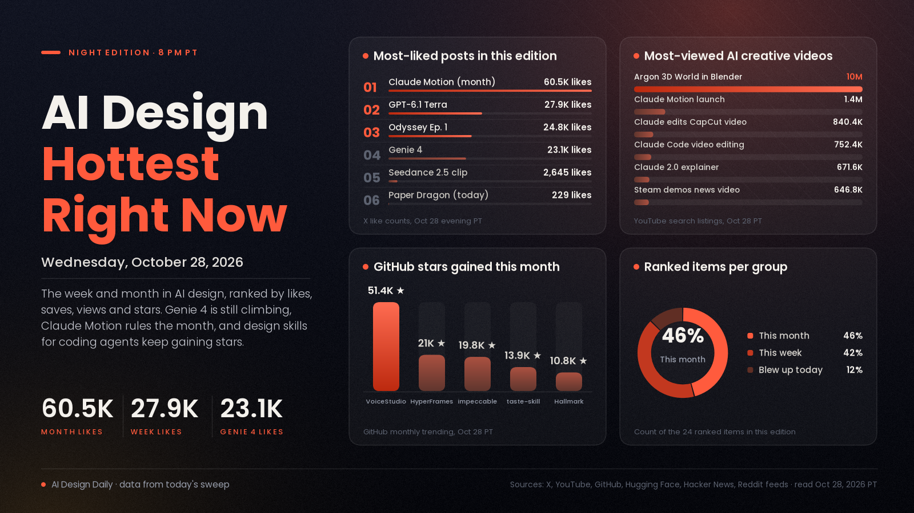

# AI Design Hottest Right Now · Wednesday, Oct 28, 2026

## Genie 4 is still climbing a day after launch, open ComfyUI rebuilds of Higgsfield are the week's new energy, and design skills for coding agents own the month

Nothing in design blew up today the way Genie 4 did yesterday: its launch post has grown to 23,076 likes, 9,634 bookmarks and about 3.21M views, up from 16,104 likes and 1.84M views last night, and it now sits at 1,021 points on Hacker News. Today's biggest launch was Gemini 4 Carbon, Google's new frontier model (788 points on Hacker News), but Google's own post makes no design, image or video claims and access starts with security teams. The week's creative energy moved to open tooling: after Higgsfield said it would open source its platform (per the entrants), ComfyUI users rebuilt it for a community challenge, and Freefield (120 apps, MIT code) and Openjutsu (a one-click character swap) came out of that, riding a MiniMax H3 wave that fills the top of r/StableDiffusion's top-of-week feed. Over the month, staying power belongs to tools that make coding agents better at design and motion. VoiceStudio, HyperFrames, taste-skill, impeccable and Hallmark added a combined 117,000 GitHub stars in 30 days, while Claude Motion remains the month's biggest AI design post at 60,543 likes.

*Engagement figures were read on the evening of Oct 28 (PT) from X post pages, GitHub (trending and repo data), Hugging Face, Hacker News and YouTube search listings, and they will keep changing. "This week" means Oct 21 to 28 and "this month" means Sept 28 to Oct 28. Reddit blocked page views, so r/StableDiffusion, r/comfyui and r/aivideo are counted only by their public top-of-week and top-of-month feeds, which show post order but not scores. YouTube started blocking page loads partway through, so video views come from search listings and we could not open every video. Product Hunt's weekly list marked all 15 top entries "Promoted", so it isn't counted. r/ClaudeAI, r/blender, r/singularity and r/gamedev feeds weren't reachable.*

## 🔥 Blew up today

- [Gemini 4 Carbon, Google's new frontier model (Google)](https://blog.google/innovation-and-ai/models-and-research/gemini-models/introducing-gemini-4-carbon/), code and agent model news. Google calls it its strongest model, built for long, hard engineering tasks and cybersecurity. Per Google it ranks #1 on Artificial Analysis's Intelligence Index v5.0 (score 59) and #4 on WebDev Arena (1768 Elo, up 89 points). The signal: 788 points and about 640 comments on [Hacker News](https://news.ycombinator.com/item?id=50276792), one of the day's biggest threads, where commenters say many users can't yet find Google's current Gemini 4 models in its apps. Why it matters: it's a general model with no design, image or video claims in the post, so treat it as news for web and UI builders only. Access starts with a subset of cyber defenders and expands to developers "soon"; the introductory price is $2 per million input tokens and $10 per million output.
- [Valve tells developers to make games harder to copy as AI clones flood Steam (Eurogamer)](https://x.com/eurogamer/status/2115455440209506363), games news. At a Steam developer conference in Korea, Valve staff were reportedly asked about AI clones and answered with advice (build a community, keep adding features) rather than new enforcement; Eurogamer notes the comments are second-hand and machine-translated and says it has asked Valve for clarification. The signal: 124 likes, 55 replies, 40 bookmarks and about 63,400 views on the [post](https://x.com/eurogamer/status/2115455440209506363), and a YouTube news video titled ["Game Devs Just Started Pulling Their Demos Off Steam"](https://www.youtube.com/watch?v=MRO1iaEv-LE) shows 646,816 views in a day in YouTube's listing (we could not open it, so we can't say how closely it tracks this story). Read it: the [full Eurogamer article](https://www.eurogamer.net/steam-ai-clone-game-problem-valve-response) for the Needle in a Haystack Simulator case.
- [Paper Dragon, a one-minute AI short film (@xIrissy)](https://x.com/xIrissy/status/2115379237234549125), video showcase. A boy's kite flies away and returns that night as a 20-metre dragon; the poster says it was made entirely with NadouPro. The signal: 229 likes, 55 reposts, 161 bookmarks and about 30,900 views since this morning, the most-saved new creative post in our X list today. Use it: study how a one-minute story with one clear image stays readable.

## 📈 Hottest this week

- [Genie 4, a world model you can walk into (Google DeepMind)](https://x.com/GoogleDeepMind/status/2115114028338962672), video, 3D and games model, update. You steer a live scene by describing weather, camera or new objects, and it generates ambient sound, music and dialogue with the picture, per DeepMind. The signal: 23,076 likes, 9,634 bookmarks and about 3.21M views, up from 16,104 likes and 1.84M views last night, plus 1,021 points on [Hacker News](https://news.ycombinator.com/item?id=50261319). Try it: it's in a preview for trusted testers, with a waitlist on [DeepMind's post](https://deepmind.google/blog/genie-4-a-new-generation-of-world-simulation/); meanwhile, write your next video-model shot brief as a scene you could walk through.
- [GPT-6.1 Terra, a fast computer-use model (OpenAI)](https://x.com/OpenAI/status/2114780711664398349), code, UI and 3D model, update. A cheaper model that operates apps by reading the screen. The signal: 27,868 likes, 4,325 bookmarks and about 6.43M views, up from 27,157 likes and 5.83M views last night, still the most-liked post of the week. Try it: give it one repetitive task in your design app and watch each step.
- [Odyssey Episode 1, made with Grok Imagine (@imagine)](https://x.com/imagine/status/2113712964419063911), video showcase, update. The first episode of a series made with Grok Imagine. The signal: 24,759 likes, 15,477 bookmarks and about 8.0M views, still the most-saved creative post of the week. Use it: study its cutting and pacing before you plan a multi-part series.
- [Freefield, Higgsfield rebuilt on ComfyUI (GitHub)](https://github.com/neuregex/freefield), image, video and sound tool. After Higgsfield said it would open source its platform (per the entrants' posts), ComfyUI ran a challenge to rebuild it; this entry packs 120 apps (cinema camera moves, relight, re-shoot, dubbing, face swap, background removal and more) as folders of ComfyUI workflows with MIT code, and the repo says each model keeps its own license. The signal: 115 stars (new this week, so early), a [post](https://www.reddit.com/r/comfyui/comments/1xh73t4/freefield_higgsfield_rebuilt_on_comfyui_117_apps/) in r/comfyui's top-of-month feed, and a [two-minute demo](https://youtu.be/N7mv2v3Txeo). Another entry, [Openjutsu](https://github.com/D3voz/openjutsu) (155 stars), swaps a person into a video with MiniMax H3 and keeps the original audio, and an earlier [Genjustsu workflow](https://github.com/sirioberati/Genjustsu-Open-Source-Workflow) has 1,267 stars. Try it: check the README's hardware list first, since the full model set is about 355 GB.
- [My first scene created with MiniMax H3 in ComfyUI, on an RTX 3090 (r/StableDiffusion)](https://www.reddit.com/r/StableDiffusion/comments/1xf5pqg/my_first_scene_created_with_minimax_h3_in_comfyui/), video showcase and model, update. A user's first test of [MiniMax H3](https://huggingface.co/MiniMaxAI/MiniMax-H3) on a consumer card. The signal: first in r/StableDiffusion's top-of-week feed (score not shown), H3 on Hugging Face at 6,424 likes and 5.44M downloads, and MDMZ's [character-swap tutorial](https://www.youtube.com/watch?v=r4P3hpoA1Is) at 47,716 views in six days. Try it: run one reference-to-video shot locally and compare with a paid model; the weights carry their own license, so check it before commercial use.
- [gpu-unlock, faster BF16 maths on older GeForce cards (GitHub)](https://github.com/Zagitta/gpu-unlock), image and video tool, update. An experimental Linux module that, per the repo, raises tensor throughput on RTX 20, 30 and 40 series cards. The signal: 12,369 stars, up from 11,448 last night, and three posts about the same unlock in r/StableDiffusion's top-of-week feed, including [one explaining why it works](https://www.reddit.com/r/StableDiffusion/comments/1xgacis/gpu_unlocks_fp32_accumulation_why_can_it_be/). Try it: read the caveats, then time one workflow before and after.
- [Design skills for coding agents: ai-design-skills, Hallmark and impeccable (GitHub)](https://github.com/elayadesign/ai-design-skills), code and UI skills, update. Three repos that push Claude Code, Cursor and Codex past template-looking pages. The signal: all three are on GitHub's daily list today, with [ai-design-skills](https://github.com/elayadesign/ai-design-skills) +2,139 stars (11,116 in total), [Hallmark](https://github.com/Nutlope/hallmark) +2,110 (40,715) and [impeccable](https://github.com/pbakaus/impeccable) +1,472 (92,657); impeccable gained 7,283 this week. Try it: build one page with one of them and one without, and compare.
- [Seedance 2.5 animation clip (@SarcasticAnnabe)](https://x.com/SarcasticAnnabe/status/2112919117556531696), video showcase. The week's most-liked Seedance 2.5 clip on X: 2,645 likes, 1,208 bookmarks and about 139,000 views. Caution: the same caption ("This Ai animation is literally A masterpiece") appears across many small accounts and the post doesn't credit a maker, so treat it as a repost of unknown origin. Use it: as a sign of how widely Seedance 2.5 clips are being reposted, not as a creator to follow.
- [OpenArt Nano Banana 2.1 with Seedance 2.5: Full AI Product Campaign Workflow (Eigi and AI, YouTube)](https://www.youtube.com/watch?v=yqUD3645J44), video tutorial. A workflow from product image to campaign video using Nano Banana 2.1 and Seedance 2.5. The signal: 138,123 views in three days in YouTube's week-range listing, the most-viewed Nano Banana result in our week-range search. We could not open the video, so we only know the title and listing. Try it: follow it with one product you own.
- [Claude 2.0 is Insane (All Updates Explained) (Ben AI, YouTube)](https://www.youtube.com/watch?v=J5EbL1UaqG8), tutorial and buzz. A walkthrough of recent Claude updates; the title is the channel's claim. The signal: 671,592 views in three days, among the most-viewed results in our week-range Claude search. We could not open it, so we only know the title and listing. Use it: a quick way to see what creators are excited about before choosing a Claude workflow.

## 🏆 Hottest this month

- [Claude Dashboards and Claude Motion are in beta (Claude)](https://x.com/claudeai/status/2108271552991252810), motion and UI tool, update. Turn data into live dashboards and ideas into animated explainers. The signal: 60,543 likes, 39,728 bookmarks and about 11.46M views, still the month's biggest AI design post in our sweep, and the [official video](https://www.youtube.com/watch?v=en0GuyhieQk) at 1,368,903 views. Try it: turn one spreadsheet into a dashboard and one idea into a short explainer.
- [Gemini 4 Argon: 3D World in Blender (Google, YouTube)](https://www.youtube.com/watch?v=1dAcJEIlQM8), 3D showcase, update. Argon building a 3D world inside Blender through an agent. The signal: about 10.0M views (10,024,537 in the listing), the most-viewed AI design video we found this month. Try it: connect Blender to an agent and ask for one small room.
- [VoiceStudio, a fully local ElevenLabs alternative (GitHub)](https://github.com/debpalash/VoiceStudio), sound tool, update. Voice cloning, voice design, video dubbing and audiobooks on your own machine; the repo says it covers 646 languages. The signal: 51,430 stars this month and 93,007 in total, the most stars gained on GitHub's monthly trending list. It is AGPL-3.0, so check the license before commercial use. Try it: dub a short clip into a second language locally.
- [HyperFrames: write HTML, render video (HeyGen, GitHub)](https://github.com/heygen-com/hyperframes), video and code tool, update. A framework built for agents that renders web pages to video. The signal: 21,015 stars this month and 74,736 in total. Try it: have an agent build an animated title card as HTML and render it to MP4.
- [taste-skill, agent skills that give coding agents taste (GitHub)](https://github.com/Leonxlnx/taste-skill), code and UI skill. Art direction, reference images and a browser check instead of generic AI pages, per the repo. The signal: 13,933 stars this month, 3,940 this week and 104,477 in total, on GitHub's weekly and monthly trending lists. Try it: install it before your next landing page and compare the first draft with your usual one.
- [oil-ui, a UI design skill for coding agents (GitHub)](https://github.com/oil-oil/oil-ui), code and UI skill. Lets an agent explore several distinct UI directions, compare them side by side and refine against real screenshots. The signal: 2,458 stars since it appeared on Sept 30, one of the fastest-rising new design repos in a GitHub search of repos created this month; MIT license, and updated today. Try it: ask for three directions for one screen and pick one.
- [Claude as a video editor: "Claude Edited My Entire CapCut Video" (Matt Loui, YouTube)](https://www.youtube.com/watch?v=5N1moUCsVhI), video tutorial. The title says Claude edited the full video without the creator touching the timeline. The signal: 840,431 views in about two weeks, and Christian Peverelli's [Claude Code editing walkthrough](https://www.youtube.com/watch?v=HzXD4GVqXwM) has 752,386 in about three, both from YouTube's month-range listing (we could not open either). Try it: hand an agent a rough cut and one editing rule, then review what it changed.
- [LTX-2.5, open video model (Lightricks, Hugging Face)](https://huggingface.co/Lightricks/LTX-2.5), video model. An image-to-video model that stays popular long after its July release, with community ComfyUI workflows. The signal: 9,720 likes and 2.23M downloads on Hugging Face, and Mikkel Lassalle's [controlled local video tutorial](https://www.youtube.com/watch?v=dqeK4GD2Bd8) at 161,466 views in about three weeks. The weights carry their own license. Try it: follow the tutorial's layout-to-render steps with one storyboard frame.
- [manimgx, an animation engine for agents (GitHub)](https://github.com/academa-labs/manimgx), motion and video tool. Math and 3D explainer videos from Manim's Python API on a Rust GPU core, built for coding agents. The signal: 2,272 stars since it appeared on Oct 5, among the top new animation repos in a GitHub search of this month's repos; MIT license. Try it: ask an agent to animate one equation or chart.
- [Google Playground, describe a game and play it (Google)](https://blog.google/innovation-and-ai/technology/ai/playground-experimental-gaming-platform/), games tool. Build, play and share games from text prompts in the browser, announced Oct 7 for US users aged 18 and over, with creation access tied to Google AI subscription tiers. The signal: 168 points and 233 comments on [Hacker News](https://news.ycombinator.com/item?id=49991823). Try it: if you're eligible, describe one simple game with one rule and see what it gets wrong.
- [Figma's remote MCP server accepts only supported clients (Figma)](https://x.com/GayaniFigma/status/2105295629941350454), design tool news. A Figma staff reply says the server only accepts clients on its supported list and points to a catalog and request form. The signal: 126 likes, 108 bookmarks and about 624,000 views on the post, and 189 points on [Hacker News](https://news.ycombinator.com/item?id=49922729). Why it matters: it shows how agent access to design files is being gated; check [Figma's catalog](https://www.figma.com/mcp-catalog/) before wiring a design file into an agent.

---
*Method:* a fresh evening sweep of the X posts gathered for this edition (each opened by ID to read its text and metrics), YouTube (week- and month-range searches sorted by views across video, design, 3D, ComfyUI, music and games), GitHub trending (daily, weekly, monthly) and repo data, GitHub search for newly created repos, Hugging Face trending models and spaces, Hacker News top stories and week and month searches, and the public top-of-week and top-of-month feeds of r/StableDiffusion, r/comfyui and r/aivideo. Ranked by engagement and velocity, staying power, how widely creators are adopting it, and how new it is. Items marked "update" were in an earlier edition and are included because their numbers moved or there is new news.

Say the word and I'll steer the next edition there.
