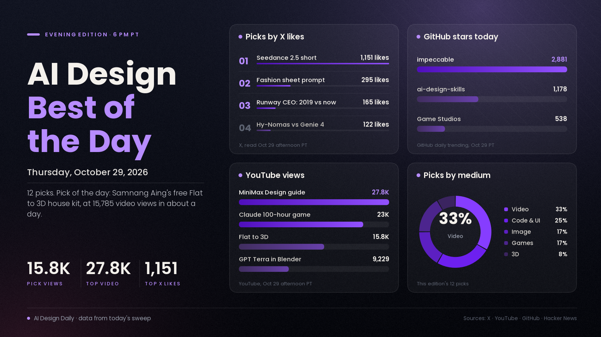

# AI Design Best of the Day · Thursday, Oct 29, 2026

## A free scroll-to-3D house kit, Tencent's world model taking on Genie 4 and a game built over 100 hours of agent time

The pick of the day is "Flat to 3D," Samnang Aing's seven scroll-driven demos that turn an architect's flat drawing (an exploded axo, a section, a construction schedule, a card model) into a walkable 3D house in the browser. It matters because it is the rare design-craft piece that is both new and copyable: every demo ships with its code and a starter prompt, each runs in under 200 KB, and the maker tested each prompt in a fresh session. The walkthrough video had 15,785 views in about 24 hours. The rest of the day split three ways: Tencent put out the Hy-Nomas technical report with a Genie 4 comparison and a no-waitlist demo, a Claude Code game built over 100 hours of agent time passed 22,000 views, and a Korean walkthrough of MiniMax Design, GPT Image 2.5 and MiniMax H3 for game characters passed 27,000.

*Engagement figures were read from X, YouTube, GitHub, Hugging Face and Hacker News on the afternoon of Oct 29 (PT) and will keep changing. Reddit and Product Hunt blocked our tools today, so neither is counted.*

## ⭐ Pick of the day

### 💻 Code and UI

- [Flat to 3D: seven ways to turn an architectural drawing into a 3D scroll (Samnang Aing, GitHub)](https://github.com/Sam1983Aing/flat-to-3d), showcase. Per the README: an exploded axo that lands layer by layer, a section that opens into depth, a build time-lapse, a construction schedule that builds the house bar by bar, a card model on a desk, and a sunlit elevation, all three.js with [live demos](https://sam1983aing.github.io/flat-to-3d/), full code and a starter prompt for each. Per the video description there are no images and no 3D models, and every demo is under 200 KB of code. Why people are losing it: the [walkthrough video](https://www.youtube.com/watch?v=UTCPqJZFg04) had 15,785 views about 24 hours after upload, and the repo, which is MIT-licensed, was created yesterday and already has 37 stars, so the audience is mostly on YouTube for now. The video is sponsored by Design+Code and carries affiliate links, and the maker used Claude Code with Opus 5.5 for the seven techniques. How to try it: open the live page on a laptop, pick the technique closest to your own drawing, and paste its starter prompt into a fresh agent session to see what you get first try.

## The ranked picks

### 🎬 Video

- [Hy-Nomas vs Genie 4: Tencent's technical report, benchmark and demo (Tencent Hunyuan)](https://x.com/TencentHunyuan/status/2115851165904814283), model/news. An update on the interactive world model from the Oct 24 edition. Tencent's post links the [technical report](https://arxiv.org/abs/2610.36729) (submitted Oct 27; per the abstract, an 8B video world model with free-form text and continuous camera control across turns, with weights, code and benchmarks released), the open [Hy-Nomas-Bench dataset](https://huggingface.co/datasets/tencent/Hy-Nomas-Bench), a comparison video that re-creates Genie 4 examples, and a [demo](https://hy-nomas.hy.tencent.com/) it says needs no waitlist. Why it's here: the post has 122 likes, 23 reposts and about 6,700 views, and the [repo](https://github.com/Tencent-Hunyuan/Hy-Nomas) is at 384 stars, up from 113 on Oct 24. The "superior to existing world models" result is the authors' own human evaluation. How to try it: open the demo and give it a scene and a camera instruction, then judge the memory yourself.
- ["This AI video is a 10/10 masterpiece," a Seedance 2.5 short (@Xmbluee)](https://x.com/Xmbluee/status/2115678521515299013), showcase. A short clip tagged Seedance 2.5 with no prompt, workflow or tool details in the post. Why it's here: 1,151 likes, 201 reposts, 588 bookmarks and about 167,800 views, the highest-engagement post in the X posts gathered for this edition. A near-identical caption on another account ("This Ai video is truly a masterpiece") has 371 likes but 239 reposts and about 2,500 views, so we did not list it. How to try it: treat it as a signal that Seedance 2.5 is what people are sharing, then rebuild a clip with a real workflow such as the storyboard-first one in today's noon edition.
- [Open-H3-Regenerate-2K in ComfyUI: a 480p H3 draft to 2K (Benji's AI Playground, YouTube)](https://www.youtube.com/watch?v=eiJbJMFU52M), tutorial. A walkthrough of NVIDIA's open refiner for MiniMax H3 drafts, with two tested ComfyUI methods. Why it's here: 8,770 views in about ten hours, and the [model page](https://huggingface.co/Efficient-Large-Model/Open-H3-Regenerate-2K) has 122 likes, created Oct 26 (the morning edition listed community nodes and a Reddit test). Per the description, NVIDIA's blinded study preferred it over the hosted API in 87% of 200 judgments, but the creator's own tests found the simpler two-stage method with an extracted LoRA beat the full custom-node pipeline on sharpness. How to try it: follow method 1 in the video; it needs roughly 6 GB of LoRA weights.
- [The Orange, Runway's first short film in 2019, against today's AI video (@c_valenzuelab)](https://x.com/c_valenzuelab/status/2115795594367082499), buzz. Runway's CEO sets the 2019 short "The Orange," made with Runway by @matamalaortiz, beside the Will Smith spaghetti meme to argue progress is bigger than people remember. Why it's here: 165 likes, 28 replies and about 10,900 views. It is a perspective post, not a new tool. How to try it: rewatch the short and ask what you would make now.

### 💻 Code and UI

- [impeccable gains 2,881 stars in a day (Paul Bakaus, GitHub)](https://github.com/pbakaus/impeccable), tool. An update on the agent design-vocabulary repo from earlier this week. It is at 95,193 stars after 2,881 today and 7,283 this week on GitHub trending; [Hallmark](https://github.com/Nutlope/hallmark) is at 42,033 and [ai-design-skills](https://github.com/elayadesign/ai-design-skills) at 12,065. Why it's here: it is still the fastest-growing design repo on the list, and the "design skills for agents" idea keeps spreading. How to try it: install it and ask your agent to critique a page you already built.
- [SWAGBENCH: AI-conference merch ranked on design, wearability and status (@demian_ai)](https://swagbench.app/), showcase. A satirical, well-built chart site that scores 222 pieces of tech merch from 0 to 40 on a wearability-against-status map, with a leaderboard, tiers and a submit form. Why it's here: the [launch post](https://x.com/demian_ai/status/2115844195730554946) has 67 likes, 16 replies and about 10,200 views, and the page is a good example of a joke given a real interface. The scoring is one reviewer's opinion. How to try it: open the chart and drag the quadrants, then steal the layout for your own ranked-list idea.

### 🖼️ Image and visual

- [MiniMax Design, Opus 5.5 and GPT Image 2.5 for game characters and pixel sheets (성공지식백과, YouTube)](https://www.youtube.com/watch?v=w-7FkzY8CbY), tutorial. A Korean-language walkthrough. Per the description, Opus 5.5 writes the character prompts, [MiniMax Design](https://design.minimax.io/) generates the characters with GPT Image 2.5, and MiniMax H3 makes an 8-second 2K pixel-animation clip; it shows three affection-stage illustrations, a pixel sheet and a scene. Why it's here: 27,782 views in about 22 hours, the most-viewed design tutorial we could verify today. The description says a character image cost 165 credits and an 8-second 2K clip 960, and lists a Pro plan at $215 a month, so check pricing before you commit. How to try it: follow the guide's first prompt and make one character in three stages.
- [A fashion reference sheet prompt for GPT Image 2.5 (@Just_Anika_Here)](https://x.com/Just_Anika_Here/status/2115679456140702100), tutorial. The full prompt is in the post: a six-panel, 2-by-3 sheet of the same model from six camera angles on a warm ivory studio background, with the identity locked in text. Why it's here: 295 likes, 252 bookmarks and about 12,700 views, a high save rate that shows people are keeping it to reuse. Many accounts posted similar GPT Image 2.5 prompt packs today (travel posters, stamps, manga editorials), mostly under 100 likes. How to try it: swap in your own character description and keep the six-angle grid.

### 🎮 Games and interactive

- [I Spent 100 Hours Building This Video Game With Claude (Brendan Jowett, YouTube)](https://www.youtube.com/watch?v=tpbXZyRxWNY), showcase. An update on a video the morning edition listed just after upload. Per the description, he builds the same Unreal Engine game four times at 10 minutes, 1 hour, 10 hours and 100 hours of agent build time, ending with an open-world survival game with vehicles, boats, gliders and underwater exploration. Why it's here: 22,995 views about twelve hours after upload, and the structure makes the effect of build time easy to see. The description carries affiliate and course links. How to try it: watch the 10-minute build at 2:03 against the 100-hour build at 14:54 to see what extra agent time buys.
- [tinyworldformer: a tiny world model that generates and plays games on a Raspberry Pi Pico 2 W (SheepSeb, GitHub)](https://github.com/SheepSeb/tinyworldformer), repo/tool. Per the README, one small looped transformer predicts the next frame and reward while a second small network plays the game, with 26k to 131k parameters for the world model, running on the microcontroller. Why it's here: 52 stars and a [Hacker News thread](https://news.ycombinator.com/item?id=50295450) with 60 points and 5 comments, an odd and charming counterpoint to Hy-Nomas at the other end of the size scale. The demos are simple retro games such as Pong and Breakout, and the numbers are the author's. How to try it: read the README's "on the chip" section before deciding whether to flash a board.

### 🧊 3D

- [Can a cheaper ChatGPT model run Blender? GPT-6.1 Terra builds a da Vinci air screw (TokyoMakers, YouTube)](https://www.youtube.com/watch?v=BzEAOHUBnhI), tutorial. A Japanese-language test. Per the description, the maker gave GPT-6.1 Terra a sketch of Leonardo da Vinci's aerial screw, had it build a 3D model in Blender, and 3D-printed the result. Why it's here: 9,229 views in about 21 hours, and the question of whether the cheaper model is enough is the one many people are asking. The verdict is the creator's. How to try it: try the same sketch-to-Blender request with the model you already pay for.

---
*Method:* the 26 X posts gathered for this edition were each opened by ID and their text and metrics re-read; none were taken on trust. They were checked against a fresh sweep of YouTube (uploads from the last day, descriptions read), GitHub trending (daily, weekly) and repo pages, Hugging Face trending, Hacker News and the day's morning and noon editions. Ranked by engagement and velocity, how many creators are copying it, and how new it is. Left out: a repost-heavy duplicate of the Seedance 2.5 caption, a "Claude 2.0" YouTube video (31,756 views) that we could not tie to any announcement, Mistral Large 4's open weights (1,077 points on Hacker News, a language-model story rather than a design one), the cloudflare security-audit skill (not design), and the many small GPT Image 2.5 prompt posts. Reddit and Product Hunt blocked our tools (403), so neither is counted.

Say the word and I'll steer the next edition there.
