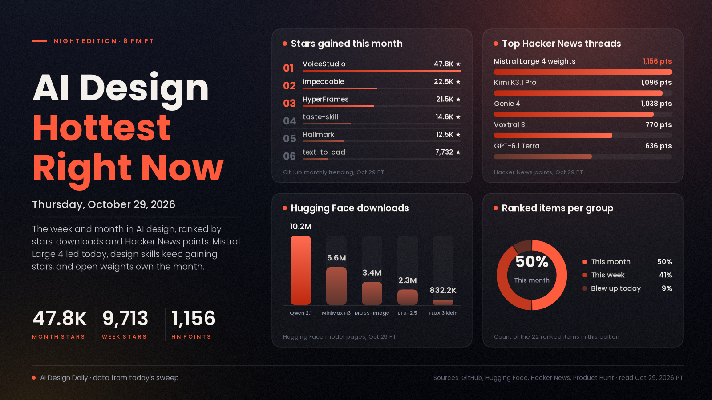

# AI Design Hottest Right Now · Thursday, Oct 29, 2026

## An open trillion-parameter model dominated today's feeds, while design skills for coding agents keep piling up stars and open image and video weights set the pace for the month

Today's biggest explosion was Mistral Large 4, a roughly 1-trillion-parameter open-weight model that reached 1,156 points on Hacker News, though it is a general coding and agent model rather than a design tool. The design story of the week is still agents learning taste: impeccable gained 9,713 GitHub stars in seven days and 2,870 today, taste-skill added 4,359 this week, and a new slide-deck skill, ppt-master, added 4,980. Genie 4 is holding at 1,038 points on Hacker News two days after launch. Over the month, staying power belongs to open weights and local tools: VoiceStudio gained 47,778 stars, and the ComfyUI packages for Qwen-Image 2.1, MiniMax H3 and MOSS-Image have passed 10.2 million, 5.6 million and 3.4 million downloads.

*Engagement figures were read on the evening of Oct 29 (PT) from GitHub (trending pages and repo pages), Hugging Face (model and Space listings), Hacker News and Product Hunt, and they will keep changing. "This week" means Oct 22 to 29 and "this month" means Sept 29 to Oct 29. X returned "payment required" to every post lookup tonight, so none of the X posts gathered for this edition could be opened and none are used here. YouTube returned no video listings and Reddit blocked every feed, so neither is counted. Any older figure is labelled as coming from an earlier edition.*

## 🔥 Blew up today

- [Mistral Large 4 open weights (Mistral)](https://mistral.ai/news/mistral-large-4-oss/), model news. Mistral released the weights of its flagship: about 1 trillion parameters in total, natively multimodal input, and a modified MIT license that requires a separate commercial license from anyone offering it as a hosted service. The signal: 1,156 points and 330 comments on [Hacker News](https://news.ycombinator.com/item?id=50289418), the top AI story on the front page. Why it matters: it is a general coding and agent model with no image-generation or design claims on Mistral's page, so treat it as news for people who build interfaces and tools. Benchmarks on the page (for example 41% on Terminal-Bench 4.0) are Mistral's own, and commenters report the smallest quantization still needs about 256 GB of memory.
- [Pika H3 Flex, LoRA adapters on MiniMax H3 (Pika, Hugging Face)](https://huggingface.co/Pika-Labs/Pika-H3-Flex), model launch. Per the model page, it generates video with synchronized audio in six sampling steps, at 480p or 768p, 24 fps and 5 to 15 seconds, with up to 12 reference inputs. The signal: 76 likes within hours of the page appearing this morning, and it is already in the top five of Hugging Face's trending image-to-video list. Much smaller than Mistral Large 4, but the day's only new video model with traction in our sweep. Try it: the adapters sit on top of [MiniMax H3](https://huggingface.co/MiniMaxAI/MiniMax-H3) and follow its community license; Pika says the 1080p to 4K features are only in its hosted API.

## 📈 Hottest this week

- [impeccable, a design vocabulary for coding agents (GitHub)](https://github.com/pbakaus/impeccable), update. Commands such as `polish`, `bolder`, `critique` and `audit`, plus a rule-based detector that flags generic AI-looking design. The signal: 9,713 stars this week and 2,870 today (the top of GitHub's daily list), 95,315 in total; Apache-2.0. Try it: run `npx impeccable install`, then `/impeccable init` in your agent, and audit one existing page.
- [taste-skill, art direction for coding agents (GitHub)](https://github.com/Leonxlnx/taste-skill), update. Adds art direction, real photographs and a browser check of the agent's own output; version 2.1 adds dashboards and app screens. The signal: 4,359 stars this week, 14,568 this month and 105,546 in total; MIT. Try it: `npx skills add https://github.com/Leonxlnx/taste-skill --skill "design-taste-frontend"`, then build the same page with and without it.
- [ppt-master, editable PowerPoint decks from a prompt or document (GitHub)](https://github.com/hugohe3/ppt-master), design tool. Runs inside an agent such as Claude Code and writes native, editable PowerPoint shapes, charts and tables instead of flat images, with optional transitions, animations and narration from speaker notes. The signal: 4,980 stars this week and 70,825 in total on GitHub's weekly trending; MIT, with an optional PDF converter that depends on an AGPL library. Try it: `npx skills add hugohe3/ppt-master`, drop a source document in `projects/` and ask for a deck.
- [Genie 4, a world model you can walk into (Google DeepMind)](https://deepmind.google/blog/genie-4-a-new-generation-of-world-simulation/), update. Prompt a live, interactive scene, steer it with text (weather, camera, new people or objects), and get ambient sound, music and real-time dialogue with it. The signal: 1,038 points and 587 comments on [Hacker News](https://news.ycombinator.com/item?id=50261319) (1,021 points in the previous edition). The post says testers use it for previs and game prototyping, and lists drifting detail and legible text as open problems. Try it: it is a limited preview for trusted testers, with a waitlist linked from the post; Ultra subscribers and early-access Gemini API partners come next.
- [SurgePix, AI visuals you keep editing layer by layer (Product Hunt)](https://www.producthunt.com/products/surgepix), update. Per the makers, you can split a flat image into editable layers, pull text off an image to retype it, repaint a region and keep a brand kit, and open-source agent skills let Claude Code and Cursor call it. The signal: 263 upvotes, #8 on Product Hunt's weekly leaderboard (212 points in the Oct 26 edition). Try it: it has a free option, with no tiers listed; split one of your own flat posters into layers and retype the headline.
- [Interfaces skills for coding agents (Jakub Krehel, GitHub)](https://github.com/jakubkrehel/skills), design tool. Fourteen skills, including `better-typography`, `better-colors`, `better-accessibility`, `build-design` (builds UI from a Figma file or design image) and `explain-interface` (explains how an effect or animation was built from a URL or screenshot). The signal: 980 stars this week and 9,174 in total on GitHub's weekly trending; MIT. Try it: `npx skills add jakubkrehel/skills`, then run `better-interface` on one screen.
- [ai-design-skills (GitHub)](https://github.com/elayadesign/ai-design-skills), update. Still only one skill so far, `landing-page-design`, which covers page structure, conversion copy and a visual system. The signal: 1,187 stars today and 12,151 in total (11,116 in the previous edition); MIT. Try it: copy the skill folder into `.claude/skills` and brief it with a real product.
- [Kimi K3.1 Pro, an open-weight model aimed at front-end and 3D work (Moonshot)](https://www.kimi.ai/blog/kimi-k3-1-pro), update. Moonshot says it builds front-end pages, Three.js scenes and Unity, Unreal and Godot games, scripts Blender and CAD, and scores 92.7% on BenchCAD; all benchmark numbers are Moonshot's. The signal: 1,096 points and 679 comments on [Hacker News](https://news.ycombinator.com/item?id=50212065). New since the last edition: the page says full weights are due by Nov 4 and does not yet name a license. Try it: it is live on kimi.ai and the Kimi API; its 3D Make feature previews and exports models for printing.
- [GPT-6.1 Terra (OpenAI)](https://news.ycombinator.com/item?id=50248124), update. The signal: 636 points and 426 comments on Hacker News since Oct 26, one of the week's biggest AI threads. OpenAI's own page returned a 403 error for us, so we are linking the discussion and cannot describe the model beyond its title. Use it: read the thread before deciding if it fits your design workflow.

## 🏆 Hottest this month

- [Claude Dashboards and Claude Motion (Claude)](https://claude.com/resources/articles/dashboards-and-motion), update. Dashboards turn connected company data into a live dashboard where each number links to its query; Motion makes animated explainers as editable code (not generated footage) that export as MP4. Per the page, Dashboards is in beta on paid plans and Motion in beta on Team and Enterprise, both off by default for Enterprise admins. The signal: the Oct 28 edition recorded 60,543 likes for the launch post on X, still the biggest AI design post of the month; we could not re-read X tonight, so that figure is from the earlier edition. Try it: type `/motion` and describe a 30-second explainer.
- [VoiceStudio, a local voice studio (GitHub)](https://github.com/debpalash/VoiceStudio), update. Voice cloning, voice design, dubbing, dictation, transcription and audiobooks on your own device; the repo says it covers 646 languages. The signal: 47,778 stars this month and 94,313 in total, the most gained on GitHub's monthly trending list. It is AGPL-3.0, and model weights and voices carry their own licenses. Try it: dub a short clip into a second language locally.
- [HyperFrames: write HTML, render video (HeyGen, GitHub)](https://github.com/heygen-com/hyperframes), update. Turns HTML, CSS and seekable animations into deterministic MP4s, built for agents. The signal: 21,520 stars this month and 75,469 in total; Apache-2.0 with no per-render fees. Try it: `npx hyperframes init my-video`, then `preview` and `render`; it needs Node 22 and FFmpeg.
- [Hallmark, a design skill that refuses to look AI-generated (Nutlope, GitHub)](https://github.com/Nutlope/hallmark), update. Fifty design themes plus a lint pass for common machine-made tells, for Claude Code, Codex, Cursor and OpenCode. The signal: 12,501 stars this month and 42,096 in total; MIT. Try it: `npx skills add nutlope/hallmark -g`.
- [MOSS-Image for ComfyUI (Hugging Face)](https://huggingface.co/Comfy-Org/MOSS-Image), update. A 5B open model from OpenMOSS, packaged for ComfyUI; its [model page](https://huggingface.co/OpenMOSS-Team/MOSS-Image-SFT) says it accepts prompts, tag lists or JSON layouts that control where text and objects go. The signal: 3,401,045 downloads and 544 likes on the ComfyUI package (2,442,344 downloads in the Oct 26 edition); Apache-2.0. Try it: lay out a poster with a JSON layout and check the lettering.
- [Qwen-Image 2.1 and its 8-step Turbo (Qwen, Hugging Face)](https://huggingface.co/Qwen/Qwen-Image-2.1), update. A 7B open model for text-to-image and editing, with up to 10 reference images, local edits by circle or mask, and native transparent output, per Qwen. The signal: 3,496 likes on the original and 10,165,332 downloads on its [ComfyUI package](https://huggingface.co/Comfy-Org/Qwen-Image-2.1); [Turbo](https://huggingface.co/Qwen/Qwen-Image-2.1-Turbo) (1,081 likes) runs in eight steps. Both use the Qwen Research License, so check it before commercial use. Try it: use Turbo for drafts and the full model for keepers.
- [FLUX.3 image klein for ComfyUI (Black Forest Labs, Hugging Face)](https://huggingface.co/black-forest-labs/flux-3-image-klein-comfy), update. A 5.6B model for text-to-image and editing with up to 10 reference images; the card says to keep its prompt upsampler on. The signal: 832,197 downloads and 2,049 likes since Oct 14 (750,694 downloads in the Oct 27 edition). The int8 files are described as running on 8 GB cards. The repo is gated and its license allows commercial output only for users under US$5M in revenue. Try it: load the repo's ComfyUI workflow and edit one photo with three references.
- [MiniMax H3, an open audio-video model (MiniMaxAI, Hugging Face)](https://huggingface.co/MiniMaxAI/MiniMax-H3), update. A 33B model that makes video with stereo audio at 768p, up to 15 seconds; the Ref2VA checkpoint takes up to 12 reference files, and dialogue is supported in 11 languages. The signal: 6,439 likes and 5,575,683 downloads, with community LoRAs built on it, Pika's among them, crowding Hugging Face's image-to-video trending list. 2K output and the prompt preprocessor are not open, and the example serving commands use four GPUs. Try it: the model page covers ComfyUI, diffusers, vLLM and SGLang.
- [LTX-2.5, an open world-and-video model (Lightricks, Hugging Face)](https://huggingface.co/Lightricks/LTX-2.5), update. Open weights for local video with synchronized audio, native multishot generation and LoRA training. The signal: 9,848 likes and 2,269,999 downloads, #1 on Hugging Face's image-to-video trending list. Free commercial use under US$10M revenue; the repo is gated. Try it: the page has a distilled checkpoint and low-memory options (`--quantization fp8-cast --offload cpu`).
- [text-to-cad, design physical products with AI (GitHub)](https://github.com/earthtojake/text-to-cad), update. A plugin where the agent writes a build123d Python script and exports STEP, GLB, STL or 3MF, with design-for-manufacturing checks. The signal: 7,732 stars this month and 24,140 in total; MIT. Try it: `claude plugin marketplace add earthtojake/text-to-cad#latest`, then describe one bracket; telemetry is on by default and can be turned off.
- [Voxtral 3, speech-to-text and text-to-speech (Mistral)](https://mistral.ai/news/voxtral-3/), update. Transcription in 50+ languages, text-to-speech in 35+ languages, and a voice-agent SDK. The signal: 770 points and 202 comments on [Hacker News](https://news.ycombinator.com/item?id=50168396). It is API-first: the page names no license and lists $13 per million characters for text-to-speech; claims about beating Whisper are Mistral's. Try it: voice one narration line in the Studio playground.

---
*Method:* a fresh evening sweep of GitHub trending (daily, weekly, monthly) with each repo opened for its description, license and install steps, Hugging Face trending models (text-to-image, image-to-video, text-to-3D) and Spaces with model pages read, Hacker News front page and searches, and Product Hunt's weekly leaderboard. The X posts gathered for this edition could not be opened tonight (X returned "payment required"), so none were used; YouTube and Reddit gave no usable data. Ranked by engagement and velocity, staying power, how widely creators are adopting it, and how new it is. Items marked "update" were in an earlier edition and are included because their numbers moved or there is new news.

Say the word and I'll steer the next edition there.
