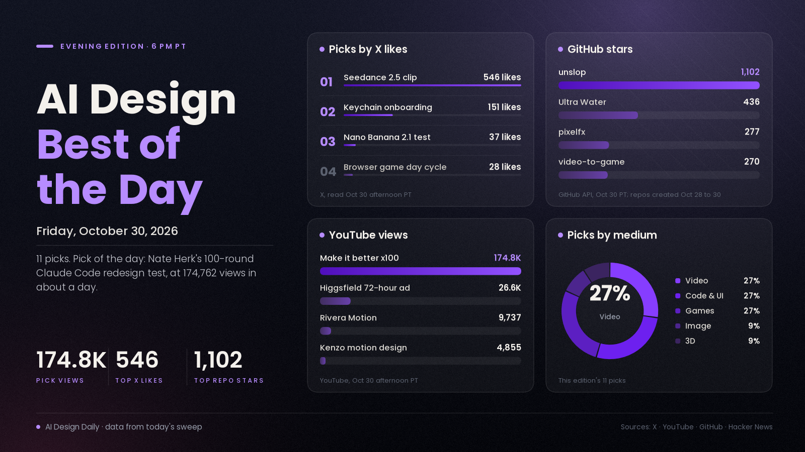

# AI Design Best of the Day · Friday, Oct 30, 2026

## 100 rounds of "make it better," a one-day-old skill that unslops AI-looking UI and 31 playable games built from generated videos

The pick of the day is Nate Herk's "I Told Claude to 'Make it better' 100 Times," a YouTube experiment that gives Claude Code one bad coffee-shop website and asks for 100 rounds of improvement, once with Sonnet 5.5 and once with Opus 5.5. It matters because it tests the habit behind much of today's agent-made design, which is to keep telling the model to try again, and it reports where that stops working: Sonnet made small, careful changes, while Opus kept adding features until the site reached 21,000 lines and started breaking itself, per the video description. The video had 174,762 views about a day after upload, up from 89,350 when this morning's edition read it. Around it, long Seedance 2.5 clips drew the most X engagement of the day, a new Claude skill called unslop passed 1,100 GitHub stars in about a day, and a video-to-game kit built on fal turned 31 generated videos into playable three.js games.

*Engagement figures were read from X, YouTube, GitHub, Hacker News and Hugging Face on the afternoon of Oct 30 (PT) and will keep changing. Reddit and Product Hunt could not be read by our tools today, so neither is counted.*

## ⭐ Pick of the day

### 💻 Code and UI

- [I Told Claude to "Make it better" 100 Times (It Went Too Far) (Nate Herk, YouTube)](https://www.youtube.com/watch?v=DByAR5Su1Yw), tutorial. An update on a video the morning edition listed from its title alone; the description is now read. Per the description, he gave Claude Code a deliberately bad coffee-shop website and said "make it better" 100 times in a row, once with Sonnet 5.5 and once with Opus 5.5. Sonnet made small, careful changes; Opus kept adding features until the site hit 21,000 lines and started breaking itself; and neither model searched the web once, though it could have. Why people are losing it: 174,762 views in about a day, the most-viewed design-related video we could verify today, and the chapter list (Sonnet's 100 rounds, Opus's 100 rounds, final stats, "no web search") makes it easy to jump to the part you care about. It is one site and one run per model, so treat the verdict as the creator's, and the description carries links to his paid community, a free website-design skill sign-up and a hosting discount code. How to try it: watch the final-stats chapter at 12:03, then run 10 rounds of your own on a page you already have and stop when it starts adding features you did not ask for.

## The ranked picks

### 🎬 Video

- [Three long Seedance 2.5 clips lead X: "This AI video cooked whole hollywood" (@xmliisu)](https://x.com/xmliisu/status/2116177871467335739), showcase. The post is a clip tagged Seedance 2.5 with no prompt, workflow or credit to a maker. Why it's here: 546 likes, 110 reposts, 250 bookmarks and about 96,300 views, the highest-reach post in the X posts gathered for this edition. Two more near-identical captions have [@xIrissy](https://x.com/xIrissy/status/2116117794882490468) (listed in this morning's edition, now updated) at 411 likes, 244 reposts, 191 bookmarks and about 9,800 views, and [@SarcasticAnnabe](https://x.com/SarcasticAnnabe/status/2116198601936527397) at 306 likes, 65 reposts, 195 bookmarks and about 4,900 views. The three clips run about 2:40, 3:12 and 7:19 and none says who made them, so this is a signal that Seedance 2.5 is what people are sharing, not a credited work. How to try it: judge the clips yourself, then rebuild a short with a documented workflow such as the next pick.
- [I Spent 72 Hours Making This AI Commercial With Seedance 2.5 (Every Prompt I Used) (Higgsfield AI, YouTube)](https://www.youtube.com/watch?v=ktGkJfxNN9M), tutorial. A 27-minute breakdown of a sportswear commercial with three characters, made with Claude and Higgsfield Cinema Studio, from character references and kits to scene building, failed and successful takes, and the final edit. Why it's here: 26,633 views in about nine hours, and chapters such as "Fixing the Dance Movement" and "Goalkeeper Generation Budget" show the retakes most clips hide. The channel belongs to the platform that sells the tool, so it is a product demo, and the description promises the prompts and assets on a Higgsfield page and ends with a "Total Credits" chapter but gives no cost figure. How to try it: skim the character and kit chapters first (2:45 to 5:50) to see how reusable assets are built before any scene is shot.
- [Claude as a motion designer, in two videos the same morning (Георгий Ривера and Kenzo Nakagawa, YouTube)](https://www.youtube.com/watch?v=AIHViECQwiU), tutorial. Both creators have Claude write code that renders animated video with no After Effects. Per the Russian-language description, Rivera's free "Rivera Motion" skill walks you through four motion projects, from a business explainer to a pixel-art intro and real-estate 3D, with a chapter on saving Claude tokens. [Kenzo's Portuguese-language video](https://www.youtube.com/watch?v=0gSkUR1R7EY) says it needs only Claude and Python and produces a paper-cutout collage style in vertical or horizontal; its description still shows an unfilled placeholder where the prompt link should be. Why it's here: 9,737 and 4,855 views within hours of upload, from two creators in two languages. How to try it: start with Rivera's four-projects chapter at 4:15 and judge the output before installing anything.

### 💻 Code and UI

- [unslop: a Claude skill that turns AI-looking UI into a designed one (Damir Sokolovsky, GitHub)](https://github.com/heydamir/unslop), tool. Per the README, it finds the slop first (purple gradients, glows, emoji labels, shouty copy, uneven spacing), proposes a direction from your product, then fixes the screen in passes for spacing, color, icons, copy, type, layout, details, visuals and motion; it can also render a short story video of the screen unslopping itself. Why it's here: 1,102 stars and 53 forks since it was created yesterday, among the fastest-rising new design repos we found, and another entry in the anti-"AI look" wave that impeccable and others have been riding this week. It is CC BY 4.0, so credit the author, and the README ends with an offer to unslop one screen for hire. How to try it: copy the skill into your Claude Code skills folder and run `/unslop` on a dashboard you vibe-coded.
- [Keychain app onboarding, designed in Figma and animated with Claude Code SVG (@oiharshit)](https://x.com/oiharshit/status/2116150062829207886), showcase. A nine-second square clip of an onboarding flow; the post says it was designed in Figma, then animated and built with Claude Code using SVG animations. Why it's here: 151 likes, 75 bookmarks, 28 replies and about 3,100 views, a high save rate for a post with no tutorial attached. There is no code or prompt in the post. How to try it: export a Figma frame as SVG and ask your agent to animate the layers one at a time, checking each against your design.

### 🎮 Games and interactive

- [video-to-game: turn a generated video into a playable three.js game (lovisdotio, GitHub)](https://github.com/lovisdotio/video-to-game), tool. Per the README, a video model designs the game's look, camera and one mechanic; the agent studies the clip frame by frame, makes every image, 3D model and sound with fal, writes a single-file three.js game, then plays it and films its best seconds. The repo shows 31 games from 10 to 15 second MiniMax H3 Max videos, with 1,013 fal calls and about 6 USD per game, 202 USD in total, which are the authors' figures. Why it's here: 270 stars and 38 forks in about a day, and you can [play all 31 games](https://fal-video-to-game.vercel.app) without installing anything. It is built around fal's paid services, so your costs depend on them. How to try it: play two or three from the gallery, then read the README's "Why" section on using the video as the design document.
- [pixelfx: 232 pixel-art effects, each a small piece of code, plus a Claude Code skill (patch-gg, GitHub)](https://github.com/patch-gg/pixelfx), tool. Fire, explosions, water, magic, weather, UI and pickups that you can play live in a [gallery](https://patch-gg.github.io/pixelfx/), recolor, mirror, drop into a browser game or export as sprite sheets, with a skill for making new ones by drafting, rendering, looking and refining. The README credits Hugo Duprez's method for making pixel-art effects with Claude. Why it's here: 277 stars and 28 forks within about sixteen hours of creation, MIT licensed, and every effect is code rather than an image. How to try it: open the gallery, pick one effect, and export it as a sprite sheet for your engine.
- [One day in a browser game, sunrise to midnight, running live in a tab (@PawelJLisowski)](https://x.com/PawelJLisowski/status/2116108914777600500), showcase. A video of a day cycle where, per the post, every shot is the game itself running in a browser tab with nothing pre-rendered, a three.js client and a Rust server built with Claude Code over four weeks. Why it's here: 28 likes and 13 replies on about 930 views, the most-discussed small game post in the X list. The post links no playable build, so the "four weeks" and "nothing pre-rendered" claims are the maker's. How to try it: ask the maker for a link, or use it as a lighting reference for your own three.js scene.

### 🖼️ Image and visual

- [Nano Banana 2.1 reverse-angle shot test, with the prompts in the post (@ai_artworkgen)](https://x.com/ai_artworkgen/status/2116217421077848340), tutorial. The maker gave the model one scene and asked it to "show me the reverse angle shot of this exact scene" while keeping the subject's position, pose, outfit and environment identical, then added a blizzard with a second prompt and built other shots from the subject's face as a reference; the post credits Google Flow. Why it's here: 37 likes, 44 bookmarks and about 3,000 views, with both prompts printed so you can copy them. It is four images from one run, not a benchmark. How to try it: take one of your own scenes and ask for the reverse angle with the same wording.

### 🧊 3D

- [Ultra Water: a real-time FFT ocean renderer for three.js (Humpalumps, GitHub)](https://github.com/Humpalumps/Ultra-Water), tool. Per the README, shore breakers, foam, caustics, underwater rendering and buoyancy in WebGL2, with a demo island scene and camera shots you can pick from a dropdown. The author's benchmark on an RTX 3060 is 3.3 to 4.8 ms a frame (about 208 to 303 fps uncapped) at 1440p-equivalent, and the README says the design was argued out with a second agent. Why it's here: 436 stars and 59 forks within about two days, MIT licensed. There is no hosted demo, so you run it locally with `npm install` and `npm run dev`. How to try it: run it and cycle the camera shots from open ocean to underwater.

---
*Method:* the 21 X posts gathered for this edition were each opened by ID and their text and metrics re-read; none were taken on trust, and 6 are linked above. They were checked against a fresh sweep of YouTube (uploads from the last day, descriptions read), GitHub trending (daily, weekly) and new-repo search, Hugging Face trending, Hacker News and the day's morning and noon editions. Ranked by engagement and velocity, how many creators are copying it, and how new it is. Left out: impeccable (gained 2,299 stars today, but it was in yesterday's edition and today's morning edition with no new news), Geist Serif and the Florilegium LaTeX flowers (both well-liked on Hacker News but not AI work), nesformer (an NES CPU compiled into model weights, 161 points on Hacker News, a curiosity rather than a design story), the Claude Code extension compromise advisory (security, not design), a claim that Higgsfield sent ComfyUI a cease-and-desist letter (we could not corroborate it beyond a single forum post), two Lovart 2.0 videos and a Figma Weave video (affiliate or sponsor links), and the many small image-model comparison posts and the Halloween challenge announcement, which fell below the engagement bar. Reddit (connection error) and Product Hunt (403) blocked our tools, so neither is counted.

Say the word and I'll steer the next edition there.
