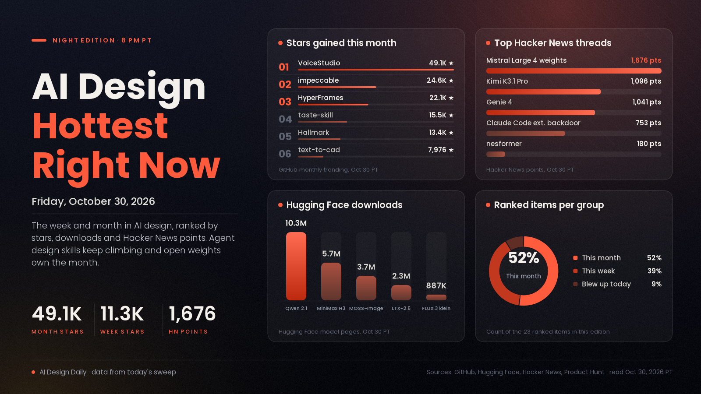

# AI Design Hottest Right Now · Friday, Oct 30, 2026

## A backdoored coding-agent extension and Canva's new editing model made today's news, while design skills for agents keep climbing and open image and video weights set the pace for the month

Today's biggest thread was a security story: a vendor advisory says the official Claude Code extension for VS Code was backdoored on the Cursor Marketplace, and it reached 753 points on Hacker News. The design launch of the day was Canva Brush, a model that edits existing designs, which took 143 upvotes on Product Hunt. The week's design story is still agents learning taste: impeccable gained 11,323 GitHub stars in seven days and 2,300 today, taste-skill added 4,712, and Mistral Large 4's open weights climbed to 1,676 points on Hacker News, though it is a general model. Over the month, staying power belongs to local and open tools: VoiceStudio gained 49,116 stars, and the ComfyUI package for Qwen-Image 2.1 passed 10.3 million downloads.

*Engagement figures were read on the evening of Oct 30 (PT) from GitHub (trending pages and repo pages), Hugging Face (model listings and pages), Hacker News and Product Hunt, and they will keep changing. "This week" means Oct 23 to 30 and "this month" means Oct 1 to 30. X returned "payment required" for every post lookup, so none of the X posts gathered for this edition could be opened and none are used here. YouTube returned no video listings and Reddit blocked every feed, so neither is counted. Any older figure is labelled as coming from an earlier edition.*

## 🔥 Blew up today

- [Canva Brush, a model that edits your designs (Canva, Product Hunt)](https://www.producthunt.com/products/canva), design tool. A vision-language model from Canva that edits an existing design from a request, from one line of copy to every slide in a deck, and keeps the output editable. Per Canva, it is up to 69% faster and 46% lower cost per edit task than its previous design agent; nothing independent backs that. The signal: launched today, 143 upvotes and #5 on Product Hunt's daily list when we read it. Commenters liked the focus on editing rather than generating, and two open questions (right-to-left languages, locked slide headers) had no visible reply from the makers. Try it: it powers Canva AI design edits for Canva Pro; pick "Brush" in the Canva AI dropdown or open a design in the editor. We could not open Canva's own announcement, so details come from the Product Hunt listing.
- [Backdoor in the Claude Code for VS Code extension on the Cursor Marketplace (Phorion)](https://phorion.io/blog/offical-claude-code-vsx-compromise/), security news. Phorion, a security vendor, reports that versions 2.1.312 and 2.1.313 of the official extension carried code that planted an SSH key, opened a reverse tunnel to an outside server and set up persistence on macOS, Linux and Windows; Phorion says Cursor has removed those versions. The signal: 753 points and 472 comments on [Hacker News](https://news.ycombinator.com/item?id=50300683), the top story on the front page. It is not a design tool, but it matters to anyone installing agent extensions and skills like the ones in this edition. The analysis is one vendor's, the advisory also promotes its own products, and we could not open Cursor's notice. Try it: check which version of the extension you have installed; per the advisory, uninstalling alone does not remove the backdoor, and its page lists the cleanup steps and says to rotate credentials.

## 📈 Hottest this week

- [impeccable, a design vocabulary for coding agents (GitHub)](https://github.com/pbakaus/impeccable), update. Commands such as `polish`, `bolder`, `critique` and `audit`, plus a detector that flags generic AI-looking design; the page lists 24 commands and 62 detection rules. The signal: 11,323 stars this week and 2,300 today, 97,060 in total (9,713 this week in the previous edition); Apache-2.0. Try it: run `npx impeccable install`, then `/impeccable init` in your agent, and audit one existing page.
- [Mistral Large 4 open weights (Mistral)](https://mistral.ai/news/mistral-large-4-oss/), update. A roughly 1-trillion-parameter, natively multimodal open-weight model under a modified MIT license (businesses offering it as a hosted service need a separate commercial license). The signal: 1,676 points and 435 comments on [Hacker News](https://news.ycombinator.com/item?id=50289418), up from 1,156 points in the previous edition. Mistral's page makes no image or design claims, so treat it as news for people who build tools and interfaces. Try it: weights are on Hugging Face for vLLM or SGLang; hosted access is $0.70 per million input tokens and $2.10 per million output tokens per the page.
- [Kimi K3.1 Pro, an open-weight model aimed at front-end and 3D work (Moonshot)](https://www.kimi.ai/blog/kimi-k3-1-pro), update. Moonshot says it builds front-end pages and Three.js scenes, works with Unity, Unreal and Godot, and scripts Blender and CAD; it scores 92.7% on BenchCAD with tools, against 96.2% for Claude Opus 5.5 on the same page. All numbers are Moonshot's. The signal: 1,096 points and 679 comments on [Hacker News](https://news.ycombinator.com/item?id=50212065). Full weights are due by Nov 4, and the page still names no license. Try it: it is live on kimi.ai and the Kimi API, and its 3D Make feature is live in the app.
- [Genie 4, a world model you can walk into (Google DeepMind)](https://deepmind.google/blog/genie-4-a-new-generation-of-world-simulation/), update. Prompt a live scene, steer it with text (weather, camera, people, objects), and get ambient sound, music and dialogue. The signal: 1,041 points and 591 comments on [Hacker News](https://news.ycombinator.com/item?id=50261319) (1,038 in the previous edition). Google lists drifting detail and illegible text as known problems, and all output carries SynthID watermarks. Try it: it is a research preview for trusted testers; Project Genie has a waitlist, with Ultra subscribers and early Gemini API partners next.
- [taste-skill, art direction for coding agents (GitHub)](https://github.com/Leonxlnx/taste-skill), update. Deals the agent one of 20 design directions, builds with credited open-collection images and checks the result in a browser at three widths. Version 2.1 adds a route for dashboards and app screens. The signal: 4,712 stars this week and 15,496 this month, 106,342 in total (4,359 this week in the previous edition); MIT. Try it: `npx skills add https://github.com/Leonxlnx/taste-skill --skill "design-taste-frontend"`; it needs Node 22 and Chrome, and the page says a build takes 30 to 45 minutes.
- [Interfaces skills for coding agents (Jakub Krehel, GitHub)](https://github.com/jakubkrehel/skills), update. Fourteen skills, including `better-interface` (one ranked review of a screen), `better-typography`, `better-colors`, `better-accessibility`, `build-design` (builds UI from a Figma file or design image) and `teardown` (a configurable technical illustration you can export as SVG, PNG or PDF). The signal: 1,107 stars this week and 9,375 in total (980 this week in the previous edition); MIT. Try it: `npx skills add jakubkrehel/skills`, then run `better-interface` on one screen.
- [Pika H3 Flex, LoRA adapters on MiniMax H3 (Pika, Hugging Face)](https://huggingface.co/Pika-Labs/Pika-H3-Flex), update. Per the model page, it makes video with synchronized stereo audio in six sampling steps, at 480p or 768p, 24 fps and 5 to 15 seconds, with up to 12 reference files. The signal: 197 likes (76 in the previous edition) and second on Hugging Face's trending image-to-video list. The adapters follow the MiniMax H3 community license, 1080p to 4K is only in Pika's hosted API, and the page says the base components total about 210 GB. Try it: load it on top of MiniMax H3 in diffusers or use the ComfyUI templates on the page.
- [SurgePix, AI visuals you keep editing layer by layer (Product Hunt)](https://www.producthunt.com/products/surgepix), update. Per the makers, you can split an image or slide into editable layers, swap text, repaint a region and keep a brand kit, with open-source agent skills for Claude Code and Cursor. The signal: 268 points and #8 on Product Hunt's weekly leaderboard (263 and #8 in the previous edition, so it has held its place). A maker comment says layer splitting costs no extra credits. Try it: free to start at surgepix.ai; split one of your own flat posters into layers and retype the headline.
- [nesformer, a Nintendo CPU running inside language-model weights (Drew Breunig, GitHub)](https://github.com/dbreunig/nesformer), creation. The README says a compiler, not training, set every weight of a Qwen3.5-sized checkpoint so that it runs an NES's 6502 processor, with a small host program handling graphics and controls. This is a curiosity, not a design tool. The signal: 180 points and 108 comments on [Hacker News](https://news.ycombinator.com/item?id=50306442), 149 stars; MIT. It is very slow (about 25 minutes for 600 frames) and supports only the simplest cartridges, with no sound. Try it: the README has a `python -m nesformer run` command and a bundled test ROM.

## 🏆 Hottest this month

- [VoiceStudio, a local voice studio (GitHub)](https://github.com/debpalash/VoiceStudio), update. Voice cloning, voice design from a text description, video dubbing, dictation, transcription and audiobooks on your own device; the repo claims 646 languages without saying which engine covers which. The signal: 49,116 stars this month and 95,743 in total, the most gained on GitHub's monthly trending list (47,778 in the previous edition). It is AGPL-3.0, and model weights and voices carry their own licenses. Try it: install with the one-line script on the repo page and dub a short clip locally.
- [HyperFrames: write HTML, render video (HeyGen, GitHub)](https://github.com/heygen-com/hyperframes), update. Turns HTML, CSS and seekable animations (GSAP, Lottie, Three.js and others) into deterministic MP4s, built for agents. The signal: 22,149 stars this month and 76,052 in total (21,520 in the previous edition); Apache-2.0. Try it: `npx hyperframes init my-video`, then `preview` and `render`; it needs Node 22 and FFmpeg.
- [Claude Dashboards and Claude Motion (Claude)](https://claude.com/resources/articles/dashboards-and-motion), update. Dashboards turn connected company data into a live dashboard where each number links to its query; Motion makes animated explainers as editable code, not generated footage, and exports MP4. Per the page, both are in beta (Dashboards on paid plans, Motion on Team and Enterprise) and off by default for Enterprise admins. The signal: the launch post had 60,543 likes on X in the Oct 26 edition, still the biggest AI design post we have recorded this month; we could not re-read X, so that figure is from the earlier edition. Try it: type `/motion` and describe a 30-second explainer.
- [Qwen-Image 2.1 (Qwen, Hugging Face)](https://huggingface.co/Qwen/Qwen-Image-2.1), update. A 7B open model for text-to-image and editing, with up to 10 reference images, local edits by circle or mask and transparent (RGBA) output, per Qwen. The signal: about 3.5k likes, and 10,297,072 downloads last month on its [ComfyUI package](https://huggingface.co/Comfy-Org/Qwen-Image-2.1) (10,165,332 in the previous edition). It uses the Qwen Research License, so check it before commercial use. Try it: use the official Hugging Face Space for a first look, then load it in diffusers or ComfyUI.
- [MiniMax H3, an open audio-video model (MiniMaxAI, Hugging Face)](https://huggingface.co/MiniMaxAI/MiniMax-H3), update. Makes video with stereo audio, with first-frame and reference-file conditioning. The signal: 6,449 likes and 5,692,510 downloads (5,575,683 in the previous edition), and community LoRAs built on it, Pika's among them, fill the top of Hugging Face's image-to-video trending list. It is under the MiniMax H3 community license; Pika's page puts the base components at about 210 GB. Try it: the model page covers ComfyUI, diffusers, vLLM and SGLang.
- [Hallmark, a design skill that refuses to look AI-generated (Nutlope, GitHub)](https://github.com/Nutlope/hallmark), update. Picks three themes from a catalog of fifty, builds the page around the visitor's task and lints the result in a browser for machine-made tells, in tiers from "never ships" to "non-blocking". Works with Claude Code, Codex, Cursor and OpenCode. The signal: 13,397 stars this month and 42,976 in total (12,501 in the previous edition); MIT. Try it: `npx skills add nutlope/hallmark -g`; the browser checks also need puppeteer-core and Chrome.
- [LTX-2.5, an open video model with audio (Lightricks, Hugging Face)](https://huggingface.co/Lightricks/LTX-2.5), update. Open weights for local video with synchronized audio, native multishot generation that keeps characters consistent across cuts, and bf16, int8 and NVFP4 variants. The signal: 9,966 likes and 2,335,172 downloads last month (9,848 likes in the previous edition), first on Hugging Face's image-to-video trending list. Free commercial use under US$10M revenue; the repo is gated. Try it: official ComfyUI workflow templates, or the API Playground with no install.
- [MOSS-Image for ComfyUI (Hugging Face)](https://huggingface.co/Comfy-Org/MOSS-Image), update. A 5B open model from OpenMOSS, packaged for ComfyUI. The signal: 3,702,490 downloads and 556 likes (3,401,045 and 544 in the previous edition); Apache-2.0. Community fine-tunes such as [Kromoss](https://huggingface.co/lodestones/Kromoss) (287 likes, Apache-2.0, a drop-in replacement per its card) build on it. Try it: start from ComfyUI's template and run a poster brief through it.
- [text-to-cad, design physical products with AI (GitHub)](https://github.com/earthtojake/text-to-cad), update. A plugin where the agent writes a build123d Python script and exports STEP, GLB, STL or 3MF, plus drawings and printer-ready G-code. The signal: 7,976 stars this month and 24,351 in total (7,732 in the previous edition); MIT. Try it: use the install script on the repo page and describe one bracket; usage telemetry is on by default and the privacy policy explains how to turn it off.
- [ArtCraft, "the IDE for artists" (GitHub)](https://github.com/storytold/artcraft), tool. Compose in 2D, stage scenes in 3D, turn images into 3D meshes and animate images into video, with a catalog of 62 models from providers including Grok, Midjourney, Sora and World Labs (some disabled or restricted). The signal: 37.8k stars and 6.0k forks, up from the 6.9k a seed post reported earlier this month (that post's claim, not verified; we did not read a monthly gain). It is dual-licensed MIT or Apache-2.0. Try it: download the Windows or macOS build from the repo's releases page.
- [FLUX.3 image klein for ComfyUI (Black Forest Labs, Hugging Face)](https://huggingface.co/black-forest-labs/flux-3-image-klein-comfy), update. One model for text-to-image, editing and multi-reference generation with up to 10 references, plus bounding-box placement of elements. The signal: 886,973 downloads last month and 2,120 likes (832,197 and 2,049 in the previous edition). Its page says never to run it without the prompt upsampler, and commercial output is allowed only for users under US$5M in revenue. Try it: load the repo's ComfyUI workflow; int8 files suit 8 GB cards.
- [Fibo 2.0, Bria's open editing and image model trained on licensed data (Bria, Hugging Face)](https://huggingface.co/briaai/Fibo-2.0-dev), update. An 8B model that handles instruction edits, masked edits and up to 4 reference images, steered by long structured prompts. Bria says it ranks #1 for image editing and #2 for text-to-image among open-weights models on Artificial Analysis as of Oct 20; that is Bria's claim. The signal: 192 likes (136 in the Oct 20 edition) and 1,805 downloads last month. It is CC BY-NC 4.0, so commercial use needs a separate agreement. Try it: the Fibo-2.0-editing Space on Hugging Face needs no install.

---
*Method:* a fresh evening sweep of GitHub trending (daily, weekly, monthly) with each repo opened for its description, license and install steps, Hugging Face trending listings (all models, text-to-image, image-to-video, image-to-3D) and Spaces with model pages read, the Hacker News front page, item counts and searches, and Product Hunt's daily and weekly leaderboards. The X posts gathered for this edition could not be opened (X returned "payment required"), so none were used; YouTube and Reddit gave no usable data, and web searches for the week's design launches turned up nothing newer than the items above. Ranked by engagement and velocity, staying power, how widely creators are adopting it, and how new it is. Items marked "update" were in an earlier edition and are included because their numbers moved or there is new news.

Say the word and I'll steer the next edition there.
