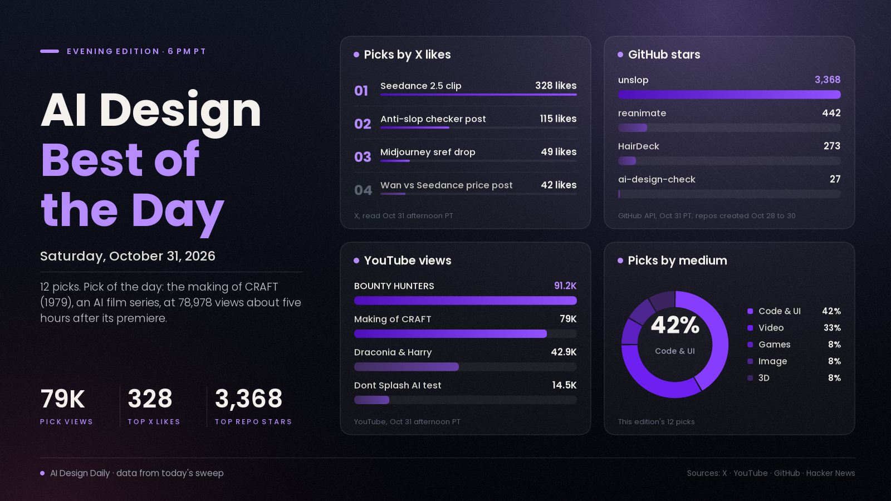

# AI Design Best of the Day · Saturday, Oct 31, 2026

## A making-of for an AI film series pulls 79,000 views in hours, a two-hour YouTube alternative built with Opus 5.5, and a skill that copies animations frame by frame

The pick of the day is "The Making of CRAFT (1979)," a behind-the-scenes film from the LatentDiffusion channel about its fan-made, Minecraft-inspired dark fantasy series, imagined as if it had been shot in the 1970s. It matters because it is a rare AI-film video that shows the whole job instead of only the output: the description lists the tools (Seedance 2.0 and 2.5 through Runway and EvoLink, Midjourney, Nano Banana Pro, ChatGPT image generation, ElevenLabs, Seed Audio 1, Photoshop and Premiere) and says the script was written by the maker and a small team, with manual sound design, compositing, color grading and shot-by-shot fixes on top. The video had 78,978 views about five hours after its premiere. Around it, a blog post signed karpathy described a YouTube-style site built from Hacker News recommendations in about two hours with Opus 5.5 (401 points on Hacker News), the anti-"AI look" skill wave kept growing (unslop is now past 3,300 stars), and Seedance 2.5 clips again made up most of the X video posts we were given.

*Engagement figures were read from X, YouTube, GitHub and Hacker News on the afternoon of Oct 31 (PT) and will keep changing. Reddit and Product Hunt returned 403 to our tools today, so neither is counted.*

## ⭐ Pick of the day

### 🎬 Video

- [The Making of CRAFT (1979) (LatentDiffusion, YouTube)](https://www.youtube.com/watch?v=RlhGKn2739E), tutorial. A behind-the-scenes film for the first season of CRAFT, ten episodes of a fan-made, Minecraft-inspired dark fantasy series that imagines the world as a 1970s production. It covers worldbuilding, making and animating the visuals, editing, sound design and assembly. Per the description, "CRAFT was made using AI as a tool, but it was not solely AI-generated": the maker names the models above, credits manual Photoshop and Premiere work, and says the story and script were written by the maker and a small team, which are the maker's statements. Why people are losing it: 78,978 views about five hours after the premiere, a count that tops the 9,165 views of today's eight-model video test, plus a full tool list that most showcase videos leave out. The description carries a Runway discount code, a Patreon appeal and a Discord invite, so treat those as promotional, and it says the series is not an official Minecraft product. How to try it: watch it for the pipeline order, then copy the habit of doing sound, compositing and color by hand over generated shots.

## The ranked picks

### 🎬 Video

- [Seedance 2.5 clips lead X again: "This Ai video is truly a masterpiece" (@xmliisu)](https://x.com/xmliisu/status/2116576677983854904), showcase. A new post from the account that led yesterday's edition (a different post, not a repeat): a clip tagged Seedance 2.5 with no prompt, workflow or credit to a maker. Why it's here: 328 likes, 79 reposts, 221 bookmarks and about 2,700 views, the most-liked Seedance post in the X posts gathered for this edition (yesterday's post reached about 96,300 views, so today's reach is far smaller). Three more near-identical captions follow: [@Arzoo12sh](https://x.com/Arzoo12sh/status/2116475295217934845) at 167 likes and 22 replies, which says the prompt is in the replies; [@ElsaSofia__AI](https://x.com/ElsaSofia__AI/status/2116486134817796115) at 155 likes and 57 replies with a prompt promised below; and [@Xmbluee](https://x.com/Xmbluee/status/2116628986931650644) at 150 likes, 56 reposts and 102 bookmarks, made with Seedance 2.5 on PixVerse. We could not confirm that any of these posters made the clips they share, and we did not read the reply threads. How to try it: open the replies on the posts that promise a prompt, test the prompt yourself on Seedance 2.5, and compare it with what the clip shows before you copy it.
- [⏪ update: BOUNTY HUNTERS (VORON PICTURES) and Draconia & Harry: A Halloween Date (Space Cafe'), YouTube](https://www.youtube.com/watch?v=-FbFhsy6DCQ), showcase. Both AI short films were in this noon's edition; the numbers are what is new. BOUNTY HUNTERS, a sci-fi western with hoverbike outlaws and sandworms, is at 91,192 views, up from 64,113 at noon; the channel calls it an original AI-created film but lists no tools, so we cannot say which models made it. [Draconia & Harry](https://www.youtube.com/watch?v=gq6I-muf1AY), an unofficial Harry Potter fan short, is at 42,891 views, up from 33,323; its description says video and sound were made with MiniMax H3 through ComfyUI and a Long Shot Studio node pack. Why it's here: they are the two most-viewed AI films we found today, both climbing through the afternoon. How to try it: for the Draconia workflow, start from the node pack named in its description; for BOUNTY HUNTERS there is nothing to reproduce, so use it as a pacing reference.
- [Wan 3.0 Prime against Seedance 2.5: "you're wasting over $500" (@simonecanciello)](https://x.com/simonecanciello/status/2116597642323280009), result. A side-by-side clip with the poster's own price claims, $0.30 for Wan 3.0 Prime against $2.00 for Seedance 2.5, and a verdict that they are "pretty much the same" with Wan almost 7x cheaper and faster, all the poster's claims. Why it's here: 42 likes and 70 bookmarks on about 2,900 views, a high save rate for a price argument, and it is the sharpest example of today's cost framing. [@openclipsai](https://x.com/openclipsai/status/2116544975207108798) ran one cyberpunk-chase prompt through four video models, ten seconds each, for $4.67 in total by its own account (7 likes, a promotional account), and [WorldofAI's eight-model test on Higgsfield](https://www.youtube.com/watch?v=eadEYJY9ydg) put the same prompt through Kling 4.0, Seedance 2.5, Wan 3.0 Prime, MiniMax H3 and four others, at 9,165 views; its description says it is sponsored by Higgsfield. It is one clip per model in each case, not a benchmark. How to try it: run your own prompt on the two models and compare cost per kept clip, not cost per generation.

### 💻 Code and UI

- [HackerTube: a YouTube-style site built from videos Hacker News recommended (karpathy, blog and site)](https://karpathy.bearblog.dev/hacker-tube/), showcase. The post says the author asked Opus 5.5 to write a YouTube clone from videos recommended on Hacker News; the model downloaded the comments, ran Sonnet over them to drop spam, kept about 40K comments and ended with [6,454 videos across 150 topics](https://hackertube.org/), then added a YouTube-style UI, a domain and a VPS in roughly two hours. Per the post it uses a 50% thumbnail instead of the uploaded one, makes "ForYou" recommendations with no accounts by keeping state in the browser, has keyboard shortcuts and offers an export of its data so your own agent can build a version. Why it's here: [401 points and 70 comments on Hacker News](https://news.ycombinator.com/item?id=50319510) within about three hours, and it is a design argument as much as a build: a feed redesigned against exaggerated thumbnails. The time, counts and "quality content" claims are the author's. How to try it: open the site, then take the data export and ask your agent for a version tuned to your own taste.
- [⏪ update: unslop, a Claude skill that turns AI-looking UI into a designed one (Damir Sokolovsky, GitHub)](https://github.com/heydamir/unslop), tool. Yesterday's edition listed it at 1,102 stars and 53 forks the day after it was created; it is now at 3,368 stars and 168 forks, CC-BY-4.0 per the repo. Per the README it finds the slop first (purple gradients, glows, emoji labels, shouty copy, uneven spacing), sets a direction from your product, then fixes the screen in passes, and works in Next.js, React, Vue, Svelte, Tailwind or plain HTML. Why it's here: roughly tripling in a day is the kind of growth that makes a skill a trend; pixelfx, also in yesterday's edition, went from 277 to 1,361 stars over the same stretch. How to try it: follow the README's install step for your agent and point it at one screen you already shipped.
- [ai-design-check: an open-source checker for the tells of AI-built UI (Enmera, GitHub and npm)](https://github.com/enmerasoftware/ai-design-check), tool. Per the README it is a zero-dependency checker with no AI and no API key, plus an agent fix skill, that flags spacing off the 4 px grid, off-scale font sizes, gradient buttons, emoji as icons, "Welcome back, Alex!" and removed focus rings; the README says 74 rules, while [the maker's X post](https://x.com/sinanyorulmazz/status/2116531845839851723) says 70 and claims a generated dashboard went from 266 findings to 0, which is the maker's claim. Why it's here: the post has 115 likes, 154 bookmarks and about 7,400 views, but the repo itself has only 27 stars and was created on Oct 28, so it is a new entrant in the anti-slop wave rather than an established one; it is MIT licensed. How to try it: run `npx @enmera/ai-design-check` in a project and read the findings before letting an agent fix anything.
- [reanimate: a Claude Code skill that reverse-engineers an animation and rebuilds it in your own code (NiazMorshed2007, GitHub)](https://github.com/NiazMorshed2007/reanimate), tool. Per the README it records a live site, screen recording, mp4, gif or Lottie file, writes a timing and property table for each element, builds the animation in your stack (CSS, Framer Motion, GSAP or three.js), then records the copy and compares timing, easing and pixels, usually for 2 to 5 rounds. The README's own examples include "417 of 417 frames identical" for a Vercel toolbar and 0.03% of pixels differing for a Stripe card, which are the author's figures. Why it's here: 442 stars and 36 forks in about two days, MIT licensed, and it is a new idea rather than another taste checker. It needs Bun 1.1+ on macOS or Linux and downloads about 250 MB of ffmpeg and Chromium on the first run, and the README says login-protected pages, YouTube and Loom cannot be recorded. The examples recreate parts of commercial sites as a study, so copy motion for learning and do not ship another company's work. How to try it: install it with the README's `npx skills add` line and ask it to recreate a hero entrance from a page you are allowed to study.
- [Build & Animate My Figma Website using Claude (Full Course) (AyzZ, YouTube)](https://www.youtube.com/watch?v=kau9QOV1G8E), tutorial. An agency's workflow for avoiding "vibe coded" sites: design in Figma, connect Figma to Claude Code through the Figma MCP, explain every animation in one detailed prompt, then fix what Claude missed using video references. The tools listed are Figma, Figma MCP, Claude Code (Opus 5.5), Next.js, GSAP, Lenis, Vercel and GitHub. Why it's here: 5,400 views in about 13 hours for a 28-minute workflow, and the chapter list (Figma, MCP, the prompt, fixing errors, video references) is easy to jump around. The description plugs the maker's design studio, so it is partly a sales video, and the title has changed since it appeared in search. How to try it: do the Figma-to-MCP step on one page first and compare the first result against your design before adding animation.

### 🎮 Games and interactive

- [ChatGPT vs Claude make Dont Splash (Zo, YouTube)](https://www.youtube.com/watch?v=A4MKxxny3Do), showcase. The maker gave GPT-6 Astra (in Codex) and Claude Opus 5.5 (in Claude Code) the same master prompt and reference images, used ForgeGUI for assets and the Roblox MCP to build, and compared two prompts each: one to build the game and one to make it scarier. Per the description, GPT-6 Astra built Don't Splash itself, which the maker calls "the most hyped Roblox horror game right now," while Opus 5.5 refused a 1:1 copy and built its own game, Still Water, with a blind monster that hunts by sound, all the maker's account. Why it's here: 14,462 views in about a day for a head-to-head game build, and it echoes the report in this morning's edition that Claude Code now declines to recreate existing games, here as the maker's own account. The description pushes the maker's ForgeGUI tool and a paid Skool community, so those links are promotional. How to try it: reuse the two-prompt pattern, build first and escalate second, with your own game idea and compare which agent keeps the structure intact.

### 🖼️ Image and visual

- [Storybook Halloween witches and black cats, Midjourney style code 6289118159 (@minuitIA)](https://x.com/minuitIA/status/2116469859215441975), showcase. A four-image set in a whimsical storybook style with dusky blue tones, moonlit castles, quirky witches and black cats, shared with the style reference `--sref 6289118159`. Why it's here: 49 likes, 12 replies and about 560 views, a small post but the only image drop in the X list with a copyable style code. It is a quote-post of an earlier set, which we did not open. How to try it: paste the `--sref` code into a Midjourney prompt with your own subject and compare it against a version without the code.

### 🧊 3D

- [HairDeck: stylized hair cards and animation bones from a single image (hyz317, GitHub)](https://github.com/hyz317/HairDeck), tool. Per the README, from one image it generates a set of hair cards, with UVs, plus the spring-bone chains that animate them, exportable as a GLB mesh or attached to an avatar and exported as VRM; the authors are from Tsinghua, Carnegie Mellon and the Chinese University of Hong Kong, and the README links an [arXiv paper](https://arxiv.org/abs/2610.40599), model weights and a [Hugging Face demo](https://huggingface.co/spaces/hyz317/HairDeck). Why it's here: 273 stars and 16 forks in about two days, Apache-2.0, and hair cards with rigging are a job that is usually done by hand. Quality claims are the authors'; we did not run it. How to try it: open the Hugging Face demo with a character image of your own and, if it works, export the GLB into Blender.

---
*Method:* the 28 X posts gathered for this edition were each opened by ID and their text and metrics re-read; none were taken on trust, and 8 are linked above. They were checked against a fresh sweep of YouTube (searches across video, design, game, 3D and music topics, descriptions read for the picks), GitHub trending (daily) and new-repo search, Hugging Face trending models and spaces, the Hacker News front page and the day's morning and noon editions. Ranked by engagement and velocity, how many creators are copying it, and how new it is. Left out: Nano Banana image posts whose prompts sit behind a Telegram link (promotional), a Nano Banana Pro post using a real person's likeness, a design skill whose name is offensive, a hype-style "7 GitHub repos" thread and a list of UI component sites whose links we did not open, an AI music video charting in France that comes from a political news account, the brand-account PixVerse clip, posts with almost no engagement so far (a 25-second train-window clip, a macOS menu bar app for coding agents, an AR horror game, a Mario Kart-style game), a YouTube "free unlimited video" video with 46K views that is mostly tool promotion, an affiliate-linked 3D game contest video, a commentary video on Claude declining to clone existing games, a 1,700-star gallery of AI fashion reference images that we did not examine, a cluster of repositories offering cracked installers for commercial software with 100 to 200 stars each (treated as bait and not opened), and Hallmark and impeccable (no new news today). Reddit and Product Hunt returned 403, so neither is counted.

Say the word and I'll steer the next edition there.
