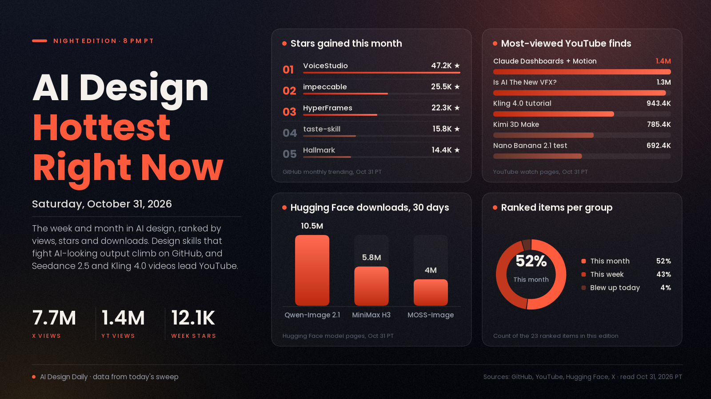

# AI Design Hottest Right Now · Saturday, Oct 31, 2026

## Design skills that fight AI-looking output keep climbing on GitHub, an all-models API launch drew 7.7 million views on X, and Seedance 2.5 and Kling 4.0 videos lead YouTube

Today's one real breakout was karpathy's HackerTube, a YouTube-style site an AI model built in about two hours, which reached 623 points on Hacker News within hours of its post. The week's biggest signal was an announcement: the Sunra API, a single key for image, video, audio and 3D models, drew 7.7 million views on X, though its own price claims are unverified and most of the follow-on posts are promotional. The week's steadiest climb is the design-taste layer for coding agents: hallmark gained 12,062 GitHub stars in seven days and unslop reached 3,488 stars three days after it was created. Over the month, the most-watched finds are Claude's Dashboards and Motion launch video (1,387,296 views) and Seedance 2.5 and Kling 4.0 tutorials, while open image and video weights keep piling up downloads, led by Qwen-Image 2.1 at 10.5 million.

*Engagement figures were read on the evening of Oct 31 (PT) from GitHub (trending pages and repo pages), Hugging Face (model listings, pages and cards), YouTube (watch pages), Hacker News and X, and they will keep changing. "This week" means Oct 25 to 31 and "this month" means Oct 1 to 31. Sponsored, affiliate and promotional items are labelled as such, and vendors' own numbers and prices are reported as their claims. Product Hunt blocked our requests and Reddit's score pages did too, so neither is counted. Any older figure is labelled as coming from an earlier edition.*

## 🔥 Blew up today

- [⏪ update: HackerTube, a YouTube-style site built from videos Hacker News recommended (karpathy)](https://karpathy.bearblog.dev/hacker-tube/), creation. The post, dated Oct 31, says the author asked Opus 5.5 to build a YouTube clone from videos recommended in Hacker News comments; the model pulled the comments, had Sonnet filter out spam and kept about 40K that recommend a video, ending with 6,454 videos across 150 topics. Per the post it uses a 50% frame as the thumbnail, makes "For You" picks with no accounts (state stays in the browser), has keyboard shortcuts and offers a data export so you can have your own agent build a version; the whole job took about two hours. The signal: 623 points and 221 comments on [Hacker News](https://news.ycombinator.com/item?id=50319510), the second-highest-scoring story posted in the last 24 hours when we read it. It was in this morning's Best of the Day without those numbers, which are the update. Nothing else took off today in what we could read: the most-liked design posts of the day we opened were under 100 likes. Try it: open [hackertube.org](https://hackertube.org/) and use the data export to have your own agent build a version around a different community's recommendations.

## 📈 Hottest this week

- [Sunra API launch: every image, video, audio and 3D model through one key (@sunra_ai, X)](https://x.com/sunra_ai/status/2115475466257596516), tool news, promotional. The vendor's own post, Oct 28: "every leading image, video, audio and 3D model through one key, each at its maker's own API price," pay as you go, with no subscription and no markup. That is Sunra's claim and we have not checked any price. The signal: 4,310 likes, 385 reposts, 184 replies, 7,720,315 views and 4,656 bookmarks, the biggest numbers in this week's sweep. Many of the quote posts are promotional too: one lists Seedance 2.5 at $0.231 a second on Sunra against $0.462 on fal and Higgsfield, another totals about $21 for a month of Kling 4.0 and GPT Image 2.5 use; those are the posters' claims, not ours. Try it: start from [sunra.ai](https://sunra.ai) and compare its prices with the makers' own pages before you move a workflow.
- [Introducing 3D Make in Kimi (Kimi AI, YouTube)](https://www.youtube.com/watch?v=VtzELsWFXV4), update, vendor video. A 74-second launch video; per the description, Kimi connects to Blender and CAD tools to create 3D models, develop game assets and turn pictures into 3D-printable models, available now on kimi.ai and Kimi Work. The signal: 785,409 views since Oct 29 (PT). The feature was in the Oct 29 and 30 editions, which had no view count. Try it: it is live on kimi.ai; ask for a 3D-printable part from a photo and check the result in your own CAD tool.
- [hallmark, a design skill that refuses to look AI-generated (Nutlope, GitHub)](https://github.com/Nutlope/hallmark), update. "Anti-AI-slop design skill for Claude Code, Cursor, and Codex," per the repo. The signal: 12,062 stars this week, the most on GitHub's weekly trending list, 14,378 this month and 43,927 in total (13,397 for the month and 42,976 in total in the Oct 30 edition); MIT. Try it: `npx skills add nutlope/hallmark -g`, then build one page and read what the linter flags.
- [unslop, a Claude skill that turns AI-looking UI into a designed one (Damir Sokolovsky, GitHub)](https://github.com/heydamir/unslop), update. Per the README, it finds the tells first (purple gradients, glows, emoji labels, shouty copy, uneven spacing), picks a direction from your product and fixes the screen pass by pass; it works with Next.js, React, Vue, Svelte, Tailwind or plain HTML, and even on a live site from a link. The signal: 3,488 stars and 172 forks, created Oct 29, up from 1,102 stars in the Oct 31 Best of the Day. The license is CC BY 4.0 per GitHub. Try it: `git clone https://github.com/heydamir/unslop`, copy `skills/unslop` into `~/.claude/skills/`, then run it on your ugliest dashboard.
- [Promotional: a fantasy fairy clip "generated with @AkoolInc" (@BGKuaci, X)](https://x.com/BGKuaci/status/2116030358835941482), showcase. A cinematic fantasy-scene video posted Oct 30 with a pitch for the AKOOL AI Film Challenge, "your share of $500,000" across three categories and a $100 bonus for every qualified entry, all per the post. Treat it as an advertisement for Akool, not an independent showcase. The signal: 3,231 likes, 156 reposts, 19 replies, 1,078,031 views and 1,703 bookmarks. No prompts or workflow are given. Try it: only if you plan to enter the contest; read its rules on Akool's own pages first.
- [BOUNTY HUNTERS, the first film of a sci-fi western series (VORON PICTURES, YouTube)](https://www.youtube.com/watch?v=xXUQ2SJ254c), showcase. An 11-minute short about two alien bounty hunters in a saloon showdown. The description says only that "some visuals in this film were created with AI-assisted tools," and names no models. The signal: 468,771 views since Oct 26. This is the channel's first film; the sandworm film in today's earlier editions is a different upload by the same channel. Try it: watch it for pacing and consistency across 11 minutes, since no workflow is shared.
- [Mr. Bean vs a Sumo Wrestler, one of a mash-up series (@TechieBySA, X)](https://x.com/TechieBySA/status/2115430062954537284), showcase. A short made, per the post, with Seedance 2.5 and GPT Image 2.5; it is one of at least five in the series this week, including two more today. The prompts are offered "for my subscribers," so they are not free to copy. The signal: 212 likes, 18 reposts, 19 replies, 29,133 views and 89 bookmarks. Try it: check the poster's replies for a free prompt before you subscribe; the clip itself shows the character-mash-up format.
- [Genie 4, a world model that generates sound along with the world (Google DeepMind)](https://deepmind.google/blog/genie-4-a-new-generation-of-world-simulation/), update. The page (Oct 27) calls it natively multimodal, with music, ambient noise and interactive dialogue generated together with the world, and lists a research preview for trusted testers, with Google AI Ultra subscribers in Project Genie and early Gemini API partners next. All video and audio carries SynthID watermarks. The signal: 1,043 points and 592 comments on [Hacker News](https://news.ycombinator.com/item?id=50261319) (1,041 in the Oct 30 edition), and the front pages of The Rundown, Superhuman and The Neuron all carried a Genie 4 story when we opened them. Try it: join the waitlist in Project Genie.
- [Idol, one image to a 3D Gaussian splat (speridlabs, Hugging Face)](https://huggingface.co/speridlabs/idol), tool, 3D. Per the model card, one picture of an object becomes up to 1,048,576 Gaussians as a standard `.ply`, runs on consumer GPUs with 7.2 GB of VRAM and can finish in under 2 seconds. Those are the makers' claims. The signal: 211 likes and 2,367 downloads in 30 days, first on Hugging Face's trending image-to-3D list; Apache-2.0. It was a top pick in earlier morning editions. Try it: use the demo Space linked on the card, or the ComfyUI route mentioned there.
- [Claude Code Game Studios, a game-dev team of agents (Donchitos, GitHub)](https://github.com/Donchitos/Claude-Code-Game-Studios), update. Per the repo description: "49 AI agents, 72 workflow skills" in a coordination system modelled on a studio hierarchy, for Claude Code. The signal: 742 stars today on GitHub's daily trending list, 31,171 in total; MIT. It was first listed in an Oct 29 morning edition. Try it: you need Claude Code (Node.js 22 or later for the npm route); the README has the setup.

## 🏆 Hottest this month

- [VoiceStudio, a local voice studio (debpalash, GitHub)](https://github.com/debpalash/VoiceStudio), update. "The open-source, fully-local ElevenLabs alternative": voice cloning, voice design, video dubbing, dictation, transcription and audiobook creation in 646 languages, per the repo. The signal: 47,234 stars this month, the most on GitHub's monthly trending list (49,116 in the Oct 30 edition; the monthly window has moved on), 96,864 in total; AGPL-3.0. Try it: install steps are on the repo page; agent skills install with `npx skills add debpalash/VoiceStudio`.
- [Claude Dashboards and Claude Motion (Claude, YouTube)](https://www.youtube.com/watch?v=en0GuyhieQk), update, vendor video. Per the description, Dashboards builds live dashboards from your data (beta on all paid plans), and Motion turns a report or chart into an animated explainer written as code, with no video model involved, exportable as MP4 (beta on Team and Enterprise); Claude Docs, Slides and Design are out of beta on every plan including Free. The signal: 1,387,296 views since Oct 8, the most-viewed find of the month in our sweep. The launch post's 60,543 likes on X came from the Oct 26 edition; we did not re-read X for it. Try it: type `/motion` and describe a 30-second explainer.
- [impeccable, a design vocabulary for coding agents (Paul Bakaus, GitHub)](https://github.com/pbakaus/impeccable), update. Commands such as `polish`, `bolder`, `critique` and `audit` to steer an agent, plus a check for AI-looking design. The signal: 25,479 stars this month, 12,031 this week and 1,338 today, 98,282 in total (24,624 for the month in the Oct 30 edition); Apache-2.0. Try it: `npx impeccable install`, reload your tool, run `/impeccable init`, then audit one existing page.
- [Is AI The New VFX? (ErikDoesVFX, YouTube)](https://www.youtube.com/watch?v=jfGVMfle07g), showcase, promotional tie. A VFX artist recreates explosion, laser-eye and chicken-explosion shots both with traditional compositing and with AI, with chapters for each. The description says everything AI in the video came from Seedance 2.5 on Higgsfield and carries a Higgsfield referral link, so read it as partly promotional. The signal: 1,347,772 views since Oct 3. Try it: watch the "AI Explosion" against the "Compositing Explosion" chapter and judge where each wins.
- [Kling AI 4.0 Tutorial: How to Make Cinematic AI Videos (FILM CRUX, YouTube)](https://www.youtube.com/watch?v=PzOH1v5GaW0), update, affiliate. A short Kling 4.0 walkthrough with examples; its description links to Kling through an affiliate address, so treat the recommendation as paid. The signal: 943,358 views since Oct 20 (625,512 in the Oct 27 edition). Try it: follow it with one 10-second product shot before a longer piece.
- [How I Make Realistic AI Videos with Seedance 2.5, Full Guide (Dan Kieft, YouTube)](https://www.youtube.com/watch?v=2hJsvDSPWYM), update, promotional. A 20-minute realism guide; the description points to the creator's Higgsfield page and a prompt library, so it is promotional. The signal: 615,465 views since Oct 16 (564,255 in the Oct 27 edition). Try it: use the prompt library linked in the description for one shot and compare it with your own prompt.
- [Nano Banana 2.1 vs GPT Image 2.5: Same Prompts, Big Difference (Kingy AI, YouTube)](https://www.youtube.com/watch?v=L3saZLsifOo), test, sponsored. The video says it is sponsored by Artlist; per the description it ran five tests on Artlist, against Nano Banana 2 and OpenAI's GPT Image 2.5: character consistency, a luxury perfume ad, a 1950s Las Vegas billboard with exact text, product accuracy and a multi-reference character swap. The signal: 692,392 views since Oct 18. We did not watch it, so we cannot say which model won. Try it: reuse the five test types on your own brief.
- [HyperFrames: write HTML, render video (HeyGen, GitHub)](https://github.com/heygen-com/hyperframes), update. "Write HTML. Render video. Built for agents." The signal: 22,303 stars this month and 76,580 in total (22,149 for the month in the Oct 30 edition); Apache-2.0. Try it: `npx hyperframes skills update` once in your coding agent, then ask it to make a short video.
- [taste-skill, art direction for coding agents (Leonxlnx, GitHub)](https://github.com/Leonxlnx/taste-skill), update. "Agent skills that give coding agents taste: art direction, reference images and a browser check instead of generic AI pages." The signal: 15,847 stars this month and 4,975 this week, 107,044 in total (15,496 and 4,712 in the Oct 30 edition); MIT. Try it: `npx skills add https://github.com/Leonxlnx/taste-skill --skill "design-taste-frontend"`.
- [Qwen-Image 2.1 (Qwen, Hugging Face)](https://huggingface.co/Qwen/Qwen-Image-2.1), update. A unified text-to-image and editing model; per the card, 7B parameters in the visual generation component, transparent (RGBA) output, up to 10 reference images, and local edits by circle, painted annotation or mask. The signal: 3,507 likes on the model page, and 10,526,488 downloads in 30 days on the [ComfyUI package](https://huggingface.co/Comfy-Org/Qwen-Image-2.1) (10,297,072 in the Oct 30 edition). Its license is the Qwen Research License, so check it before commercial use. Try it: use the ComfyUI package for a local run.
- [MiniMax H3, an open audio-video model (MiniMaxAI, Hugging Face)](https://huggingface.co/MiniMaxAI/MiniMax-H3), update. Per the card, it makes video with native stereo audio at up to 2K and 4 to 15 seconds, from text, image, video and audio context. The signal: 5,837,724 downloads in 30 days and 6,469 likes (5,692,510 and 6,449 in the Oct 30 edition). It is under the MiniMax H3 community license. Try it: the card links the vendor's API and app; for local runs, see the ComfyUI route in the community tutorials.
- [MOSS-Image (OpenMOSS, GitHub and Hugging Face)](https://github.com/OpenMOSS/MOSS-Image), update. A 5B-parameter open base DiT image model with text and layout-guided workflows, packaged for ComfyUI. The signal: 2,357 stars on the official repo, created Oct 16; the [ComfyUI package](https://huggingface.co/Comfy-Org/MOSS-Image) has 3,959,924 downloads in 30 days and 563 likes (3,702,490 and 556 in the Oct 30 edition); Apache-2.0. Try it: start from the ComfyUI workflows on the package page, text-to-image or layout-guided, and run a poster brief.

---
*Method:* a fresh evening sweep of GitHub trending (daily, weekly, monthly) plus GitHub repository search for new fast-rising repos, with each repo page opened for its description, license and install steps; Hugging Face trending listings (all models, text-to-image, image-to-video, image-to-3D, image-to-image, text-to-speech) and Spaces, with model pages and cards read; YouTube searches for the most-viewed uploads of the week and month, with each watch page opened for views, upload date and description; the Hacker News front page, 24-hour, 7-day and 30-day top lists and item counts; and the front pages of The Rundown, Superhuman, The Neuron, TLDR and Creative Boom. The X posts gathered for this edition were each opened by ID through a public post reader, and their text and counts re-read; posts that were mainly promotional are labelled, and posts that were low on design value or repost accounts were left out. Ranked by engagement and velocity, staying power, how widely creators are adopting it, and how new it is. Items marked "update" were in an earlier edition and are included because their numbers moved or there is new news.

Say the word and I'll steer the next edition there.
